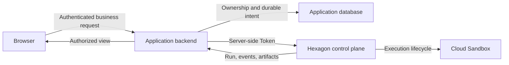
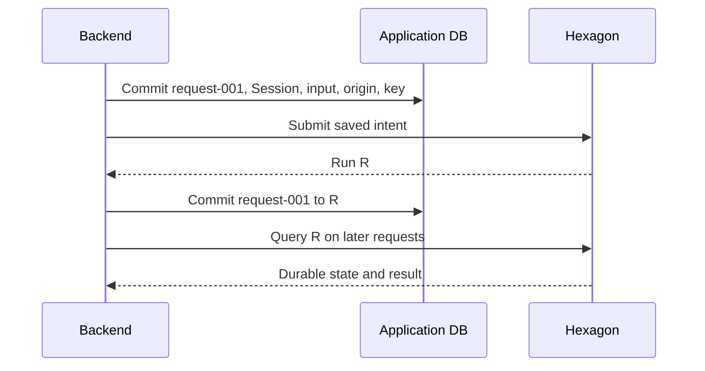
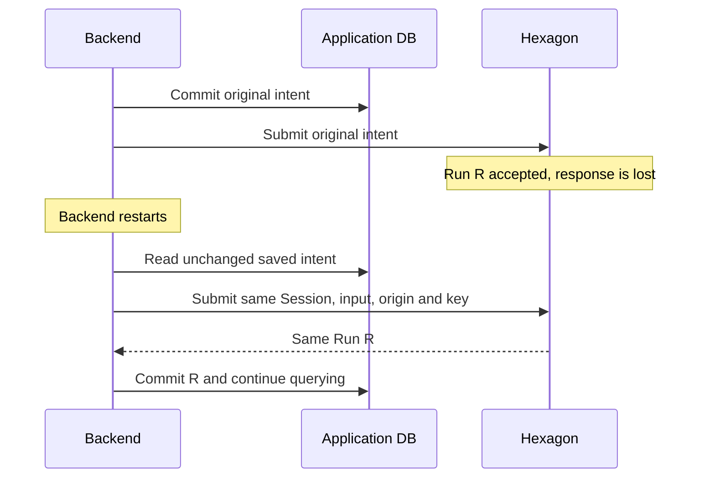

Keep the Hexagon client in your backend. Authenticate business users there, persist Session and Run identifiers, and return authorized results to the frontend. The browser should not hold control-plane administration credentials.

This guide assumes the [first Session tutorial](/en/start/first-session), verified Sandbox/model connections, and a durable application database. Code snippets illustrate SDK calls; authentication, business authorization, and application transactions remain your responsibility.

## Assign responsibilities before sending requests



Your backend decides whether a business user may use a task, Session, Run or artifact. Hexagon validates its tenant boundary and manages execution. These checks complement each other: an application Token shared by Alice and Bob cannot tell Hexagon which business user's records your endpoint should expose. Check the application ownership relation before both mutations and reads, including event subscriptions and download proxies. Keep the Hexagon Token in the backend; return your own authorized response to the browser.

## Persist the relationships

The following is a suggested application model, not Hexagon's database schema:

| Application record | Data to retain | Purpose |
| --- | --- | --- |
| Work context | Business user/workspace, task ID, Session ID | Authorize every read and mutation |
| Submission intent | Business request ID, Session ID, exact input, origin, idempotency key | Recover a lost submission response |
| Execution | Run ID, last observed state, result reference | Resume queries after backend restart |
| Observation | Run ID and last committed event cursor | Replay and deduplicate events |
| Cleanup | Session ID, close intent, confirmed status | Recover unfinished resource cleanup |

A well-formed Session ID is not authorization. Resolve its ownership through your business database before contacting Hexagon. This remains necessary when multiple business users share one control-plane tenant.

## Initialize the client

Use local discovery for local development. For a remote control plane, configure the URL and an appropriate application Token on the backend.

```python
import os
from hexagon import Hexagon
client = Hexagon(os.environ['HEXAGON_API_URL'], os.environ['HEXAGON_API_TOKEN'])
```

After installing the locally built TypeScript package in your application:

```typescript
import { Hexagon } from '@hexagon/agent-sdk';
const apiUrl = process.env.HEXAGON_API_URL;
const apiToken = process.env.HEXAGON_API_TOKEN;
if (!apiUrl || !apiToken) throw new Error('Missing server-side Hexagon configuration');
const client = new Hexagon(apiUrl, apiToken);
```

Check permissions separately for administration, registrations, and approval decisions. An execution Token does not imply unrestricted management access. Exclude Tokens, authorization headers, and original Provider credentials from logs.

## Create context and submit work

Create a direct Session for the business context:

```python
session = client.create_session(
    harness={'id': 'pi', 'version': '1.5.2'},
    sandbox_connection_id=sandbox_connection_id,
    model_connection_id=model_connection_id,
)
# Persist session['id'] against the authorized business record before submission.
run = client.submit(session['id'], saved_input, saved_idempotency_key,
                    origin={'request_id': saved_business_request_id})
# Persist run['id'] against the same business request.
```

```typescript
const session = await client.createSession({
  harness: { id: 'pi', version: '1.5.2' },
  sandbox_connection_id: sandboxConnectionId,
  model_connection_id: modelConnectionId,
});
// Persist session.id against the authorized business record before submission.
const run = await client.submit(session.id, savedInput, savedIdempotencyKey,
  { request_id: savedBusinessRequestId });
// Persist run.id against the same business request.
```

The `saved*` values come from a committed submission intent, not fresh values generated on every HTTP retry. `origin` helps correlate requests; it does not replace authorization or idempotency. The request hash includes input and nonempty origin. Changing either while reusing a key produces `idempotency_conflict`.

Your database and Hexagon do not share a transaction. Handle the gap where a remote request succeeds before its response is saved: persist intent, send, then persist the response. Recover lost Run submission responses by resending the same Session, input, origin, and key.

Session creation does not have that Run idempotency contract. An unknown creation outcome requires investigation through Session queries or Console before creating another. Track such records in an observable recovery queue rather than repeatedly creating resources.

## Normal submission and lost-response recovery

The diagrams start after the application has persisted an authorized Session association. `request-001` identifies one business intent; pressing “continue” with a new task creates a new intent and key.





A timeout is not proof that the Run was rejected. With a saved Run ID, query it; without one, recover the committed Run submission as shown. A changed payload with the old key is an intent conflict, not permission to manufacture a new key. A new key represents new work and can create another Run after the original finishes. This recovery does not authorize blindly repeating Session creation, Tool side effects or unknown cloud-resource operations.

## Runnable durable-submission example

[backend-intents.py](https://github.com/NexusFox88/hexagon-docs/blob/main/resources/examples/documentation/backend-intents.py) uses application-owned SQLite for context ownership, business requests, exact input/origin, idempotency keys and Run IDs. Database operations and Hexagon SDK calls are separate, making restart and lost-response boundaries observable. Install the Python SDK first and use an existing, authorized Session that can accept work; do not reuse the first tutorial's already closed Session.

Each command runs in a separate process. Store the database and input file in a private directory and replace YOUR_SESSION_ID with the backend-confirmed Session:

```sh
mkdir -p .local/docs-backend
chmod 700 .local/docs-backend
.local/docs-example-venv/bin/python examples/documentation/backend-intents.py --database .local/docs-backend/intents.sqlite --user alice bind --session YOUR_SESSION_ID
cat > .local/docs-backend/input.txt <<'TASK'
List the files in the workspace without changing them.
TASK
.local/docs-example-venv/bin/python examples/documentation/backend-intents.py --database .local/docs-backend/intents.sqlite --user alice prepare --session YOUR_SESSION_ID --request request-001 --input-file .local/docs-backend/input.txt
.local/docs-example-venv/bin/python examples/documentation/backend-intents.py --database .local/docs-backend/intents.sqlite --user alice submit --request request-001
.local/docs-example-venv/bin/python examples/documentation/backend-intents.py --database .local/docs-backend/intents.sqlite --user alice status --request request-001
```

Prepare commits the local intent without calling Hexagon. Submit sends that saved intent, then persists the Run ID. After a lost response, repeat the same submit command to resend the identical intent. If a Run ID is already saved, submit queries it instead. Status never submits work; without a Run ID it returns submission_not_confirmed, which does not establish that the remote request was rejected.

The CLI user argument is demonstration input, **not authentication**. A real HTTP handler obtains the principal from its authenticated session. Bind belongs only in the trusted Session-creation response handler, never an endpoint allowing users to claim arbitrary Sessions. The example includes durable submission, verified artifact delivery and explicit cleanup steps. It does not implement Session-creation reconciliation, frontend event delivery, task queues or a background cleanup scheduler; follow the corresponding procedures on this page. The database contains original inputs and must be treated as sensitive application data, not uploaded or dumped to logs.

The [check record](https://github.com/NexusFox88/hexagon-docs/blob/main/resources/testing/evidence/2026-11-20-backend-intents-example.json) uses real SQLite and a fake SDK to verify lost responses, restart, identical resubmission, known-Run querying, cross-user denial and intent conflicts. It does not contact a real control plane or prove dual-SDK cloud acceptance. Equivalent TypeScript SDK calls appear above; application database transactions remain the integrator's responsibility.

Run the offline persistence checks without SDK installation or cloud credentials:

```sh
python3 -B examples/documentation/check-backend-intents.py
```

These checks use temporary SQLite files and a fake remote service. They verify this example’s recovery and ownership checks, not the server’s idempotency implementation or concurrent production traffic.

## Query and deliver results

Query saved Run IDs with `client.run(run_id)` in Python or `await client.run(runId)` in TypeScript. Distinguish queued, executing, waiting for authorization/approval, and terminal states in the UI.

Subscribe and forward events from the backend. Frontend disconnection means observation stopped; it must not automatically cancel execution. Confirm terminal state through durable queries. Recheck business ownership before delivering artifacts. Preview URLs are expiring access credentials and should not enter public logs.

### Deliver an artifact through an authorized application endpoint

The SQLite example also exposes `store.deliver_artifact(client, user, request, artifact_id)` as a library method. Your HTTP handler supplies `user` from its authenticated session, resolves the business request and calls this method before writing the download response. It returns verified bytes; the CLI intentionally does not print them.

The method checks business ownership before remote calls, verifies that the saved Run still belongs to the saved Session, requires a terminal state, finds the requested artifact in that Run’s export list, checks its Run/Session association, and verifies byte count and SHA-256. It never uses an exported name as a local path. Failed or cancelled Runs can have useful artifacts: the method permits their verified exports, while your UI must still show the actual Run outcome and apply the business task’s success criteria.

An active Run is rejected by this example’s delivery policy, although the underlying API can list exports during execution. Keep progress events separate from settled-result delivery. An unknown artifact, wrong association or integrity failure must not become a successful empty download. Map these failures to your application’s response contract and retain enough private context for diagnosis.

Return bytes as an attachment using an application-chosen safe filename and `application/octet-stream`; do not render generated HTML on your application origin. Recheck the authenticated user on each download and event-subscription request. If your product supports sharing or ownership transfers, implement that authorization policy explicitly rather than treating possession of a Run/artifact ID as permission.

The [delivery check record](https://github.com/NexusFox88/hexagon-docs/blob/main/resources/testing/evidence/2026-11-20-backend-artifact-delivery-review.json) uses real temporary SQLite and a fake SDK. It checks restart-safe delivery, cross-user and unrelated-artifact denial, wrong remote associations, active-Run refusal and corrupted bytes, alongside submission recovery. It does not implement login, a production HTTP download endpoint, streaming large responses or the equivalent TypeScript database integration.

## Handle concurrency and cleanup

Only one Run can be active per Session. On `session_busy`, your application can retain a message and submit it after the current Run terminates. This is an application queue, not an automatic platform queue. Use separate Sessions for independent work within account limits.

Assign an explicit close policy to every Session. Settle active work, request closure, and record the confirmed outcome. Process exit hooks are insufficient: unfinished cleanup must survive restarts in your database.

### Persist and recover a close intent

The runnable example stores cleanup separately from submissions. After deciding that a context should close, use its existing authorized Session ID:

```sh
.local/docs-example-venv/bin/python examples/documentation/backend-intents.py --database .local/docs-backend/intents.sqlite --user alice request-cleanup --session YOUR_SESSION_ID
.local/docs-example-venv/bin/python examples/documentation/backend-intents.py --database .local/docs-backend/intents.sqlite --user alice cleanup-status --session YOUR_SESSION_ID
.local/docs-example-venv/bin/python examples/documentation/backend-intents.py --database .local/docs-backend/intents.sqlite --user alice cleanup-step --session YOUR_SESSION_ID
```

`request-cleanup` commits a `requested` record without contacting Hexagon. It prevents subsequent prepare/new-submit calls through this store; reads of already saved Runs and verified artifact delivery remain available. Repeating the command preserves the existing record, including confirmed status.

`cleanup-step` queries the same Session first. If already closed, it records `confirmed` without sending close again. Otherwise it sends one close request, then queries again; it confirms only when the read reports `closed`. An error leaves the durable intent in place and records only the exception class, not potentially sensitive exception text. After investigating the error, rerun the same command for that Session. There is no automatic retry loop or direct Provider deletion.

| Outcome | Recovery |
| --- | --- |
| Close response lost, but Session query reports closed | Confirm the saved intent; do not create another context |
| `session_busy` | Let active work settle, or explicitly request cancellation according to user intent and observe its terminal state before another close attempt |
| Unknown create/checkpoint/delete outcome | Inspect the existing resource operations and follow [reconciliation](/en/operate/reconciliation); retain all original IDs |
| Query fails or Session cannot be found | Keep the intent unresolved; check endpoint, tenant and saved association rather than interpreting a missing response as cleanup success |

This command is an observable cleanup step, not a background scheduler. A production worker needs bounded backoff, monitoring and ownership of each pending record. Serialize submission admission and close intent across workers; the example’s local check is not a distributed lock and cannot eliminate races with already in-flight submissions. Hexagon’s active-Run check remains necessary.

The [cleanup example checks](https://github.com/NexusFox88/hexagon-docs/blob/main/resources/testing/evidence/2026-11-20-backend-cleanup-review.json) use real SQLite and a fake SDK to verify restart persistence, blocking subsequent new work, lost-close-response recovery, failure retention and cross-user denial. They do not establish real cloud deletion or a concurrent production scheduler. Keep your application cleanup record alongside the control plane’s resource-operation evidence.

## Verify the integration

Test cross-user denial, lost-response recovery returning the same Run, backend restart without creating new work, frontend reconnect without duplicated events, and confirmed closure with retained artifacts. These are acceptance requirements, not claims that the snippets have passed a fresh cloud journey.

Sources: [Run submission implementation](https://github.com/NexusFox88/hexagon-docs/blob/main/resources/modules/execution/runs.ts), [Token authentication](https://github.com/NexusFox88/hexagon-docs/blob/main/resources/modules/credentials/api-auth.ts), [SDK guide](https://github.com/NexusFox88/hexagon-docs/blob/main/resources/sdk/README.md), [HTTP contracts](/en/reference/http). Next: [Continue in a Session](/en/build/multi-turn), [stream events](/en/build/stream-events), [recover interrupted requests](/en/build/recovery).
