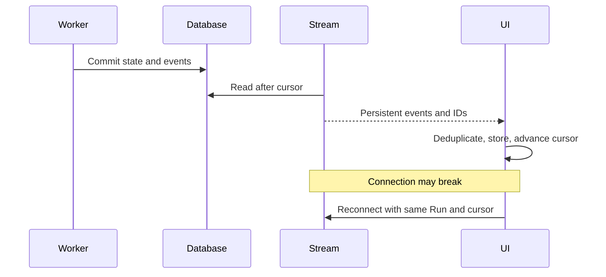
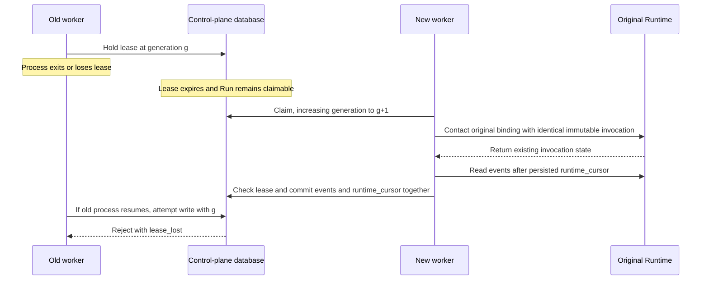
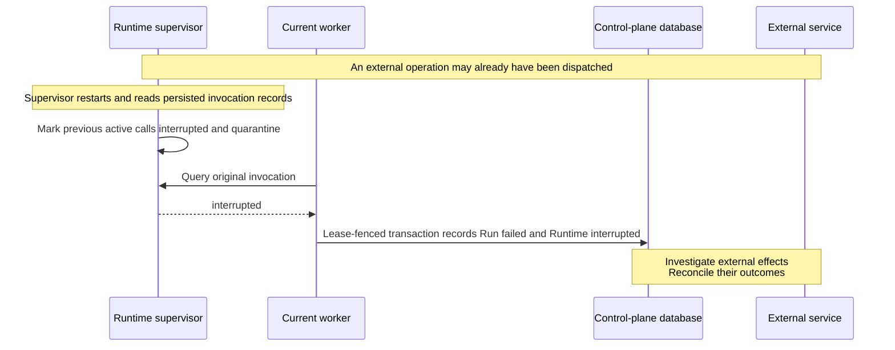

Execution state and events live in the control-plane database. A client observes persisted work; an uninterrupted connection is not required to keep the task alive.

## Persistence before observation

State changes and associated events are committed transactionally before streaming or paginated readers observe them. After seeing terminal state, the stream rechecks the final event page so a concurrent final commit cannot fall into an empty-page race.

Applications must coordinate their own event persistence and cursor. Memory-only cursors can replay after restart; saving a cursor before its event can lose UI history. Deduplication by Run/event ID is more dependable than assuming networks never deliver duplicates.

## Three different recovery cases

| Failure | What is known | Recovery |
| --- | --- | --- |
| Client disconnect | Observation stopped | Reconnect to the original Run, replay, query terminal state |
| Worker restart | A control-plane process stopped; durable records remain | A worker coordinates recovery using leases and persisted invocation identity |
| Runtime interruption | Sandbox supervision was interrupted; active invocations are not safely replayable by assumption | Quarantine old calls, record interruption/failure, investigate external effects |

Leases and generation fencing prevent stale workers from overwriting current ownership. They constrain control-plane writes; they do not put remote services inside the database transaction.

## Unreachable versus interrupted

Unreachable means the control plane cannot currently establish Runtime state. The process may still be running. Reinstalling the Harness or issuing a second side-effecting task is not a safe repair. Recovery contacts the existing binding and immutable invocation.

Interrupted reflects observed supervisor interruption behavior. Active invocations are quarantined rather than treated as normal idle wake. Previously dispatched Tool operations may still need reconciliation, and a known interrupted workspace is not automatically reused as healthy.

## Worker restart: take over coordination of the original work

This scenario starts after Runtime initialization and persistence of the invocation intent. Directory preparation and supervisor launch have separate recovery boundaries; see [initialization](/en/concepts/initialization).

Takeover requires an available database, an eligible Run and a working worker; it is not a recovery-time guarantee. If Runtime cannot be reached, the control plane preserves execution records and records recovery needs. That uncertainty does not establish termination. Resending the same immutable invocation is an idempotent recovery-protocol action that locates the original work. An application should not replace it by submitting a new Run.

Two different consumption positions exist:

| Cursor | Consumer | Meaning |
| --- | --- | --- |
| Internal `runtime_cursor` | Control-plane worker | Runtime events already ingested into the control plane |
| Public event `id` / `after` | Application client | Control-plane durable events already processed by the application |

They do not share a numbering space and are not interchangeable. Ingestion deduplicates Runtime events by source cursor and commits the internal cursor with the events. Public streams also contain control-plane-generated events. Store public IDs as decimal strings, do not convert them to JavaScript `Number`, and do not require consecutive IDs.

## Runtime interruption: observed interruption does not authorize replay

This failure describes interrupted execution supervision; it does not prove that every model or Tool side effect was absent. Even if the Run was `cancelling`, observed Runtime interruption records failure with `runtime_interrupted` before claiming confirmed cancellation. Replaying the old call as new work is not safe by assumption. Assess the existing workspace, artifacts and external results before designing follow-up work.

## Startup recovery is not task replay

Before deciding what can be repeated, the worker checks the persisted Runtime binding and whether this Run already has an invocation record.

| Observed boundary | Control-plane recovery | What it does not authorize |
| --- | --- | --- |
| `reserved` / `preparing`, or restoration preparation | Repeat directory/file preparation, then persist launch intent | Repeating a previously dispatched external Tool write |
| Startup uncertain, no persisted invocation for this Run | Check Runtime health; if unavailable, inspect the supervisor lock. Only a confirmed free lock permits another lock-protected start | Treating a timeout or malformed lock probe as permission to launch |
| Startup uncertain, invocation already persisted | Check the existing Runtime rather than using the no-invocation relaunch path | Launching the task as a new Run |
| Existing binding `ready` / `unreachable` | Recover the original immutable invocation and its event position | Reinstalling inputs or assuming lost process state |
| Observed `interrupted` invocation/workspace | Quarantine and report failure; retain records for investigation | Automatically treating the workspace as healthy or redispatching pending mailbox writes |

The lock prevents two supervisor listeners from starting through this launcher. It does not prove exactly-once model calls, preserve arbitrary process memory, or settle remote writes. A restarted supervisor can discover old active invocation records and quarantine them even if starting the supervisor itself was permitted.

Local automated checks exercise free/held/invalid lock results, already-healthy startup, launcher exclusion and interruption quarantine using fake connectors or temporary local records. They support these specific mechanisms, not a claim that every cloud Provider survives every fault. Implementations: [worker startup branches](https://github.com/NexusFox88/hexagon-docs/blob/main/resources/modules/execution/worker.ts), [Runtime client reconciliation](https://github.com/NexusFox88/hexagon-docs/blob/main/resources/modules/sandboxes/runtime-client.ts), [Runtime quarantine](https://github.com/NexusFox88/hexagon-docs/blob/main/resources/runtime/server.py).

## Where the application continues

Reconnect using the original Run ID and the last public event ID whose processing was durably committed. An empty event page means that query found no new events; it is not a terminal Run state. SSE `stream.end` is a transport completion notification without a durable ID and must not advance the consumption cursor. A disconnect, heartbeat or lack of output cannot independently prove completion.

For example, an application receives event `104` but crashes before committing its database transaction. It resumes from committed cursor `103`, receives `104` again and deduplicates by Run/event ID. Saving cursor `104` before saving its contents could instead skip those contents forever after a crash. If event processing sends email or performs another external write, local event deduplication still does not guarantee exactly-once external effects; that operation needs its own idempotency or reconciliation mechanism.

Distinguishing observation of the original Run, takeover of the original invocation and reconciliation of external effects gives you the basis for choosing a recovery action. Continue with [recovery](/en/build/recovery), [remote-operation reconciliation](/en/operate/reconciliation) and [events and states](/en/reference/events-and-states). These diagrams describe source-reviewed behavior, not a new real fault-injection test. Additional sources: [worker recovery](https://github.com/NexusFox88/hexagon-docs/blob/main/resources/modules/execution/worker.ts), [Runtime supervisor](https://github.com/NexusFox88/hexagon-docs/blob/main/resources/runtime/server.py).

## Unknown does not prove failure

Cloud create/delete and Tool writes can take effect before their response is lost. Persisted operation journals retain intent and identifiers for reconciliation. A transport error cannot prove that no resource or write exists.

Run-submission idempotency applies to that request boundary, not global exactly-once behavior across third-party services. Approval records are not external-system transactions either. Inspect the dispatch policy and actual remote result.

Use these distinctions to show recoverable observation, uncertain execution, or required reconciliation instead of a universal “failed; retry” action. See [recovery actions](/en/build/recovery) and [event consumption](/en/build/stream-events). Sources: [architecture](https://github.com/NexusFox88/hexagon-docs/blob/main/resources/docs/architecture.md), [state transactions](https://github.com/NexusFox88/hexagon-docs/blob/main/resources/modules/execution/runs.ts), [stream route](https://github.com/NexusFox88/hexagon-docs/blob/main/resources/apps/control-plane/server.ts).
