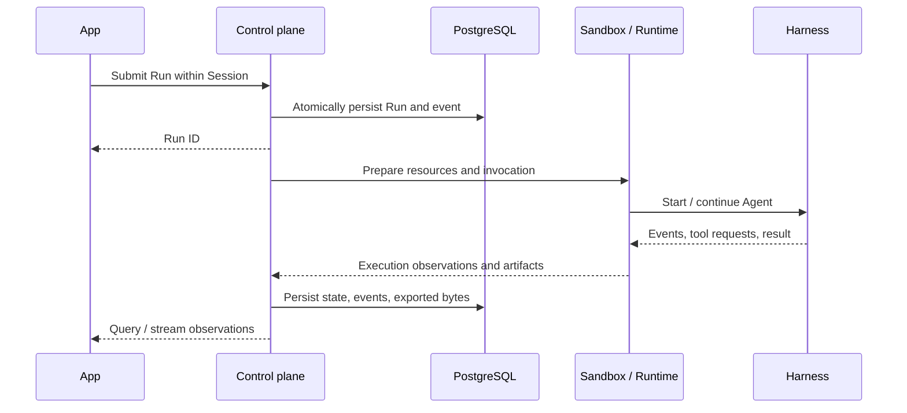
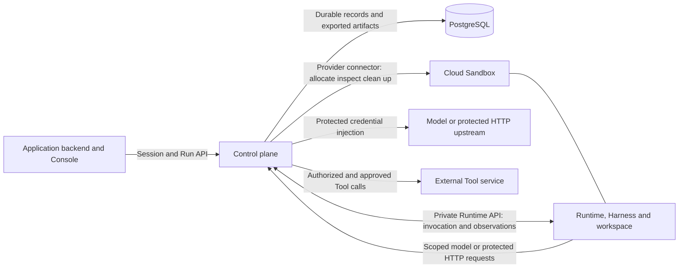
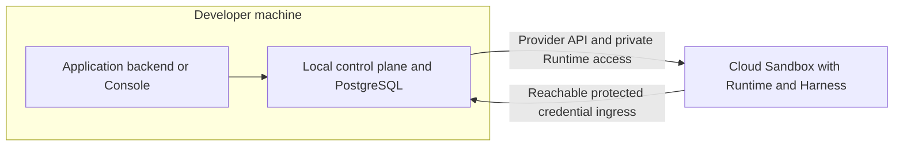
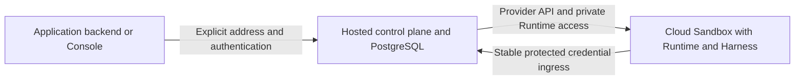

Hexagon separates durable task management from cloud process execution. This boundary helps locate failures and keeps Provider-specific operations out of application semantics.

| Layer | Owns | Does not own |
| --- | --- | --- |
| Application / SDK | Business authorization, submission intent, presentation | Proof that a cloud process terminated |
| Control plane | Sessions/Runs, scheduling, cloud operations, credentials, events, artifacts | Agent reasoning steps |
| Sandbox connector | Provider creation, inspection, files, execution, private access, cleanup | Business Session/Run semantics |
| Runtime | Sandbox process supervision, Harness invocation, Tool bridge | Provider account administration |
| Harness | Agent logic, model interaction, tool selection, conversation format | Tenant and approval enforcement |

Console consumes the same control-plane API; it is not an independent execution backend. Closing it does not stop tasks.

Authorization, approval, and unknown remote outcomes add waiting and reconciliation branches. This diagram does not assume every remote operation returns a response.

## Follow one project task across the boundaries

Suppose your backend asks an Agent to add a filter to an uploaded project, run its tests and export the changed files. Your backend owns the business request and its association with the user. The control plane owns the Session and Run records. The cloud Sandbox holds the working files and processes; Runtime supervises the Harness, which chooses how to perform the task.

The arrows describe responsibility and data flow, not one listener or one network connection. The control plane's management API, protected credential ingress and private Runtime access have different authentication and reachability requirements. A Provider connector runs on the control-plane side; it is not an Agent process in the guest.

For this task, a successful model response is only one observation. The Harness must still finish execution; the worker interprets its output and captures exported artifacts before completing the Run. The current artifact implementation stores metadata and bytes in PostgreSQL. Unexported workspace files remain subject to the selected Sandbox's persistence behavior. Closing the Session cleans up cloud resources while retained Run records and exported artifacts remain queryable.

## Two deployment locations, the same execution boundary

### Local control plane

The SDK's supported local discovery identifies the local workspace endpoint and client credentials. The guest still runs in the cloud. A loopback management URL on your laptop is not a cloud-reachable credential endpoint: configure the separate development ingress required by the chosen execution path. Shutting down the local control plane stops its workers and reconciliation; it does not by itself prove that every remote process or resource has stopped.

### Hosted control plane

Hosted changes where the control plane and its durable services run. It does not move Harness execution into the API server. Your application backend still authorizes business users and protects its control-plane Token. Both deployments need a supported Sandbox/Harness/model combination; neither topology claims every catalog entry has passed the same real-cloud journey.

## Where resources and credentials belong

| Resource or authority | Owner / location | Consequence for this task |
| --- | --- | --- |
| Business user and request mapping | Your application backend | Check which user may read or continue this Session; tenant checks alone do not implement business-user permissions |
| Session, Run, lease, event cursor and resource-operation ledger | Control plane and PostgreSQL | Reconnect using the original IDs; do not infer cloud absence from a lost API response |
| Provider account credential and cloud resource ID | Control-plane credential store and connector/operation records | The guest does not receive the account credential; cleanup uses the original resource identity |
| Runtime process and Harness invocation | Runtime inside the Sandbox, coordinated by a persisted control-plane invocation | Runtime supervises processes; it does not administer the Provider account |
| Workspace and native conversation state | Sandbox / Harness according to the selected adapter | Continuity depends on the specific pause/restore contract; it is not a universal RAM guarantee |
| Exported artifact bytes and metadata | Control-plane PostgreSQL in the current implementation | A completed export can survive Sandbox cleanup; it is not a snapshot of every workspace file |
| Original model and protected HTTP credentials | Encrypted control-plane Secrets and access backend | The proxy applies fixed upstream policy and authentication; bounded delegated authority may reach the guest |
| Tool OAuth or API credential | Control-plane connection and Tool broker | The broker checks account authorization, operation policy and any required approval before dispatch |
| Runtime/Tool-bridge and delegated access tokens | Scoped execution channels | These are sensitive capabilities even though they are not original Provider/account credentials |
| Ordinary user variables | Encrypted at rest, then delivered to the Harness environment | Agent code and child processes can read them; use protected connections for managed credential access |
| Preview ticket and OCI registry credential | Separate preview and image-preparation paths | A preview ticket grants access; registry auth may reach an authorized Provider builder, but is not ordinary Harness environment |

Model traffic uses protected credential access; the Harness still chooses a compatible model protocol. That access backend does not convert protocols or decide whether a task succeeded. Brokered Tools use a different path: the Harness submits a request through the Runtime bridge, the worker asks the control-plane broker to authorize/approve/dispatch it, and the result returns through the bridge. A permitted external write can occur without revealing its original credential to the Agent.

This description applies to Hexagon-managed connections and brokered Tools. Native shell commands and network requests made by task code are also subject to the configured Sandbox/network boundary; do not assume every arbitrary command is intercepted for human approval. See [credential and trust boundaries](/en/concepts/security-boundaries) for delegated authority, registry auth and ordinary variables.

## Diagnose by ownership

For disconnected clients, recover observation of the original Run. For worker restarts, inspect durable execution recovery. Unreachable Runtime does not prove stopped processes. A lost deletion response requires inspecting the original resource operation. Model protocol failures require checking Harness/endpoint compatibility, not replacing Session IDs to hide the issue.

You should now be able to trace one task from the business request to cloud execution, identify which component holds each credential, and explain why client disconnection is not cancellation. Continue with [durable events and recovery](/en/concepts/events-and-recovery), [trust boundaries](/en/concepts/security-boundaries) or the [contributor code map](/en/contribute/codebase).

Sources: [architecture](https://github.com/NexusFox88/hexagon-docs/blob/main/resources/docs/architecture.md), [execution worker](https://github.com/NexusFox88/hexagon-docs/blob/main/resources/modules/execution/worker.ts), [Runtime supervisor](https://github.com/NexusFox88/hexagon-docs/blob/main/resources/runtime/server.py), [access grants](https://github.com/NexusFox88/hexagon-docs/blob/main/resources/modules/access/access.ts), [Tool broker](https://github.com/NexusFox88/hexagon-docs/blob/main/resources/modules/tools/broker.ts), [artifact storage](https://github.com/NexusFox88/hexagon-docs/blob/main/resources/modules/artifacts/artifacts.ts).
