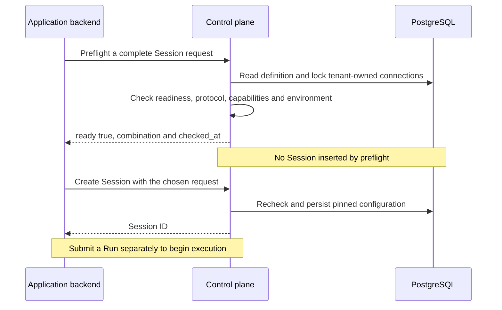
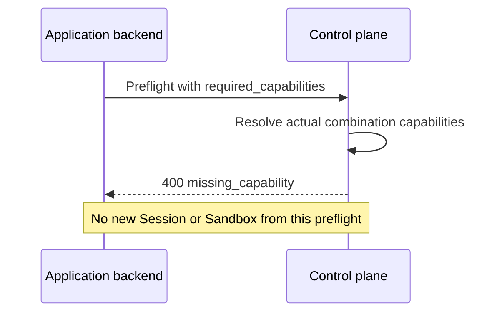
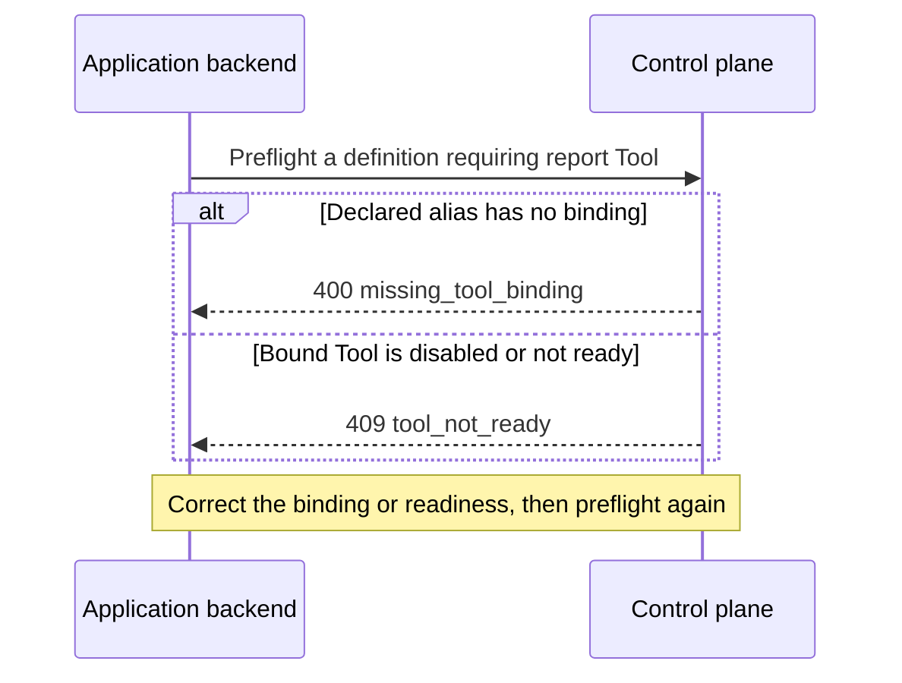

Preflight checks known configuration and compatibility. Session creation pins the selected definition. Execution still depends on cloud quota, networking, model availability, and Runtime readiness. These phases establish different facts.

## Checks before creation

The control plane verifies tenant ownership and connection types, enabled/verified Sandbox and model connections, required Tool readiness, Harness version/protocol, initialization support, OCI/private-image capabilities, network policy, and required capabilities.

| Request | Meaning |
| --- | --- |
| Ready connections with compatible Harness | Returns readiness and combination metadata, not proof of future cloud allocation |
| OCI Harness on unsupported Provider | Rejected before execution; no silent built-in Harness fallback |
| Required Tool not ready | Initialization fails until authorization/readiness is corrected or optionality explicitly chosen |

Optional Tools still need valid, correctly typed, tenant-owned connection bindings. Optionality permits missing readiness, not arbitrary missing connections.

Preflight does not persist a new Session or allocate its Sandbox. It may check or restore credential ingress, so absence of Sandbox creation does not mean absence of all network preparation.

## Three preflight paths

These source-derived sequences are illustrative, not records of a live Provider test. All earlier checks must pass before a particular later error can be observed; the response reports the first applicable failure rather than every possible issue.

### A compatible request

Preflight is not a reservation or a reusable authorization ticket. Creation repeats validation against then-current state. For example, a connection disabled after preflight can make creation fail even if the request body is unchanged. Cloud allocation begins through the execution/lifecycle path, not merely because preflight returned `ready: true`.

### A missing required capability

For example, requesting `snapshot` when the resolved combination lacks it fails. Choose a combination with the required capability, or remove that requirement only if the product task truly does not need it. Do not remove requirements simply to get a green preflight. Some failures have more specific codes, such as `sandbox_oci_image_unsupported`; unsupported model protocols and network policies are distinct checks.

### A required Tool cannot be used

A saved Agent can declare `report` before a concrete Session binds it. Missing that binding differs from binding a real connection whose authorization is incomplete. A direct Session derives its declared Tool names from the supplied bindings; omitting a Tool there does not create a hidden required Tool. Even an optional declared Tool needs a valid binding. Optionality defers readiness, not ownership/type checks or dispatch-time authorization. Operation approval is a later decision for a specific call, not something preflight grants in advance.

## What each stage actually establishes

| Stage | Established fact | Still unproven |
| --- | --- | --- |
| Definition/schema validation | Fields and behavior have supported shapes; selected Harness definition is known | Connection readiness and future execution |
| Connection and combination preflight | Current ownership, kind, enabled/ready state and declared capability/protocol policy are compatible | Future quota, upstream uptime, operation approval or a completed real-cloud journey |
| Session creation | A durable Session pins resolved configuration and version references | Sandbox allocation, process startup or model task success |
| First Run submission | The Run is accepted after current submission checks, including referenced input files | Worker provisioning and successful Harness execution |
| Worker invocation and Tool dispatch | Current execution and authorization checks permit this action | Future external response, side-effect settlement or artifact export |

The combination's compatibility and verification fields answer different questions. A supported combination can remain unverified. The preflight timestamp records a check time; it is not a lease on Provider capacity.

## Agent revisions and connection versions are separate

Suppose Session A is created from Agent revision 2 and Sandbox connection version 5. Editing the Agent creates revision 3; A keeps revision 2. A newly created Session without an explicit historical revision resolves the current Agent definition. Supplying revision 2 selects that saved definition, but its connection IDs still resolve through current connections during creation: it does not restore connection version 5 or old credentials.

If a connection is disabled, new work is blocked by current readiness checks. Configuration or credential changes require their own validation and enablement workflow; re-enabling does not rewrite A's initialization snapshot or guarantee that its old bindings remain usable. Read the exact error and [connection lifecycle rules](/en/build/connection-lifecycle) rather than treating revision numbers as a bypass. Changing behavior for an existing task requires a new Session or an appropriate new Agent revision, not mutation of the historical snapshot.

## What becomes pinned

A Session records Harness identity/version and optional image metadata, behavior, Tool/protected-API aliases, resource/network policy, connection versions/configuration, and optional Agent revision. Effective merged environment values are encrypted separately; reads expose names only.

Behavioral `identity` is not an authenticated account or permission grant. Instructions/context guide the Harness but do not override platform authorization. Referenced context files are checked again for existence, hash, and encoding at submission.

## Inspect history

Python `client.session_initialization(session_id)` and TypeScript `await client.sessionInitialization(sessionId)` return the versioned snapshot displayed by Console Initialization. It remains readable after closure. A current Agent definition is not a substitute for historical configuration.

The snapshot omits credentials/environment values and is not a complete replay backup. Creating from it resolves connection IDs against current configuration and permissions. Identical IDs do not reproduce historical cloud conditions; preflight again.

## Pinning is not freezing the outside world

Template revision does not rewrite existing Sessions. Disabling Sandbox/model connections still blocks new Runs. A pinned definition cannot bypass current availability checks or prevent upstream deletion, quota exhaustion, or credential expiry.

Sources: [Session creation](https://github.com/NexusFox88/hexagon-docs/blob/main/resources/modules/execution/sessions.ts), [initialization contract](https://github.com/NexusFox88/hexagon-docs/blob/main/resources/docs/session-initialization.md). Next: [templates](/en/build/agent-templates), [connection lifecycle](/en/build/connection-lifecycle), [file context](/en/build/project-context).

Implementation details: [combination resolver](https://github.com/NexusFox88/hexagon-docs/blob/main/resources/modules/execution/compatibility.ts), [submission checks](https://github.com/NexusFox88/hexagon-docs/blob/main/resources/modules/execution/runs.ts). Configure [Sandbox resources and network policy](/en/build/sandbox-policy), or inspect the [Session API contract](/en/reference/sessions).
