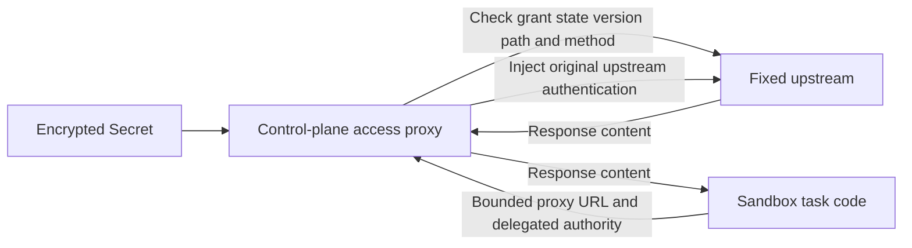

Managing cloud accounts, models, and Tools should not give task code their original administrative credentials. Hexagon separates protected connections from ordinary execution configuration and checks tenant ownership on resource reads and bindings.

| Credential | Path | Boundary |
| --- | --- | --- |
| Owner/application Token | Control-plane client authentication and route permissions | Keep persistent Tokens out of business frontends/Sandboxes; still authorize business users |
| Provider credential | Control-plane connector | Not ordinary Harness environment |
| Model/protected HTTP key | Encrypted connection, upstream injection by access backend | Guest gets bounded authority or placeholder, not original account key |
| Tool OAuth/Token | Control-plane broker and refresh | Selection, authorization, and approval remain distinct |
| OCI registry credential | Metadata resolution / permitted image build pull | Separate from ordinary Agent environment |
| User env/variables | Encrypted at rest, injected for execution | Readable by Agent and child processes |
| Preview ticket | Exchanged for an isolated-origin cookie | The URL grants access; do not publish it |

## Secrets, connections, and grants

A managed Secret stores encrypted values without returning them through reads. A Connection references credentials and defines upstream policy. A Session binding grants use, not an API for retrieving the original secret.

The protected proxy enforces configured destinations and request policy rather than arbitrary caller-selected upstreams or authentication headers. Delegated tokens still carry authority and need lifecycle limits; they are not original account keys.

Rotation/disablement affects subsequent requests, while already-admitted operations may finish. Logical deletion retains historical encrypted records and is not proof of physical cryptographic erasure. Database recovery requires its matching encryption key.

## Identity and approval

Behavioral identity/instructions are prompt content, not authentication. Tenant checks protect control-plane ownership. Applications serving multiple business users within one tenant still need business ownership checks.

Authorization supplies usable account credentials; approval permits a specific operation. Ordinary application Tokens cannot decide management approvals. Cancellation, revocation, and connection deletion cannot retroactively undo external writes.

## What authority still reaches the guest

Protected model and HTTP requests share the following path. Use the backend reported by preflight and the policy of the selected connection for the precise configuration.

The `external_proxy` baseline lets the guest hold bounded proxy authority; that token remains a sensitive capability. Vercel's `external_proxy_with_native_auth` injects **delegated proxy authority** through native network policy while the guest uses a placeholder. The central proxy still checks requests. This does not inject original upstream Secrets into the VM or establish that other providers' native Secret APIs are implemented.

Run-created grants depend on that Run's state. Explicit Session access grants have their own expiry and revocation lifecycle. Neither is a permanent account credential or evidence of management permission. See the [Session access contract](/en/reference/session-access) for scope.

Ordinary `variables` / `env` follow a different path: decrypted values enter the execution environment and can be read by task code and child processes. Putting an API key there exposes it despite encryption at rest and bypasses the isolation supplied by protected connections. For OCI registry credentials, the control plane resolves metadata and a permitted image-build path may pass a registry Secret to the Provider's builder. Keeping it out of the Agent environment does not mean it never leaves the control-plane process.

## The current identity model

| Identity or identifier | Actual role | What it does not establish |
| --- | --- | --- |
| owner | Management routes within its tenant | Access to another tenant's resources |
| application Token | Allowed execution and read routes within its tenant | Restriction to one business user or one Session |
| Local Console browser identity | Local bootstrap protected by loopback, origin and request checks | A public login mechanism portable to remote websites |
| Application business-user ID | Your backend maps and validates resource ownership | Automatic implementation of your team's RBAC |
| Agent identity / instructions | Behavioral prompt content | Authentication or permission grants |

The local Console has a dedicated browser bootstrap identity. This is different from distributing persistent owner/application Tokens to a business frontend. Your browser talks to your application backend, which checks the business user's relationship to each Session / Run before using its protected server-side Token. Another valid Session ID in the same tenant can pass the control plane's tenant check, so business ownership checks remain necessary.

## A write that needs several independent decisions

Suppose a task creates an issue in an external project tracker. OAuth determines which account can call the service; selected connection operations determine which actions are available; approval determines whether this particular call is permitted; and the external service's permissions determine which project the account can access. These checks serve different purposes and cannot replace one another.

An approved create operation still writes data even when the Agent never sees the original OAuth token. A webpage telling the model to ignore restrictions and create an issue grants no additional authority and cannot be treated as human approval. After a timeout, reconcile the external record and persisted call intent rather than approving or sending the operation again merely because its response was lost.

## What rotation stops and what it cannot undo

Changing a Managed Secret's value or enabled flag disables dependent connections, clears verification and increments versions. Old grants fail subsequent checks. After validating and enabling the connection again, create a fresh Session according to pinned-version rules rather than assuming existing Sessions migrate automatically. Already-admitted proxy requests and completed external writes cannot be retracted by rotation.

The proxy restricts destinations and request policy, but upstream response content still reaches the task. Trust the configured upstream and limit operations accordingly; keeping original keys out of requests from the guest does not guarantee an upstream will never disclose information in its response. For diagnosis, record resource IDs, states and error codes instead of authorization headers, full responses or one-time tokens in ordinary logs.

You should now be able to identify the original credential store, execution-visible authority, business ownership check and remaining effects after revocation for a connection. Continue with [identity and application Tokens](/en/operate/access-control), [credential rotation](/en/operate/credentials) and [human approval](/en/build/approvals). Additional implementation sources: [local browser identity](https://github.com/NexusFox88/hexagon-docs/blob/main/resources/modules/credentials/local-access.ts), [access grants](https://github.com/NexusFox88/hexagon-docs/blob/main/resources/modules/access/access.ts).

Keeping original credentials out of the guest does not mean an Agent cannot modify data through permitted operations. Review operation selection, arguments, and approvals. Generated HTML, Tool responses, and uploaded files remain untrusted content; their instructions do not grant permissions.

Sources: [Secret contract](https://github.com/NexusFox88/hexagon-docs/blob/main/resources/docs/secret-management.md), [Token permissions](https://github.com/NexusFox88/hexagon-docs/blob/main/resources/modules/credentials/application-tokens.ts), [OCI credentials](https://github.com/NexusFox88/hexagon-docs/blob/main/resources/docs/harness-images.md). Next: [Tools](/en/build/tools), [approvals](/en/build/approvals), [previews](/en/build/private-preview).

## Revocation acts on a particular authority

Choose the authority you intend to remove. These actions are not interchangeable cancellation mechanisms.

| Action | Subsequent check affected | Still needs separate handling |
| --- | --- | --- |
| Revoke an application Token | New authentication attempts with that Token fail | Already accepted Runs, issued access grants and remote resources are not cancelled by this Token update |
| Revoke one Session access grant | That grant is denied at its next authorization check | Other grants and already-admitted upstream requests |
| Revoke a Session's connection binding | Access checks for that Session/connection pair deny grants | Other Sessions using the connection and already-completed external effects |
| Change a Managed Secret value or enabled flag | Dependent connections become disabled/draft with changed versions; old grants fail subsequent checks | Validating/enabling intended configuration and handling pinned Sessions |
| Cancel a Run | Its Run-scoped access no longer passes the active-state check once cancelling; new Tool dispatch stops | Already-dispatched requests, explicit Session-scoped grants and cloud-resource cleanup |
| Close a Session | Access checks require an open Session, so new uses are denied once closing | Confirming cloud/associated-resource cleanup and any external effects |

A grant created for a Run and a grant explicitly created for a Session differ: the latter has no Run binding and is not revoked merely because one Run finishes. Both still depend on their own expiry/revocation, current Session state, connection readiness/version and managed-secret availability. The [access contract](/en/reference/session-access) describes the actual operations; use the [reconciliation guide](/en/operate/reconciliation) for uncertain writes rather than treating revocation as rollback.

For example, your application revokes a user's application Token after a Run has already been accepted. That changes the user's next authenticated API request, not the durable task intent. If the intended action is to stop work, an authorized backend must explicitly cancel the original Run, observe settlement, reconcile any dispatched writes and close the Session when cleanup is required. Keep business-user access control, execution cancellation and credential revocation as separate decisions.

Source boundaries: [Token revocation and route policy](https://github.com/NexusFox88/hexagon-docs/blob/main/resources/modules/credentials/application-tokens.ts), [authentication](https://github.com/NexusFox88/hexagon-docs/blob/main/resources/modules/credentials/api-auth.ts), [grant checks](https://github.com/NexusFox88/hexagon-docs/blob/main/resources/modules/access/access.ts), [Managed Secret invalidation](https://github.com/NexusFox88/hexagon-docs/blob/main/resources/modules/credentials/managed-secrets.ts). This table describes code-level checks, not a promise that revocation interrupts an already-open network connection immediately.
