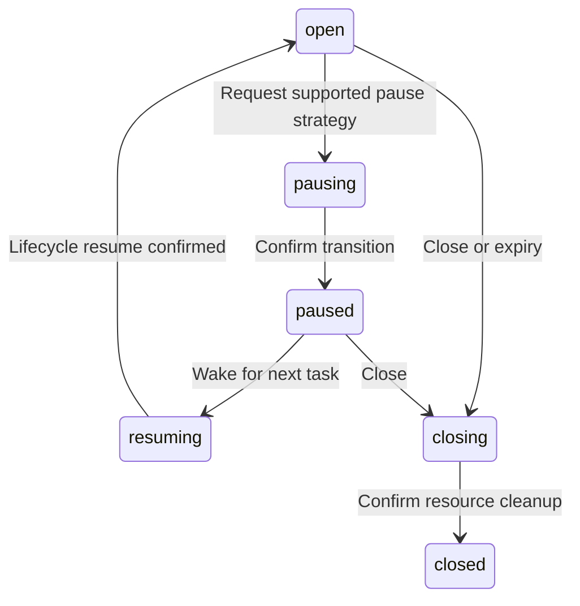

Serverless describes idle compute management and preparation for the next submission. Durable Session identity and a Provider's current compute state are separate facts.

## Separate the state domains

Session states include open, pausing, paused, resuming, closing, and closed. Sandbox state and Runtime reachability are recorded separately. Provider-managed standby is not always observable, so an open Session does not establish continuously active compute; paused also needs its scope and Provider result interpreted.

This depicts principal managed transitions. Automatic Provider standby need not pass through every explicit platform pause state. Uncertain transitions remain investigable instead of being forced into their intended state.

## Four preservation strategies

Memory suspension preserves machine/process state. Filesystem recovery restarts Runtime with retained files. Snapshot recreation preserves Session identity while changing cloud resources. Provider-managed standby schedules compute upstream, with readiness recovered for the next task.

Depend on the managed workspace and verified Harness conversation recovery, not arbitrary processes, sockets, or temporary directories. Fly Machines can cold-boot; Modal can change resource IDs; Blaxel's actual standby cannot be conclusively observed through its API. See the [Provider strategy table](https://github.com/NexusFox88/hexagon-docs/blob/main/resources/docs/serverless-sessions.md).

## Idle eligibility

Pause between Runs only. Authorization/approval waits remain active Runs. The next submit coordinates wake, Runtime recovery, and a new invocation without requiring a manual resume first.

Normal wake does not replay uncertain active invocations. Unknown snapshot/create/restore outcomes still need reconciliation. Automatic recovery is not permission for duplicate external writes.

## Pause scope determines what you can infer

| Situation | Meaning of the platform record | What it does not establish |
| --- | --- | --- |
| `scope: session` | Logical Session pause, the default manual scope | Paused compute, stopped billing or suspended resource deadlines |
| `scope: sandbox`, native pause / snapshot | The corresponding Provider lifecycle strategy is applied | Portable preservation of memory and background services |
| `scope: sandbox`, automatic standby | Provider controls scheduling; `provider_managed_standby` is recorded | Platform confirmation that compute is actually paused |
| `pausing` / `resuming` | Transition has not been confirmed complete | Permission to ignore the original operation and create another resource |

Automatic idle checks select `sandbox` scope. Eligibility requires an open Session with an existing Sandbox, pause or automatic-standby capability, and no nonterminal Run. A newly created Session without allocated compute and a Session awaiting approval are therefore not simply paused when a timer expires. Concurrent submission and lifecycle work also require coordination; timer expiry is not a completion promise.

## Understand the next turn through four strategies

| Strategy | Preparation for the next turn | Identity and preservation boundary |
| --- | --- | --- |
| Memory suspension | Resume suspended compute | Session identity remains; exact memory behavior still needs combination-specific evidence |
| Filesystem recovery | Restore Runtime and Harness context from retained files | Files are the foundation; old sockets and background PIDs are not portable |
| Snapshot recreation | Prepare a resource binding from a confirmed snapshot | Session ID remains while cloud resource ID may change |
| Provider-managed standby | Contact the existing resource and recover execution readiness | Standby timing and observability depend on the Provider |

For example, a first Run saves project files and finishes, then the application submits a second Run to the same Session after idle. With snapshot recreation, obtain the current binding from the Session instead of operating a cached old cloud resource ID. With filesystem recovery, a lost preview process means retained source files do not prove the old preview remains usable. Required services must become ready through the applicable recovery path.

## Three different clocks

`idle_timeout_seconds` determines idle eligibility; the effective value is capped at resource `timeout_seconds` minus ten seconds. The resource execution deadline bounds active resource lifetime. Provider retention and billing rules form a third layer. These are not one countdown.

The current control-plane expiry sweep excludes Sessions with `state: paused` and `pause_scope: sandbox`; wake records a fresh running deadline for corresponding control-plane-managed resources. Logical Session pause does not receive that exemption. This implementation rule does not override Provider retention limits or promise free, indefinitely recoverable paused resources.

Explicit close and deadline-triggered closure also differ. Explicit close rejects an active Run with `session_busy`. Control-plane expiry fences the old worker lease, moves active work into cancellation, and finishes terminal cleanup after resource deletion is confirmed. A rejected close on a task waiting for authorization is not evidence of cleanup. See the [Session contract](/en/reference/sessions) for operations and errors.

Choose an action only after distinguishing whether the Session accepts subsequent work, whether compute is actually paused, whether Runtime is reachable and whether resource deletion is confirmed. These separate state domains describe the situation more accurately than one online/offline badge.

## Read the idle clock from persisted activity

The idle query compares the current time with the later of the Session's `updated_at` and its latest Run's `updated_at`. It also requires no nonterminal Run, existing compute and a supported lifecycle capability. Closing a browser or receiving no model tokens does not satisfy those conditions by itself.

For an illustrative Session with `idle_timeout_seconds: 60` and `timeout_seconds: 600`, a Run that finishes at 12:00:00 makes idle pause eligible only after the relevant persisted activity is more than 60 seconds old, assuming nothing else updates it. The worker's five-second sweep is a polling interval, not a promise that pause completes at 12:01:00. It performs expiry processing before idle processing, avoids overlapping cleanup sweeps, and may encounter pending transitions or Provider delays.

If that Run instead remains `waiting_authorization` at 12:01:00, it is still active and is not eligible for idle pause. The resource deadline can still expire while it waits. A logical `scope: session` pause also does not stop the control-plane resource deadline. Display authorization wait, idle eligibility and expiry separately rather than using an “inactive browser” timer as the compute lifecycle authority.

## Trace a snapshot wake without losing resource identity

The following labels are illustrative, not API request values or live receipts.

| Step | Durable identity / record | What must be established |
| --- | --- | --- |
| First Run ends | Session S, original cloud resource R1 | No active Run before pause |
| Snapshot requested | A checkpoint operation records its intent and snapshot handle C1 | Preserve the checkpoint receipt; an uncertain snapshot remains an investigation |
| Original compute removed | The checkpoint record remains associated with R1 | Source resource inspection confirms absence before the pause path completes |
| Next Run is accepted | Same Session S, new Run | Resume uses checkpoint C1 instead of treating the task as a new Session |
| Restore issued | A distinct restore operation records its operation ID | A lost response is reconciled by that operation; exactly one discovered match can bind the restored resource |
| Runtime prepared | Session S now refers to R2 | Prepare restored Runtime state without overwriting retained workspace inputs |

The restore response can be lost after R2 was created. An empty or ambiguous lookup does not justify another restore request: the operation remains unconfirmed. Keep the Session/operation records and investigate rather than retrying with a different identity. The source and checkpoint are also separate resources; a Session close must deal with retained checkpoint/image resources as well as current compute.

For native filesystem recovery, the resource may keep its identity while Runtime processes are rebuilt. For memory suspension, preservation still depends on the actual Provider/Harness contract. For automatic standby, the provider may change scheduling while the Session stays open. None of these paths makes unknown active Tool effects safe to repeat.

Sources for these examples: [idle eligibility and lifecycle cleanup](https://github.com/NexusFox88/hexagon-docs/blob/main/resources/modules/sandboxes/lifecycle.ts), [worker sweep and restoration](https://github.com/NexusFox88/hexagon-docs/blob/main/resources/modules/execution/worker.ts), [checkpoint/restore ledger](https://github.com/NexusFox88/hexagon-docs/blob/main/resources/modules/sandboxes/checkpoints.ts). For choice and operations, continue with [Sandbox capabilities](/en/integrations/sandboxes) and [capacity, quotas and cost](/en/operate/capacity-and-cost).

## Closure, expiry, and cost

Close is terminal cleanup, not reversible suspension. Confirmed cleanup permits closed state; uncertain deletion retains closing and operation records. Sleeping is not absence and may still incur charges.

Control-plane-enforced deadlines require the service to be running; downtime prevents a guarantee of timely cloud deletion. Storage charges, account retention, and Provider limits remain independent of the idle timer.

Next: [configure and verify wake](/en/build/idle-and-wake), [persistence boundaries](/en/concepts/persistence), [recovery](/en/build/recovery). Implementation: [lifecycle manager](https://github.com/NexusFox88/hexagon-docs/blob/main/resources/modules/sandboxes/lifecycle.ts).
