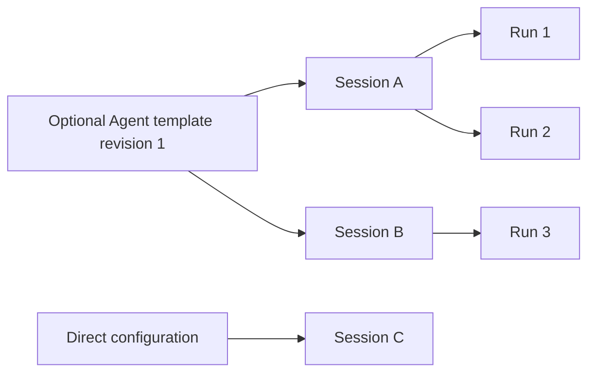

A Session identifies a continuing work context. A Run identifies one submission. An Agent template identifies reusable execution configuration.

Sessions A and B can share a template while retaining independent workspaces and histories. C needs no template. Runs 1 and 2 execute sequentially in A; they cannot both be active.

## Durable Session identity

A Session pins its Harness, connection configuration, and optional template revision. It associates workspace, conversation, and cloud resources. Recreating an SDK client does not change its identity; an authorized client in another language can continue using the same ID.

A Session is not a cloud machine. Strategies such as Modal recreation can change the resource while preserving Session identity. Conversely, an existing Session record does not prove its original process or memory survives.

Closure is terminal and cleans up cloud resources. Suspension and Provider standby are continuation strategies. Historical Runs and exported artifacts can remain after closure without guaranteeing access to the former workspace.

## One traceable submission

A Run has input, idempotent request identity, state, durable events, and a result. A normal follow-up uses a new key and creates a new Run. Recovering a lost response reuses the original key to retrieve the original Run.

Authorization and approval waits remain active execution. Disconnecting a stream neither releases the one-active-Run constraint nor cancels work. A disconnected UI should resume observation instead of submitting duplicate work.

## Optional configuration reuse

Templates preserve immutable revisions. Revising does not overwrite existing Sessions; archiving does not close their resources. Create a new Session when a different pinned definition is needed, and explicitly transfer required inputs.

| Requirement | Choice |
| --- | --- |
| Continue editing a project | Same Session, new Run |
| Use the same setup for another project | Same template revision, new Session |
| Recover a lost submission response | Same Session, input, origin and key; original Run |

## Follow two projects and three Runs

The diagram's labels are examples, not resource IDs to paste into API calls. Imagine a reusable “project editor” template at revision 1. Session A contains the inventory project; Session B contains a documentation project. Run 1 adds inventory filtering in A. After Run 1 reaches a terminal state, Run 2 adjusts the filter labels in that same Session. Run 3 edits the documentation project in B. Sharing the template does not share project files, native conversation history or the Run list between A and B.

The separate direct-configuration branch shows that the same execution model works without saving a template first. Select either a direct Harness definition or `agent_id` when creating a Session. A template is configuration reuse, not a continuously running Agent process, a separate cloud account or a prerequisite for the first task.

| Identifier | What your application uses it for | What it cannot replace |
| --- | --- | --- |
| `session_id` | Continue the same work context and list its Runs | Business-user authorization or a Provider resource ID |
| Run `id` | Query one accepted submission, observe events and obtain artifacts | The Session ID for a follow-up |
| `agent_id` plus `agent_revision` | Identify the reusable definition selected at creation | A mutable pointer that updates existing Sessions |
| Idempotency key | Recover the same submission within a tenant and Session | An event cursor or universal cross-Session deduplication key |
| Event `id` | Resume observation after a persisted cursor | A new execution request |
| Provider resource ID | Inspect or reconcile the actual cloud resource | The durable identity of the Session |

Keep your business request mapping in your backend. A valid Hexagon object ID establishes which record to address; it does not prove that the current business user may access that record.

## Two mistakes that create different work

**“The stream disconnected, so create another Run.”** Suppose Run 1 is still executing when the browser loses its connection. A new key requests new work, and the same Session rejects it with `409 session_busy` while Run 1 remains active. If the original Run has already finished by the time the retry arrives, that new key can create a second task instead. Recover the original Run ID and reconnect after your persisted event cursor. If the submission response itself was lost, retry the original Session, input, **origin and key**. Changing input or origin while reusing the key returns `409 idempotency_conflict`; `origin.message_id` alone is correlation metadata, not automatic deduplication.

**“Editing the template updates the current project.”** Suppose the editor template is revised to revision 2 after Sessions A and B exist. Their historical definitions remain revision 1. A new Session can select the new revision, but it will not automatically inherit A's workspace or conversation. Decide which files/context to transfer explicitly and create the new work context. Archiving the template prevents new creation from that archived Agent; it is not a command to cancel Runs or close Sessions already created from it.

## Lifecycle decisions for an application

| Observation | Meaning | Next decision |
| --- | --- | --- |
| Session exists, no Run submitted | Durable configuration exists; compute need not exist yet | Upload required inputs and submit the first task |
| Run waits for authorization or approval | It is still an active Run | Resolve the specific wait; do not submit a concurrent follow-up |
| Run is cancelling | Process/effect settlement is not finished | Observe the original Run and investigate already-dispatched effects |
| Run is completed, failed or cancelled | The active-Run slot is released | Check Session/Runtime usability before deciding to continue |
| Session is paused | Continuation follows its pause scope and Provider contract | A new accepted Run can trigger wake; do not assume process memory survives |
| Session is closing | Cleanup is not yet confirmed | Follow resource-operation reconciliation instead of creating a replacement to hide uncertainty |
| Session is closed | New work cannot use that Session | Read retained output/artifacts or create a new context when needed |

A free active-Run slot is not a health guarantee: an interrupted Runtime or changed connection can still prevent a follow-up. Cancellation does not itself close the Session or undo external writes. Even after closure, retrying an already accepted submission with its original matching key can return its historical Run; that is retrieval of accepted work, not reopening the Session.

Sources: [Sessions](https://github.com/NexusFox88/hexagon-docs/blob/main/resources/modules/execution/sessions.ts), [submission](https://github.com/NexusFox88/hexagon-docs/blob/main/resources/modules/execution/runs.ts). Next: [multi-turn work](/en/build/multi-turn), [templates](/en/build/agent-templates), [recovery](/en/build/recovery).

Exact fields and errors: [Sessions API](/en/reference/sessions), [Runs API](/en/reference/runs). Historical configuration: [initialization contract](https://github.com/NexusFox88/hexagon-docs/blob/main/resources/docs/session-initialization.md).
