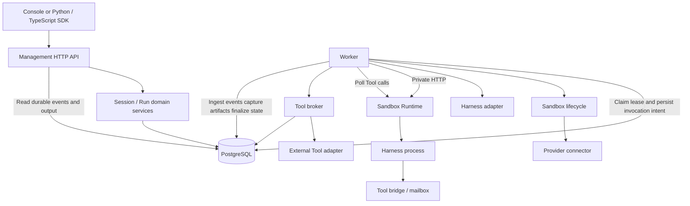

Follow one Run to locate its implementation. Before changing behavior, read [architecture](https://github.com/NexusFox88/hexagon-docs/blob/main/resources/docs/architecture.md) and the [acceptance journey](https://github.com/NexusFox88/hexagon-docs/blob/main/resources/testing/acceptance.md). User journeys define acceptance; missing implementation is not permission to remove a requirement.

## Directory responsibilities

| Location | Responsibility |
| --- | --- |
| `apps/control-plane` | HTTP composition, management API, credential ingress, preview ingress |
| `apps/console` | Management UI consuming the same API; bilingual catalogs and application-owned interaction components |
| `modules/execution` | Sessions/Runs, inputs, initialization, scheduling, result interpretation |
| `modules/sandboxes` | Resource lifecycle, operation records, checkpoints, pause, cleanup |
| `modules/harnesses` | Harness registration, protocols, images, execution adapters |
| `modules/connections / credentials / access` | Account configuration, Secrets, protected access policy |
| `modules/tools / apps` | ToolBroker, call reconciliation, applications and OAuth management |
| `modules/artifacts / storage` | Artifacts and PostgreSQL transactions/migrations |
| `integrations` | External protocol adapters for cloud providers, models, applications, HTTP Tools, MCP |
| `runtime` | In-Sandbox Python supervisor and Tool bridge |
| `sdk` | Public Python and TypeScript clients |
| `tooling / testing` | Management/verification scripts and journey/evidence; not substitute product implementations |

## Trace one submission

1. **Client entry:** [TypeScript](https://github.com/NexusFox88/hexagon-docs/blob/main/resources/sdk/typescript/index.ts) and [Python](https://github.com/NexusFox88/hexagon-docs/blob/main/resources/sdk/python/hexagon/__init__.py) use the same HTTP operations. Console consumes the public API, not a separate execution state model.
2. **Identity/routes:** [server.ts](https://github.com/NexusFox88/hexagon-docs/blob/main/resources/apps/control-plane/server.ts) checks identity/scope and parses Session ID, input, and idempotency key before delegation. Every lookup and cross-resource binding validates tenant ownership.
3. **Durable submission:** [runs.ts](https://github.com/NexusFox88/hexagon-docs/blob/main/resources/modules/execution/runs.ts) owns idempotency, active-Run constraints, transitions, and events; [sessions.ts](https://github.com/NexusFox88/hexagon-docs/blob/main/resources/modules/execution/sessions.ts) pins configuration/resource associations. Persist state/events before streaming.
4. **Worker:** [worker.ts](https://github.com/NexusFox88/hexagon-docs/blob/main/resources/modules/execution/worker.ts) uses leases for preparation, recovery, event ingestion, and completion. Stale workers cannot update newer state. Client disconnect does not cancel execution.
5. **Cloud resources:** the [connector contract](https://github.com/NexusFox88/hexagon-docs/blob/main/resources/modules/sandboxes/connector.ts) and [registry](https://github.com/NexusFox88/hexagon-docs/blob/main/resources/integrations/sandboxes/registry.ts) provide allocation, inspection, files, commands, and private access. Provider branches belong in adapters, not scattered through generic Run orchestration.
6. **Guest processes:** [Runtime](https://github.com/NexusFox88/hexagon-docs/blob/main/resources/runtime/server.py) supervises Harness processes; the [Harness contract](https://github.com/NexusFox88/hexagon-docs/blob/main/resources/modules/execution/harness.ts) defines installation, invocation, and output. The control plane never executes uploaded source; Runtime does not own cloud resource management.
7. **External Tools:** [tool_bridge.py](https://github.com/NexusFox88/hexagon-docs/blob/main/resources/runtime/tool_bridge.py) connects calls to [broker.ts](https://github.com/NexusFox88/hexagon-docs/blob/main/resources/modules/tools/broker.ts) for authorization, approval, dispatch, and durable results. Original credentials stay in the control plane. Uncertain effects enter [reconciliation.ts](https://github.com/NexusFox88/hexagon-docs/blob/main/resources/modules/tools/reconciliation.ts).
8. **Delivery:** [Artifacts](https://github.com/NexusFox88/hexagon-docs/blob/main/resources/modules/artifacts/artifacts.ts) persists deliverables. The worker checks actual results/artifacts before terminal completion. Model text is not execution evidence. Clients query durable results and separately close Sessions for cleanup.

## Runtime call relationships

This shows runtime responsibilities, not every static import. Diagram labels are shortened for readability: Worker maps to `ExecutionWorker`, Sandbox lifecycle to `SandboxLifecycle`, Provider connector to `SandboxConnector` and its adapter, and Tool broker to `ToolBroker`. Provider adapters operate cloud resources; Harness adapters define program installation and invocation; Runtime supervises guest processes. The Tool bridge hands calls to a mailbox, then the control-plane broker manages authorization, approval and external dispatch. It does not give the Harness account-administration authority to call arbitrary services.

The Console's [api helper](https://github.com/NexusFox88/hexagon-docs/blob/main/resources/apps/console/app.js) calls `/v1`. Its local identity bootstrap is client authentication, not a second Run-state store. A display change cannot replace a domain-state transition.

## Find functions and tests from a behavior

| Behavior | Reading entry | Related test entry |
| --- | --- | --- |
| Duplicate submission returns the original Run | Idempotency lookup, Session lock and active-Run checks in `Runs.submit` | [runs.test.ts](https://github.com/NexusFox88/hexagon-docs/blob/main/resources/modules/execution/runs.test.ts) |
| Which preparation steps can repeat after interruption | `ExecutionWorker.execute` and Runtime binding preparation / launch branches | [worker-prepare.test.ts](https://github.com/NexusFox88/hexagon-docs/blob/main/resources/modules/execution/worker-prepare.test.ts) |
| Original invocation stays fixed instead of being regenerated | Persisted invocation reads/writes in `ExecutionWorker.invocation` | [worker.test.ts](https://github.com/NexusFox88/hexagon-docs/blob/main/resources/modules/execution/worker.test.ts) |
| Text, exit state and artifacts become a result | Worker `drain` / `finish` and `Artifacts.capture` | [worker-results.test.ts](https://github.com/NexusFox88/hexagon-docs/blob/main/resources/modules/execution/worker-results.test.ts) |
| Authorization waits and approval affect dispatch | `ToolBroker.process` and durable Tool call state | [broker.test.ts](https://github.com/NexusFox88/hexagon-docs/blob/main/resources/modules/tools/broker.test.ts), [cancellation.test.ts](https://github.com/NexusFox88/hexagon-docs/blob/main/resources/modules/tools/cancellation.test.ts) |
| Unknown deletion does not directly become closed | Original-operation and resource confirmation in `SandboxLifecycle` | [lifecycle.test.ts](https://github.com/NexusFox88/hexagon-docs/blob/main/resources/modules/sandboxes/lifecycle.test.ts) |
| Runtime restart protects active invocations | Startup quarantine and invocation identity in `runtime/server.py` | [supervisor lock](https://github.com/NexusFox88/hexagon-docs/blob/main/resources/testing/runtime-supervisor-lock.test.ts), [workspace](https://github.com/NexusFox88/hexagon-docs/blob/main/resources/testing/runtime-workspace-persistence.test.ts) |

These are reading and validation entry points, not proof that running only these files covers every change. Prepare database/process prerequisites using the [testing guide](/en/contribute/testing) and record actual results. Real Provider/model journeys remain separate from deterministic tests.

For a boundary example, a Provider-specific private HTTP tunnel should not become a `provider === ...` networking implementation inside the worker. Start with the connector's private-access contract, target-release responsibility and adapter. Express the difference there, then verify that Runtime and preview callers release resources correctly. The same fix can then serve execution and previews without duplicating vendor logic.

## Locate recovery behavior

- Run/invocation recovery: execution/worker and runs. Do not replay dispatched operations with unknown outcomes.
- Pause/checkpoints/deletion: [lifecycle.ts](https://github.com/NexusFox88/hexagon-docs/blob/main/resources/modules/sandboxes/lifecycle.ts), [checkpoints.ts](https://github.com/NexusFox88/hexagon-docs/blob/main/resources/modules/sandboxes/checkpoints.ts). Idle, paused, closed, and provider deletion are different states.
- Protected access: [access-server.ts](https://github.com/NexusFox88/hexagon-docs/blob/main/resources/apps/control-plane/access-server.ts) and modules/access. Raw keys in environment are not an acceptable compatibility fallback.
- Storage upgrades: [migrate.ts](https://github.com/NexusFox88/hexagon-docs/blob/main/resources/modules/storage/migrate.ts) and numbered SQL. Do not modify applied migrations to disguise a new schema.

## Choose the implementation boundary

| Change | Start here | Also verify |
| --- | --- | --- |
| New Sandbox | connector + integrations/sandboxes | Capabilities, uncertain creation, cleanup, both SDKs |
| New Harness | Harness contract + modules/harnesses | Protocol, Tools, native history, result, cancellation |
| New application operation | integrations/apps + ToolBroker | Schema, permissions, approvals, uncertain effects |
| Console interaction | apps/console | Both languages, keyboard/focus, application-owned components |
| Public field | server + domain contract + both SDKs | Types, permissions, examples, compatibility |
| State transition | runs / worker / lifecycle | Transactions, persistence-before-streaming, lease fencing, recovery |

As a no-cloud reading exercise, locate submission, idempotency checking, persisted invocation, Runtime execution, Tool dispatch, and result persistence. Explain who recovers each failure and which actions cannot be blindly repeated. Listing directories alone is insufficient.

This map follows current files/implementation and claims no newly passed tests. Record deterministic and real-provider/model evidence separately, retaining sensitive resource IDs privately.

Next: [Sandbox connectors](/en/contribute/sandbox-connectors), [Harness adapters](/en/contribute/harness-adapters), [Tool and application connectors](/en/contribute/tool-connectors).
