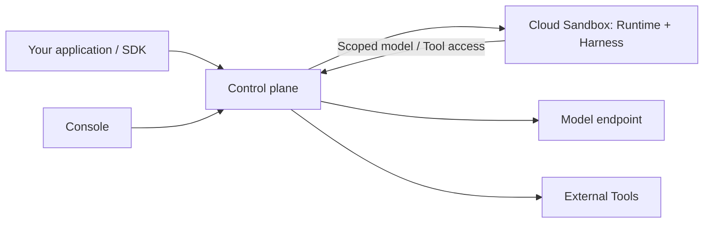

Hexagon is a self-hostable, open-source Agent control plane. Your application creates a continuing Session, runs tasks in cloud Sandboxes, observes durable events, and retrieves results and artifacts. For example, upload a Web project, ask an Agent to implement filtering, inspect its tests and preview, then continue in the same workspace.

**[Create your first Session](/en/start/first-session)** · [Complete a project task](/en/start/project-task)

## See what completion looks like

After [installation](/en/start/install) and connection setup, the first tutorial creates a direct Session; saving an Agent template is optional. This excerpt is taken from the [complete Python program](https://github.com/NexusFox88/hexagon-docs/blob/main/resources/examples/documentation/first-session.py):

```python
session = client.create_session(
    harness={'id': 'pi', 'version': '1.5.2'},
    sandbox_connection_id=sandbox, model_connection_id=model,
)
```

The complete program persists a submission key and Session/Run IDs, submits a task, polls its result, downloads artifacts, closes the Session and reads an artifact after closure. The excerpt alone does not include those steps. Use the [tutorial](/en/start/first-session) for dependencies, Python/TypeScript execution and recovery instructions.

| Completion check | What you inspect |
| --- | --- |
| Identifiable work | Returned Session and Run IDs in a private journal |
| Finished task | Durable Run state is `completed`, with an actual assistant response |
| Useful artifact | Downloaded content matches `Hello from Hexagon` |
| Lifecycle completed | Session is `closed`; the exported artifact remains downloadable |

These are the tutorial's expected checks, not fabricated output or a claim of a fresh cloud run. A model saying “done” does not replace them. Cloud/model usage is billed through your configured accounts.

The [2026-11-20 first-Session record](https://github.com/NexusFox88/hexagon-docs/blob/main/resources/testing/evidence/2026-11-20-first-session-docs-cloud.json) provides an actual scoped result for the linked programs:

| Recorded observation | Python | TypeScript |
| --- | --- | --- |
| Run / Session after cleanup | `completed` / `closed` | `completed` / `closed` |
| Exported content | 19 bytes, expected greeting verified | 19 bytes, expected greeting verified |
| Deletion record | `completed` | `completed` |
| Download after closure | Identical bytes | Identical bytes |

Both used Vercel Sandbox, Pi 1.5.2 and the configured Messages endpoint with `deepseek-ai/DeepSeek-V4-Flash`. This dated result covers the first task and retained artifact; it does not establish Tools, approvals, preview or other combinations. Original resource IDs stay in private journals. The complete example is the runnable entry point; copying only the creation excerpt leaves an open Session to manage.

## Choose your next task

| Your goal | Primary guide |
| --- | --- |
| Add Agent execution to a product backend | [Backend integration](/en/build/backend-integration) |
| Give an Agent project files and verify its work | [Project files and context](/en/build/project-context) |
| Select and manage different execution combinations | [Choose integrations](/en/integrations/choose) |

The [complete project tutorial](/en/start/project-task) covers upload, fixed tests, private preview, a second modification and retained exports; [dated independent dual-SDK cloud and browser checks](https://github.com/NexusFox88/hexagon-docs/blob/main/resources/testing/evidence/2026-11-20-project-docs-cloud.json) passed for the documented Vercel/Pi/Messages combination. [Use cases](/en/start/use-cases) explains product fit and boundaries.

## Understand where work runs



The control plane owns Session/Run state, durable events, credentials and cloud resources. Runtime supervises Harness processes inside the cloud Sandbox. Original provider/model/Tool credentials stay in the control plane; the guest receives scoped access. “Local” and “hosted” describe the control plane's location, not local versus cloud task execution. See [execution architecture](/en/concepts/execution-architecture) and [security boundaries](/en/concepts/security-boundaries).

## Enter by your responsibility

| You are… | Start here | Then continue |
| --- | --- | --- |
| Trying Hexagon | [Install](/en/start/install) | [First Session](/en/start/first-session) → [What happened](/en/start/what-happened) |
| Building an application | [Backend integration](/en/build/backend-integration) | [Events](/en/build/stream-events), [approvals](/en/build/approvals), [recovery](/en/build/recovery) |
| Operating a deployment | [Self-hosting](/en/operate/self-host) | [Networking](/en/operate/networking), [diagnostics](/en/operate/observability), [backup](/en/operate/backup-restore) |
| Extending the project | [Development setup](/en/contribute/development) | [Code map](/en/contribute/codebase), [tests and evidence](/en/contribute/testing) |

Coding Agents can use the [integration reading guide](/en/agents). Browse the [complete documentation directory](/en/directory) for all existing pages, including provider guides, concepts, extension guides and reference entries.

## Check capabilities and evidence

Start with [Sandbox capabilities](/en/integrations/sandboxes), [Harness contracts](/en/integrations/harnesses) and [model protocols](/en/integrations/model-protocols), then inspect [dated verified combinations](/en/integrations/verified-combinations). Registration, supported capability and real execution evidence are separate facts; there is no blanket guarantee for every cross-product.

A client disconnect does not cancel a Run. Explicitly close unused Sessions and reconcile unknown operations before claiming cleanup. Use [troubleshooting](/en/operate/troubleshooting) or [resource reconciliation](/en/operate/reconciliation) when progress or cleanup is uncertain.

Read [changes and upgrade notes](/en/changelog) before changing versions. Product docs remain drafts under active completion; the [coverage ledger](https://github.com/NexusFox88/hexagon-docs/blob/main/resources/docs/product/coverage.json) identifies unfinished assets. Exact API/SDK/configuration references are still being completed; current implementation-backed details remain in the [SDK guide](https://github.com/NexusFox88/hexagon-docs/blob/main/resources/sdk/README.md) and linked source. The repository's [release policy](https://github.com/NexusFox88/hexagon-docs/blob/main/resources/release-policy.json) does not yet approve publication. No public hosting or download channel is implied by these local pages.

[Repository README](https://github.com/NexusFox88/hexagon-docs/blob/main/resources/README.md)
