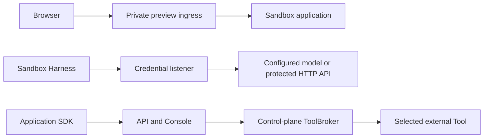

Hexagon has three inbound traffic roles. Route each deliberately rather than pointing one development tunnel at all services.

| Ingress | Local default | Caller and purpose |
| --- | --- | --- |
| API / Console | 127.0.0.1:8787 | SDK/Console task and configuration access |
| Private preview | 127.0.0.1:8788 | Browser access to authorized Sandbox HTTP apps |
| Credential listener | 127.0.0.1:8789 | Bounded model/protected HTTP access from Sandboxes |

These are defaults, not recommendations to expose them publicly. Corresponding HOST/PORT settings change listeners; reverse proxies should route only the intended role.

## Control-plane calls and model calls travel in different directions

The local control plane is a client of the cloud Sandbox provider and Sandbox Runtime. Protected model calls travel in the opposite direction: Sandbox Harness → dedicated credential listener → configured model endpoint. This route does not expose the management API.

Sandbox provider account credentials stay in the control-plane connector. Original model and protected HTTP credentials are encrypted in the control plane and added only to authorized upstream requests by the credential listener. The common backend gives the Harness a scoped delegated grant. Vercel native Header transforms inject that delegated grant at the provider boundary; the guest receives a placeholder. Vercel does not inject the original model key or eliminate the proxy.

Native direct-to-model access is not implemented. Ordinary Session environment variables are guest-readable and are not an alternative protected-credential mode.

Session creation and preflight await credential readiness before inserting a Session. The Worker checks again before Sandbox provisioning. This probes the listener from the control-plane host, not from the Sandbox: acceptance still requires a real cloud model call. An ingress error can therefore precede resource creation; a lost response still requires reconciliation.

Source: [Session readiness](https://github.com/NexusFox88/Hexagon/blob/e64574111fabee1e3bfa2f7c08eb403d6fda1c34/modules/execution/sessions.ts#L125), [invocation grants](https://github.com/NexusFox88/Hexagon/blob/e64574111fabee1e3bfa2f7c08eb403d6fda1c34/modules/execution/worker.ts#L231), [upstream authentication](https://github.com/NexusFox88/Hexagon/blob/e64574111fabee1e3bfa2f7c08eb403d6fda1c34/apps/control-plane/access-server.ts), and [Vercel policy](https://github.com/NexusFox88/Hexagon/blob/e64574111fabee1e3bfa2f7c08eb403d6fda1c34/integrations/sandboxes/vercel.ts#L25).


## Development ingress

The managed launcher defaults to a Cloudflare development channel and needs cloudflared. It forwards the credential listener, not management. Console Network & ingress displays its status; management remains independently available when the tunnel fails.

The tunnel carries delegated tokens and request/response content through its service. Fixed/production networks should use a stable HTTPS origin. Example external configuration:

```json
{"no_proxy":[],"ingress":{"mode":"external","url":"https://credentials.example.com"}}
```

Save through local configure and restart without active work. Replace the placeholder with an actual reachable origin routed to the credential listener.

Stopping a temporary channel is a runtime action; future work can restore the saved mode. Save disabled mode to keep ingress disabled. Do not rotate an origin currently used by active invocations.

## Quick Tunnel unavailable or rate limited

A working Console and validated connections do not prove the credential ingress is reachable. If Session creation returns `credential_proxy_tunnel_unavailable`, inspect Network & ingress and the cloudflared diagnostic before submitting again. A Quick Tunnel HTTP 429 is a provider rate limit: stop repeated tunnel creation and wait for the provider to permit requests, or provision the documented stable external ingress for sustained use. Do not switch IPs or proxies to evade a limit.

With no active Runs, stop the temporary channel in Network & ingress to pause automatic recovery attempts. This leaves the saved deployment mode unchanged; the next SDK request may try to start it again. Preserve the failed example journal. Inspect Sessions and resource operations to establish whether creation happened before archiving that journal and starting a new independent attempt. Never infer cloud cleanup from a tunnel failure.

## Hosted and preview routing

Hosted requires stable HTTPS credential ingress and rejects temporary tunnels. Verify reachability from a real Sandbox: a loopback health request from the control plane is insufficient.

Management remains authenticated. Previews require a dedicated wildcard domain/TLS and grant-specific subdomains, separate from Console origin. See [preview limits](/en/build/private-preview). OAuth callbacks belong to management authorization routing; a credential tunnel is not an OAuth callback tunnel.

## Outbound proxies and policy

Saved outbound_proxy settings and explicit process environment govern their respective paths. Environment wins; bypass entries merge with loopback. Protected upstreams have additional destination enforcement: direct paths check public DNS and reject redirects; trusted proxy mode requires exact approved hosts.

`HEXAGON_ACCESS_EGRESS_PROXY_URL` and `HEXAGON_ACCESS_EGRESS_HOSTS` configure protected upstream proxying. Hosts are exact names, not wildcards. Successful npm traffic does not prove model/Tool egress works.

Sandbox allowlists must include the credential origin hostname. Sandbox policy and control-plane Tool egress are different boundaries; see [network policy](/en/build/sandbox-policy).

## Follow the request, not just the port



| Symptom | First boundary to inspect | Completion signal |
| --- | --- | --- |
| Console loads but SDK authentication fails | API address, workspace identity and token | Authenticated request reaches the intended deployment |
| Model validation succeeds but Run fails to connect | Sandbox egress and credential origin routing | Real Sandbox request reaches protected access using its delegated grant |
| Credential origin returns management HTML | Reverse-proxy upstream/port | Route points only to credential listener; management stays separate |
| Preview fails while model works | Preview grant/origin, Sandbox process and port | Authorized browser sees the intended app; unauthorized access is denied |
| Dependency downloads work but Tool calls fail | Control-plane Tool egress and exact-host policy | Intended operation succeeds through its configured adapter |
| Restart changes connectivity | Saved settings versus explicit environment and origin | Recheck both network legs without rotating active invocation origins |

The graph describes traffic roles, not a claim that every arrow shares one authorization system. ToolBroker calls occur in the control plane; Sandbox domain allowlists do not govern that outbound path. The [local-mode cloud/recovery record](https://github.com/NexusFox88/hexagon-docs/blob/main/resources/testing/evidence/2026-11-18-local-beta-delivery.md) is evidence for its actual temporary-ingress topology, not every stable hosted origin. Repeat cloud reachability and preview isolation checks in your chosen topology.

## Diagnose in order

1. Confirm control-plane health and intended workspace.
2. Check credential origin identity, TLS, and routing.
3. Test actual Sandbox access, including allowlist restrictions.
4. Check model protocol, fixed upstream, credentials, and outbound proxy.
5. For previews, check process/port, grant, origin, and expiry.

Record execution stage, sanitized codes, and required identifiers; avoid complete headers, tokens, and upstream bodies. Do not repair ingress by exposing management or injecting original model keys into the Sandbox.

Acceptance needs a real cloud call, isolated preview authorization, rejected unauthorized access, and working ingress after restart. Sources: [entry](https://github.com/NexusFox88/hexagon-docs/blob/main/resources/apps/control-plane/main.ts), [settings](https://github.com/NexusFox88/hexagon-docs/blob/main/resources/modules/deployment/settings.ts), [credential boundary](https://github.com/NexusFox88/hexagon-docs/blob/main/resources/docs/secret-management.md). Next: [troubleshooting](/en/operate/troubleshooting), [security boundaries](/en/concepts/security-boundaries), [private preview](/en/build/private-preview).
