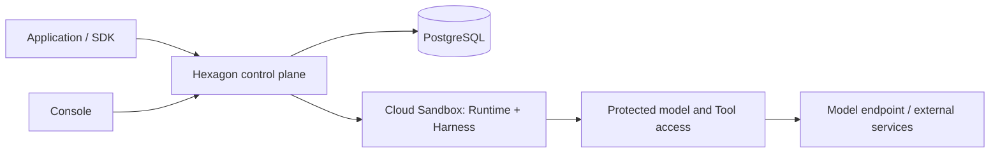

Hexagon is an open-source, self-hostable Agent control plane for applications. Your application submits work; Hexagon manages cloud execution resources, task state, Tool calls, events, and artifacts around a continuing work context.

Read this page when evaluating where Hexagon fits or when encountering Session, Run, and Harness for the first time.

## Four outcomes for your application

| Outcome | What a user or application can observe | Boundary to keep in mind |
| --- | --- | --- |
| Turn a request into durable work | A submitted task has a Run ID; its state, events and exported files can be queried again | Your backend still owns business authorization and request-to-Run mapping |
| Choose an execution combination | Select Sandbox, Harness, model and Tools through the same application API, then inspect preflight and scoped verification | A shared interface does not make every combination equivalent or supported |
| Manage work beyond one connection | Continue in the same Session, handle authorization/approval, reconnect, cancel and confirm cleanup | Disconnection is not cancellation; unknown external results require reconciliation |
| Operate within explicit trust boundaries | Run your own control plane and configure your own accounts; inspect where original credentials and delegated authority are used | Self-hosting the control plane does not move cloud task execution onto your laptop |

A **Harness** is the engine that runs the Agent loop: it interprets the task, interacts with a model and chooses execution steps. Hexagon supplies the surrounding task and resource lifecycle. Its Console is useful for configuring and investigating that lifecycle; your application normally integrates through the Python SDK, TypeScript SDK or HTTP API.

## Follow a project task

Suppose your application lets users upload a Web project and ask an Agent to add filtering:

1. Configure, validate, and enable a cloud Sandbox connection and model connection.
2. Choose a compatible Harness, create a Session, and upload project files.
3. Submit the change request and retain its Run ID.
4. Hexagon executes in the cloud Sandbox. Your application observes durable events and presents progress.
5. The Agent edits files, runs tests, and places deliverables in the Run's artifact directory.
6. Retrieve results and artifacts, optionally exposing an authorized private Web preview.
7. Submit follow-up work as another Run in the same Session.
8. Close the Session and confirm cloud cleanup; exported artifacts and completed records remain queryable.

Each step depends on the selected combination's capabilities and evidence. Inspect actual test results rather than accepting the Agent's statement that tests passed.

## Responsibilities

| Component | Responsibility |
| --- | --- |
| Your application | User experience, business identity/permissions, persisted task IDs, result delivery |
| Console | Connection configuration, Session/Run/resource observation, authorization and management |
| Control plane | Durable Sessions/Runs/events, cloud resources, credentials, execution scheduling |
| Sandbox | Cloud environment containing workspace and processes |
| Runtime | In-Sandbox Harness process supervision and execution protocol |
| Harness | Agent logic using a model and authorized Tools |
| Model and Tools | Reasoning and external operations under connection/permission constraints |

This diagram shows responsibility boundaries; actual request paths depend on connection type. Provider credentials remain in the control plane. Protected model/Tool credentials use scoped access. Values you explicitly put into Session env or variables are readable by Sandbox code.

## Three core objects

**Session** is a continuing context with conversation, workspace, and pinned configuration. It is not one physical machine; recovery strategies can replace underlying resources.

**Run** is one submission's execution record. A Session currently permits one active Run. Client disconnection does not cancel it.

**Agent template** is optional reusable configuration. Create Sessions directly; use templates when you need configuration reuse/versioning. Template edits do not overwrite existing Session configuration.

## Deployment and execution locations

Local and hosted refer to the control plane. A local control plane uses a local database/private configuration, while real Agent tasks still execute in cloud Sandboxes. Local Docker is not required as a replacement for actual cloud execution.

The control plane retains execution records and exported artifacts. Workspace, process, and memory preservation vary by provider/lifecycle action. A durable Session does not imply an immortal process.

Next: [use cases](/en/start/use-cases) or [local installation](/en/start/install). Sources: [architecture](https://github.com/NexusFox88/hexagon-docs/blob/main/resources/docs/architecture.md), [acceptance journey](https://github.com/NexusFox88/hexagon-docs/blob/main/resources/testing/acceptance.md).
