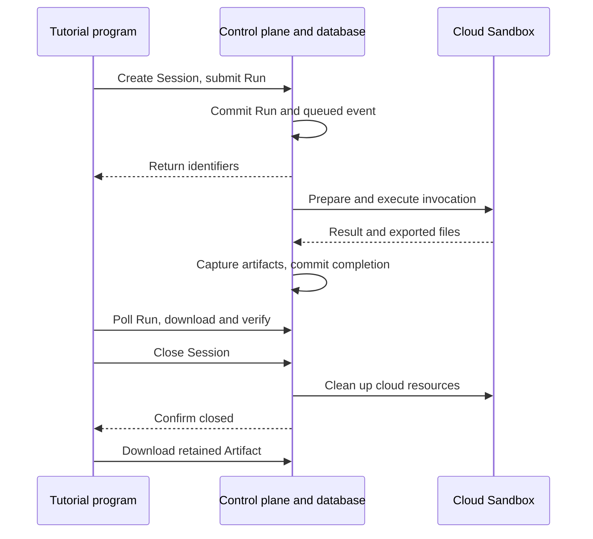

The [first Session tutorial](/en/start/first-session) produces three distinct results: a durable Session identity, one Run execution record, and exported files from the cloud workspace.

## Follow the request

1. **Connections establish prerequisites.** The Sandbox connection identifies cloud access; the model connection identifies an endpoint, model, and protocol. Both must be verified and enabled.
2. **The Session pins configuration.** The selected Harness and connection configuration become its execution context. Direct creation does not require an Agent template.
3. **The Run represents one submission.** The example saves its input and idempotency key before submitting. Reusing that request after a lost response recovers the original Run instead of creating a second task.
4. **The control plane schedules execution.** It owns cloud resources and execution records. Inside the Sandbox, Runtime supervises the Harness process; the Harness uses the model to perform the task.
5. **State and events are persisted.** Observers read durable execution state. This example polls; an event-stream client can also reconnect to observe the original Run.
6. **Artifacts are exported before completion.** The Harness receives a Run-specific output directory. Ordinary workspace files are not automatically exported artifacts.
7. **Closing releases cloud resources.** Run completion and Session closure are separate actions. Exported artifacts remain in control-plane storage and can be downloaded after closure.

## Match the tutorial's output to the work

| What the program shows or saves | What it identifies | What it does not prove by itself |
| --- | --- | --- |
| `Session: … Run: …` | The continuing context and this particular accepted submission | Successful execution or completed cleanup |
| Printed `output` | The final assistant result returned by the Run query | That every promised file was exported correctly |
| `artifact-0.bin` and other local files | Downloaded bytes; local filenames deliberately differ from remote paths | A new live workspace or a deployable Web service |
| Journal `artifacts` | Remote Artifact IDs, names, sizes and hashes | A complete backup of every Sandbox file |
| `closed_and_retention_checked` | The program observed closed state and re-downloaded the first listed Artifact unchanged | That every possible artifact, another Provider or every recovery branch was tested |

Both programs validate the size/hash of every listed download before closure and require at least one file containing `Hello from Hexagon`, allowing surrounding whitespace. After closure, they re-download the **first listed Artifact** and compare its bytes. In the [recorded cloud runs](https://github.com/NexusFox88/hexagon-docs/blob/main/resources/testing/evidence/2026-11-20-first-session-docs-cloud.json), each SDK produced one 19-byte artifact, so that single-file retention check covered the entire exported set for those runs. Do not generalize the program's first-file recheck into an all-files retention check for a different task.

## The same tutorial as a short sequence

This diagram summarizes the successful path; waiting, unknown remote outcomes and retries follow the failure guidance in the tutorial. Runtime is the supervisor inside the Sandbox; Harness is the Agent engine it runs. Your Python or TypeScript process is a client of the control plane. The diagram's combined control-plane/database participant keeps the sequence short; events are committed before observation, and exported bytes are stored independently of the cloud resource.

The tutorial polls rather than subscribing to SSE. Polling does not prevent durable events from being recorded: Console and the event API can inspect the same Run later. Console's Initialization view describes the pinned configuration; Run input/output and events describe the execution; Fleet/resource-operation records describe allocation and cleanup. Do not read those separate records as one shared success flag.

## Compare the records in Console

Use the printed IDs to find the Session and Run. Check pinned configuration, input, output, and resource operations. Sandbox state, Runtime reachability, and Run state describe separate objects. A completed Run does not mean its Sandbox was deleted; an unreachable Runtime does not prove that its process stopped.

For another turn, submit a new Run to the same still-open Session. The tutorial explicitly closes its Session, so a new experiment needs a new Session. Closure is terminal, unlike idle suspension.

| Object | Behavior in this tutorial |
| --- | --- |
| Session and Run records | Completed history remains queryable |
| Exported artifacts | Remain downloadable after closure |
| Original cloud workspace | Cloud resources are removed; continued workspace access is not guaranteed |
| Harness process and preview services | Do not persist merely because history exists |
| Private local journal | Remains under your control for recovery and investigation |

Idle suspension has different preservation rules from closure. Memory, filesystem, and process continuity also vary by Provider. Read [Serverless Sessions](https://github.com/NexusFox88/hexagon-docs/blob/main/resources/docs/serverless-sessions.md) before depending on a particular behavior.

## Choose your next experiment

| You want to… | Continue with | Keep in mind |
| --- | --- | --- |
| See a useful project change | [Complete project task](/en/start/project-task) | Creates new resources; includes two turns, tests, preview and cleanup |
| Integrate into your own product | [Backend integration](/en/build/backend-integration) | Persist business ownership and submission intent before network calls |
| Show progress in your interface | [Event delivery](/en/build/stream-events) | Backend consumption and browser delivery have separate cursors |
| Understand preservation | [Persistence boundaries](/en/concepts/persistence) | Stored history, workspace files and process memory differ |

The completed tutorial is a fixed example, not a background Agent waiting for new work. Keep its journal as evidence and create a new Session for the next experiment. Learn the public object model in [Session, Run and Agent](/en/concepts/sessions-runs-agents); implementation ownership is described in the [architecture](https://github.com/NexusFox88/hexagon-docs/blob/main/resources/docs/architecture.md).

For another execution setup, read [choosing a combination](/en/integrations/choose); for event persistence and replay, read [events and recovery](/en/concepts/events-and-recovery).
