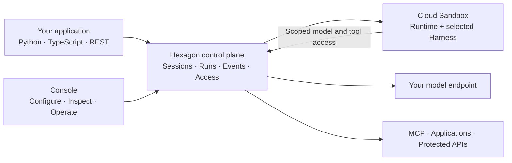

<p align="center">
  <picture>
    <source media="(prefers-color-scheme: dark)" srcset="brand-assets/creative/readme-banner-dark.svg">
    
  </picture>
</p>

<h1 align="center">Your agent fleet.<br>Your infrastructure stack.</h1>

<p align="center">
  <strong>The open-source control plane for your Agent fleet.</strong><br>
  Bring your Sandbox, Harness and LLM. Ship headless agents through Python, TypeScript or REST.
</p>

<p align="center">
  <a href="https://hexagon.autos"><strong>Official website ↗</strong></a> ·
  <a href="docs/product/en/start/first-session.md"><strong>Run your first Session →</strong></a> ·
  <a href="docs/product/en/index.md">Documentation</a> ·
  <a href="https://github.com/NexusFox88/Hexagon">GitHub</a> ·
  <a href="#see-your-fleet">Console</a> ·
  <a href="docs/product/en/integrations/verified-combinations.md">Verified combinations</a> ·
  <a href="CONTRIBUTING.md">Contribute</a>
</p>

<p align="center">
  <a href="LICENSE"></a>
  
  
</p>

Build coding agents, internal operators and tool-connected assistants on infrastructure you control. Hexagon handles the execution around the agent: Session state, cloud workspaces, scoped tool access, durable events and result delivery. Your application owns the user experience.

## From a prompt to an operated fleet

An agent needs more than a model call. It needs a workspace, a runtime, permissions, continuity and a way to see what happened.

- **Choose your execution stack.** Bind a Sandbox, a versioned Harness and a model endpoint per Session. Register custom OCI Harness images where the provider supports them.
- **Keep the conversation alive.** Continue work in the same Session, inspect its pinned initialization, and reuse that definition in SDK code or the Playground.
- **Treat execution as infrastructure.** Observe Runs, reconnect to persisted events, cancel work explicitly, and reconcile uncertain cloud operations.
- **Give agents scoped access.** Connect remote MCP, applications and protected APIs. Keep original provider and upstream credentials in the control plane, with authorization and approval flows for tools.
- **Deliver more than text.** Retrieve answers and exported artifacts. Inspect private previews where supported. Retain exported artifacts after workspace closure.
- **Let idle workspaces rest.** Pause and automatic wake follow provider-specific strategies. Session identity survives supported idle transitions; recovery scope depends on the stack.

## See your fleet

**Configure once. Inspect the actual API. Take the code into your application.**


The API Playground exposes Python, TypeScript and REST side by side. Console is the operations surface for connections, authorization, Session execution and diagnostics; your application drives conversations through the API.

<details>
<summary><strong>Inspect a real Session: conversation, execution and initialization</strong></summary>


A captured acceptance Session, not a fabricated demo. Inspect the conversation and execution progress, then switch to Initialization to see the definition used for that Session.

</details>

<details>
<summary><strong>Choose a Harness: built-ins, OCI images and build recipes</strong></summary>


The catalog distinguishes published images, build recipes and linked verification. A catalog entry is not a claim that every provider/model combination works.

</details>

## Bring your stack

| Layer | Available integration paths |
| --- | --- |
| **Sandbox** | E2B, Modal, Vercel Sandbox, Blaxel, Fly Sprites, Fly Machines, Upstash Box, Instabox, Freestyle VMs, Boat and Agent37 |
| **Harness** | Built-in Pi and OpenCode; OCI adapters/templates for Codex, Hermes, OpenClaw, OpenCode, Aider, Claude Code, DeepSeek Harness and custom agents |
| **Model** | Anthropic Messages, OpenAI Chat Completions and OpenAI Responses; bring a compatible endpoint and model |
| **Tools** | Remote MCP, application connectors and protected HTTP APIs, with explicit Session bindings |
| **Client** | Python SDK, TypeScript SDK and REST; Console uses the same control plane |

**Choose a verified combination, not just a familiar name.** Image distribution, tool support, model protocols and pause/recovery vary by adapter. Some Harness templates require a build. Daytona is excluded. See [integration selection](docs/product/en/integrations/choose.md), [Sandbox capabilities](docs/product/en/integrations/sandboxes.md) and [dated cloud evidence](docs/product/en/integrations/verified-combinations.md).

## Launch your first Session

**1. Start the control plane.** You need Node.js 22.19+, a dedicated PostgreSQL database and Python 3.10+ if using the Python SDK. Local development credential ingress uses `cloudflared`; see [installation prerequisites](docs/product/en/start/install.md).

```sh
git clone https://github.com/NexusFox88/Hexagon.git
cd Hexagon
npm ci

# Use an existing dedicated database and your PostgreSQL credentials.
export DATABASE_URL='postgres://YOUR_USER@127.0.0.1:5432/hexagon'
npm run local -- doctor
npm run local -- start
```

The clone URL matches this checkout’s configured `origin`; repository access and release approval are separate. If you already have a source checkout, run from its root. Full data-directory, SDK and ingress preparation is in the [installation guide](docs/product/en/start/install.md).

**2. Connect your infrastructure.** Open [Console](http://127.0.0.1:8787/console/), validate and explicitly enable one Sandbox and one model connection, then choose a compatible Harness in API Playground. Local Console and `Hexagon.local()` discover workspace access automatically—no manual API token. Hosted clients use explicit credentials.

**3. Submit from your application.** This is the TypeScript API shape after [installing the local SDK](docs/product/en/start/install.md) and configuring connections:

```ts
import { Hexagon } from '@hexagon/agent-sdk';

const hexagon = await Hexagon.local();
const session = await hexagon.createSession({
  harness: { id: 'pi', version: '1.5.2' },
  sandbox_connection_id: 'YOUR_SANDBOX_CONNECTION_ID',
  model_connection_id: 'YOUR_MODEL_CONNECTION_ID',
  env: { APP_ENV: 'development' },
});

const run = await hexagon.submit(
  session.id,
  'Create hello.txt in the supplied Run artifact directory, then explain it.',
  crypto.randomUUID(), // Keep this key when retrying the same submission.
);

console.log({ session: session.id, run: run.id });
// Inspect execution in Console, or query hexagon.run(run.id).
```

Submission returns a Run, not a completed answer. Use the complete [Python](examples/documentation/first-session.py) or [TypeScript](examples/documentation/first-session.ts) journey to wait for completion, download and verify artifacts, close the Session and check retention. Those programs keep a private recovery journal. API Playground also generates programs for your selected connections.

**[Follow the full first-Session walkthrough →](docs/product/en/start/first-session.md)**

Your cloud and model accounts fund execution. The startup commands do not provision PostgreSQL. Close unused Sessions and confirm cleanup; a disconnected client does not stop a Run.

## A control plane you can reason about



**The control plane owns lifecycle. The Sandbox runs the Harness.** PostgreSQL persists state and events. Runtime supervises agent processes. Your application owns business identity and user permissions. Local versus hosted describes the control plane; agent execution uses cloud Sandboxes.

| Build next | Guide |
| --- | --- |
| Add an agent to your backend | [Backend integration](docs/product/en/build/backend-integration.md) · [Use cases and boundaries](docs/product/en/start/use-cases.md) |
| Supply a repository or project | [Project context](docs/product/en/build/project-context.md) |
| Connect tools and handle approvals | [Tool authorization](docs/product/en/build/tool-authorization.md) · [Approvals](docs/product/en/build/approvals.md) |
| Operate and recover your deployment | [Self-hosting](docs/product/en/operate/self-host.md) · [Recovery](docs/product/en/build/recovery.md) · [Backup](docs/product/en/operate/backup-restore.md) |
| Extend the execution stack | [Code boundaries](docs/product/en/contribute/codebase.md) · [Harness integration](docs/product/en/integrations/harnesses.md) |

## Preview status

Hexagon is in **developer preview**, with scoped real-cloud acceptance records. It is not a universal Sandbox × Harness compatibility promise or a stable-release SLA. The [2026-11-19 release-preparation attempt](testing/evidence/2026-11-19-open-source-preparation.md) records unresolved E2B image preparation and a blocked credential-ingress journey; historical passes do not erase those failures. Separately, the [2026-11-20 first-Session tutorial evidence](testing/evidence/2026-11-20-first-session-docs-cloud.json) records independent Python and TypeScript passes on Vercel/Pi 1.5.2/Messages, including artifact integrity and completed cleanup; it does not certify the release candidate or resolve the earlier E2B attempt. Follow the [support ledger](docs/release/support.md) and [release prerequisites](release-policy.json) when evaluating a deployment.

Pause is distinct from close and does not universally mean zero billing. Recovery may restore files and native conversation without preserving every process. Unknown remote outcomes require [reconciliation](docs/product/en/operate/reconciliation.md), not blind retries. Keep the database and its matching encryption key together; see [security boundaries](SECURITY.md).

## Build with us

The repository’s current contribution guide does not yet configure a public intake; prepare local, reviewable changes through its documented workflow. Good contributions make the fleet easier to operate: a reproducible provider failure, an adapter with lifecycle tests, a complete SDK journey, or a clearer first-run experience. Start with [CONTRIBUTING.md](CONTRIBUTING.md) and [development setup](docs/product/en/contribute/development.md).

```sh
export TEST_DATABASE_URL='postgres://YOUR_USER@127.0.0.1:5432/hexagon_test'
npm run verify
npm run verify:packages
npm run release:check
```

Use an isolated test database and the documented packaging prerequisites. Deterministic tests and real cloud acceptance are separate; cloud tests consume your resources. See [testing](docs/product/en/contribute/testing.md).

[Apache-2.0](LICENSE) · [Third-party notices](THIRD_PARTY_NOTICES.md) · [All documentation](docs/product/en/directory.md) · [Chinese documentation](docs/product/zh-CN/index.md) · [Brand assets](brand-assets/README.md)
