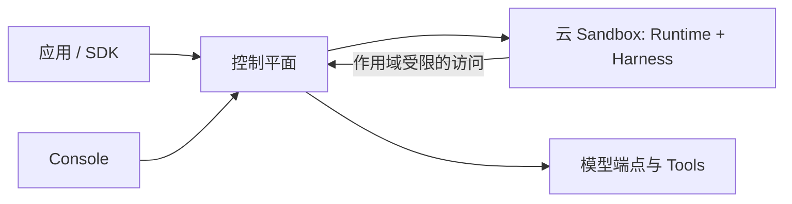

# Hexagon

**面向应用、可自托管的 Agent 控制平面。** 通过 Python、TypeScript 或 REST 创建有状态的 Session，在云 Sandbox 执行 Agent 任务，读取持久事件，并获取结果与产物。Console 管理连接和执行，所选 Harness 在 Sandbox 内运行 Agent。

[**访问官网 ↗**](https://hexagon.autos) · [GitHub 主仓库](https://github.com/NexusFox88/Hexagon) · [English](README.md) · [产品文档](docs/product/zh-CN/index.md) · [第一个 Session](docs/product/zh-CN/start/first-session.md) · [编程 Agent 指南](docs/product/zh-CN/agents.md)

**当前处于 Developer Preview 准备阶段，不是稳定公开发行版。** 本 checkout 有限定范围的真实云证据，不证明所有 Sandbox × Harness 组合兼容。[release-policy.json](release-policy.json)中的公开发布批准仍未完成。项目代码采用 [Apache-2.0](LICENSE)，并保留适用的[第三方声明](THIRD_PARTY_NOTICES.md)。

## 可以构建什么

给 Agent 一个 Web 项目，让它实现筛选功能，检查实际测试输出和私有预览，下载修改文件，再在同一工作区继续对话。Hexagon 管理任务周围的执行生命周期：

| 应用负责的动作 | Hexagon 提供的能力 |
| --- | --- |
| 创建工作上下文并提交任务 | 固定的 Session 配置与 Run 状态 |
| 展示进度并处理重连 | 持久事件与基于游标的重放 |
| 接入外部 Tools | 作用域受限的账户访问、授权与写入审批 |
| 交付结果并结束工作 | 导出产物、支持情况下的私有预览、资源清理与对账 |

业务身份、用户权限和应用自己的任务记录仍由应用管理。详见[适用场景与边界](docs/product/zh-CN/start/use-cases.md)。



## 从源码启动

准备 Node.js 22.19+、已创建的专用 PostgreSQL 数据库；Python 客户端需要 Python 3.10+。临时开发凭据入口使用 cloudflared，Provider 专属依赖见[安装指南](docs/product/zh-CN/start/install.md)。

```sh
npm ci
# 替换为已存在的专用数据库及本机认证配置。
export DATABASE_URL='postgres://YOUR_USER@127.0.0.1:5432/hexagon'
npm run local -- doctor
npm run local -- start
npm run local -- status
```

打开[本地 Console](http://127.0.0.1:8787/console/)。本地 Console 与 `Hexagon.local()` 使用工作区发现，hosted 客户端使用显式凭据。以上命令不会创建 PostgreSQL 或数据库。执行云任务前，按[安装指南](docs/product/zh-CN/start/install.md)准备数据目录、ingress 和 SDK。

然后完成[第一个 Session](docs/product/zh-CN/start/first-session.md)：接入、验证并显式启用一个 Sandbox 和模型，选择兼容 Harness，提交任务，检查结果与产物，关闭 Session 并验证产物保留。不必先保存 Agent，也不需要先接入 Tools 或 OAuth。云资源与模型调用使用你的账户，可能产生费用。

教程提供完整的 [Python](examples/documentation/first-session.py) 和 [TypeScript](examples/documentation/first-session.ts) 程序，保留私有执行记录并检查清理。按教程配置依赖和连接 ID 后运行，不应脱离前置条件直接执行。Console 的 API Playground 也可以根据所选连接生成调用。

[2026-11-20 首个 Session 记录](testing/evidence/2026-11-20-first-session-docs-cloud.json)中，Python 与 TypeScript 分别在 Vercel / Pi 1.5.2 / Messages 组合完成任务，核对 19 bytes 产物及关闭后下载一致性，删除操作记录均为 completed。这是教程的限定组合证据，不是发行候选版本的完整认证。[2026-11-19 发布准备记录](testing/evidence/2026-11-19-open-source-preparation.md)中的 E2B 镜像准备与凭据入口失败仍保留；后续不同组合通过不能替代原失败的调查。

## 继续构建产品

| 目标 | 指南 |
| --- | --- |
| 接入业务后端 | [后端集成](docs/product/zh-CN/build/backend-integration.md) |
| 提供项目并检查结果 | [项目上下文](docs/product/zh-CN/build/project-context.md)、[产物](docs/product/zh-CN/build/artifacts.md) |
| 处理授权、审批与失败 | [Tool 授权](docs/product/zh-CN/build/tool-authorization.md)、[审批](docs/product/zh-CN/build/approvals.md)、[恢复](docs/product/zh-CN/build/recovery.md) |
| 维护自己的控制平面 | [自托管](docs/product/zh-CN/operate/self-host.md)、[网络](docs/product/zh-CN/operate/networking.md)、[备份恢复](docs/product/zh-CN/operate/backup-restore.md) |
| 查找全部已有文档 | [完整目录](docs/product/zh-CN/directory.md) |

## 执行与安全边界

Local 与 hosted 描述控制平面，真实执行使用云 Sandbox。Runtime 监督 Harness 进程；Provider 及上游原始凭据保留在控制平面。guest 获得作用域受限的访问，其权限仍需管理。数据库与匹配的加密密钥一起保护；临时凭据入口不能暴露管理 API，hosted 部署需配置适当的稳定 HTTPS 入口。参见[安全说明](SECURITY.md)。

断开事件流不取消 Run。不再使用的 Session 需要显式关闭并确认清理。暂停不统一等于免费，部分过期与清理机制依赖控制平面持续在线。远程结果未知时先[对账](docs/product/zh-CN/operate/reconciliation.md)，不能盲重试。

镜像承载、模型协议、Tool bridge 与恢复能力因组合而异。查阅[集成选择](docs/product/zh-CN/integrations/choose.md)与[带日期的验证证据](docs/product/zh-CN/integrations/verified-combinations.md)。配方、注册或 catalog 卡片不等于实云通过；Daytona 不在当前目录。产品文档仍在补齐与复核，进度见[覆盖台账](docs/product/coverage.json)，变化见[更新记录](docs/product/zh-CN/changelog.md)。

## 参与贡献

从[开发环境](docs/product/zh-CN/contribute/development.md)、[代码边界](docs/product/zh-CN/contribute/codebase.md)和 [CONTRIBUTING.md](CONTRIBUTING.md)开始。公共贡献入口尚未配置，这些指南说明仓库的工程要求。

安装开发依赖后，使用隔离测试数据库：

```sh
export TEST_DATABASE_URL='postgres://YOUR_USER@127.0.0.1:5432/hexagon_test'
npm run verify
npm run verify:packages
npm run release:check
```

两个验证门禁都要求测试数据库；安装包验证还需要 Python 打包工具。不配置数据库而只运行 `npm test` 可能缺少数据库覆盖。确定性检查与显式、可能计费的实云验收分开。按[测试指南](docs/product/zh-CN/contribute/testing.md)记录实际结果并保留失败证据。

[发布清单](docs/release/checklist.md) · [支持范围与证据](docs/release/support.md) · [第三方声明](THIRD_PARTY_NOTICES.md)。发布检查不会执行发布，公开发布前置条件仍未完成。
