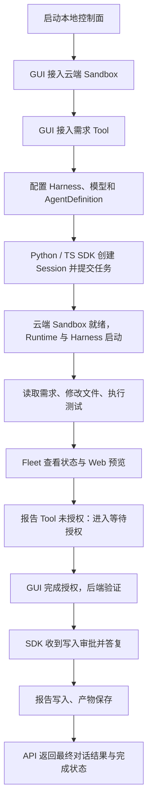

我会设计成 **一条完整的主旅程，加上四类专项验收支线**。主旅程让用户从零配置到拿到真实的 agent 对话结果；支线验证连接管理、组合替换、故障恢复和权限边界。

这条旅程的主角是一位开发者：**在本地启动 Hexagon 控制面，通过 Python 或 TypeScript SDK 驱动云端 sandbox 中的 agent，用 GUI 完成连接配置、授权和运行观察。**

**一、先确定一个能串起产品功能的真实任务**

建议准备一个专用验收项目，让用户提交这样的任务：

> 读取需求服务中的 `ACCEPTANCE-001`，在我上传的示例项目中实现需求，运行规定的测试，并启动 Web 预览。  
> 将测试报告保存为可下载产物；连接报告服务并获得审批后，再把报告写入测试报告服务。  
> 最后用中文说明完成了什么、测试结果如何，并返回产物和预览入口。

验收项目应当具备固定输入与明确结果，例如：

- 一个带有待实现筛选功能的小型 Web 应用。
- 一组固定测试，能够客观判断功能是否完成。
- **需求 Tool**：需要凭证，首次初始化时通过 GUI 接入。
- **报告 Tool**：需要凭证，故意留到运行过程中再授权；写入操作需要审批。
- 一个隔离的测试报告服务，可以核对实际写入次数及内容。

这样可以让凭证接入、运行中授权、工具审批、文件操作、执行事件、Web 预览和最终回复都有实际用途。

模型配置使用用户提供的 MiniMax 端点和凭证，由所选 Harness 直接调用。整个旅程沿用我们已经确定的模型配置边界。

**二、主旅程：从首次启动到成功返回对话结果**



| 阶段 | 用户如何操作 | 用户应该看到什么，以及如何判定通过 |
|---|---|---|
| **1. 首次启动** | 按 README 启动本地控制面，打开 Console，运行健康检查。 | API、worker、数据库和凭证后端状态明确；得到可供 SDK 使用的 API 地址与访问方式。重启后初始化配置仍存在。 |
| **2. 创建 Sandbox Connection** | 在 GUI 选择云端 provider，填写账号/区域等配置和凭证，执行验证并启用。 | 显示连接、认证、权限及已验证操作的结果；生成连接 ID。凭证脱敏，保存成功和验证成功分别显示。 |
| **3. 首次接入需求 Tool** | 在 Tool Connections GUI 中输入凭证或完成授权，验证后保存。 | 显示目标账号、资源范围和 `ready` 状态。后端能够实际读取验收需求；失败的连接不能被当作可用连接绑定。 |
| **4. 选择执行组合** | 通过 API/SDK 查询 Harness、provider 和能力，配置用户模型，注册或选择 AgentDefinition。 | 能明确知道该组合是否支持工具调用、审批、文件操作、持续运行与 Web 预览。必需能力缺失时，在启动任务前给出原因。 |
| **5. 创建 Session** | 用 Python 或 TS SDK 指定 AgentDefinition、Sandbox Connection、工具绑定、资源和网络配置。 | 返回稳定的 Session ID；能够查询选择的 Harness、配置版本、连接及资源绑定。 |
| **6. 提交输入与任务** | 上传示例项目，使用幂等键提交任务，并订阅事件。 | 返回 Run ID。相同提交请求重试仍对应同一 Run；输入文件最终出现在目标 workspace，内容与上传文件一致。 |
| **7. 自动准备环境** | 用户观察 SDK 事件和 Fleet，无须手动进入 sandbox 安装 agent。 | 能看到 sandbox 创建、Runtime 就绪、Harness 启动和任务开始的进展。Fleet 分别显示资源状态、Harness 状态与 Run 状态。 |
| **8. Agent 实际执行** | Agent 读取需求、修改项目并执行测试。 | SDK 和 Fleet 能展示工具进度、输出与错误；文件确实改变，规定测试确实执行。验收证据来自实际文件和测试报告。 |
| **9. 打开预览** | 用户从 Fleet 实例详情打开 Web 预览。 | 页面可访问，能操作刚实现的功能；预览归属于正确实例，并具有明确的访问权限和有效期。 |
| **10. 运行中补授权** | Agent 尝试使用尚未连接的报告 Tool；用户从返回的 GUI 入口完成接入。 | Run 明确进入等待授权，SDK 和 Fleet 显示一致。后端验证连接就绪后继续原任务，不要求用户重发整个任务。 |
| **11. 处理审批** | SDK 收到报告写入审批，用户或调用方通过 API/SDK 明确批准。 | 审批请求关联正确的 Run、工具和操作。在批准前没有发生写入；批准后继续执行。当前不要求新增审批 GUI。 |
| **12. 收到最终结果** | SDK 消费到完成事件，并调用查询接口读取结果。 | 返回最终 assistant 消息、明确的 Run 终态、测试报告与产物引用。查询结果与事件流一致，客户端稍后重新查询仍能拿到结果。 |

这里有两个细节需要放进主旅程，而不是留到后面猜测。

**第一个是订阅断线。** 在第 8 阶段主动断开 SDK 的事件连接，再按事件游标恢复。预期执行继续，重连后能补齐事件或明确报告缺口，不能因此重新提交任务、创建第二个 Run。

**第二个是“任务结束”和“预览服务仍然运行”的区别。** 构建、测试和报告写入完成后，Run 可以结束；用于预览的 Web 进程可以按 Session 生命周期继续存在。两者的状态需要分别表达。

**三、最终成功结果应当长什么样**

用户最终应当收到一段有事实依据的对话结果，例如：

> 已完成需求中的筛选功能，规定测试全部通过。  
> 修改文件和测试结果见附带报告；你可以下载变更补丁，或打开预览检查交互。  
> 测试报告已写入已授权的报告服务，记录编号为……。

API 同时提供可供程序处理的信息。下面是**拟议结构示意，并非当前已实现接口或实测结果**：

```json
{
  "session_id": "session_example",
  "run_id": "run_example",
  "status": "completed",
  "output": {
    "role": "assistant",
    "text": "已完成筛选功能，规定测试通过。报告已写入测试报告服务。"
  },
  "artifacts": [
    {
      "id": "artifact_patch",
      "name": "changes.patch"
    },
    {
      "id": "artifact_tests",
      "name": "test-results.json"
    }
  ],
  "preview": {
    "id": "preview_example",
    "status": "available"
  },
  "last_event_id": "event_example"
}
```

**成功判定要同时满足三个层面：**

1. **执行成功**：功能修改、测试和已批准的工具操作有可核对的结果。
2. **协议成功**：Run 明确进入完成状态，最终消息、产物和事件关联一致。
3. **用户成功**：用户能读到回复、下载产物、查看有效预览。

提交请求返回 Run ID，只代表任务被接受；只有这三个层面都成立，才算主旅程完成。

随后再发送一句：

> 把刚才的修改总结成三句话，并指出主要修改文件。

这条追问应该沿用同一个 Session，创建新的 Run，复用仍有效的环境和工具连接。这能验证产品确实支持连续对话，而不只是一轮任务调用。它依赖当前会话和 workspace，不引入额外的 Memory 产品能力。

**四、Python 与 TypeScript 都要完整走一遍**

我建议把这条旅程实现成一份语言无关的验收场景，然后分别提供：

```text
acceptance/
  scenarios/
    complete-agent-task/
  clients/
    python/
    typescript/
```

两种 SDK 都需要独立完成：

- 创建 Session、上传输入、提交 Run。
- 订阅事件、断线续接。
- 处理等待授权事件和审批请求。
- 查询最终结果、获取产物、发送追问。
- 取消任务和关闭 Session。

再加一项交叉验证：**Python 创建的 Session，TypeScript 可以读取并继续交互；反过来也成立。** 同一可写 workspace 仍保持 Run 串行执行。

**五、四类专项支线，把其余规划功能覆盖完整**

单条正常旅程无法充分证明删除、失败恢复和所有组合，因此需要以下支线。

| 验收支线 | 必须覆盖的用户动作 | 通过标准 |
|---|---|---|
| **A. 连接管理与凭证生命周期** | 修改连接配置、替换凭证、重新验证、停用连接、尝试删除有依赖的连接；清理依赖后删除。另测 Tool 授权拒绝、过期和重新认证。 | 配置更新可见；停用阻止新调度但保留旧资源管理能力；有依赖时删除被阻止；最终删除连接不会误删供应商账号或共享凭证。 |
| **B. Harness / Sandbox / 自定义接入** | 用同一类 SDK 调用选择其他已支持 Harness、其他云端 Sandbox，并注册自定义 Harness 包。 | 业务调用结构稳定；能力和不兼容原因明确；新组合使用新 Session，保留各自版本与资源绑定。每个公开支持组合都有实际验证记录。 |
| **C. 中断、取消与恢复** | SDK 断线、worker 重启、Runtime 失联、任务取消、创建超时、资源删除失败。 | 能区分连接断开、进程故障和资源状态；不会盲目重复执行；取消有明确结果；清理失败可见且可继续核对。 |
| **D. 权限、网络与预览边界** | 使用另一身份访问 Session、连接和产物；访问允许与禁止的网络目标；尝试打开过期或无权限的预览。 | 访问结果符合策略；网络限制有实际执行证据；敏感数据不会跨作用域暴露；未知状态不会被呈现为成功。 |

多 Harness、多 Sandbox 的验证要按**声明支持的组合与能力**展开：

- 主旅程选择具备完整工具、审批和 Web 预览能力的组合。
- 无预览能力的组合验证对话、执行、产物和状态，并明确显示“预览不支持”。
- 声明支持暂停、恢复、快照或桌面画面的组合，增加相应专项场景。
- 每种纳入支持范围的凭证 Tool，都要实际走通其 GUI 接入方式。

这能保持覆盖完整，同时避免把某一种 provider 的能力强加给所有实现。

**六、结果返回之后，还要验收资源收尾**

用户拿到对话结果后，通过 API 关闭 Session，验证：

1. 已完成的对话和导出的产物仍可按保留策略查询。
2. sandbox 按策略停止或销毁，provider 侧的实际资源状态与平台记录一致。
3. 预览入口失效，相关端点按声明能力撤销。
4. Fleet 正确显示已结束和资源清理状态。
5. 解除实例依赖后，Sandbox Connection 才能被删除。
6. 测试账号下没有本次验收遗留的无主资源。

**我会用这份证据清单作为最终签收依据：**

| 证据 | 要证明什么 |
|---|---|
| 初始化与接入操作记录 | 新用户确实能完成配置 |
| Session / Run / Sandbox / 原生会话绑定 | 整条链路关联正确 |
| SDK 事件与最终查询结果 | 对话协议和状态一致 |
| 实际文件差异与测试报告 | Agent 完成了任务 |
| 授权、审批及报告服务记录 | 凭证与外部操作受控 |
| Fleet 详情与预览操作记录 | GUI 实际可用 |
| 两种 SDK、各支持组合的执行报告 | 可复用能力已经验证 |
| Provider 侧资源清理结果 | 生命周期完整闭环 |

为了让后续开发可重复验证，授权等待、审批、断线、超时等场景先用 Scripted Harness 和受控测试服务稳定触发，再用真实 Harness、MiniMax 和云端 sandbox 跑通。**确定性测试负责证明机制，真实端到端测试负责证明这些机制能共同完成用户任务。**