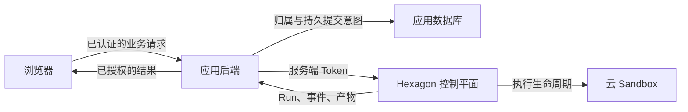
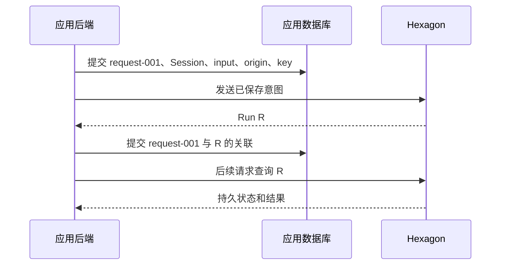
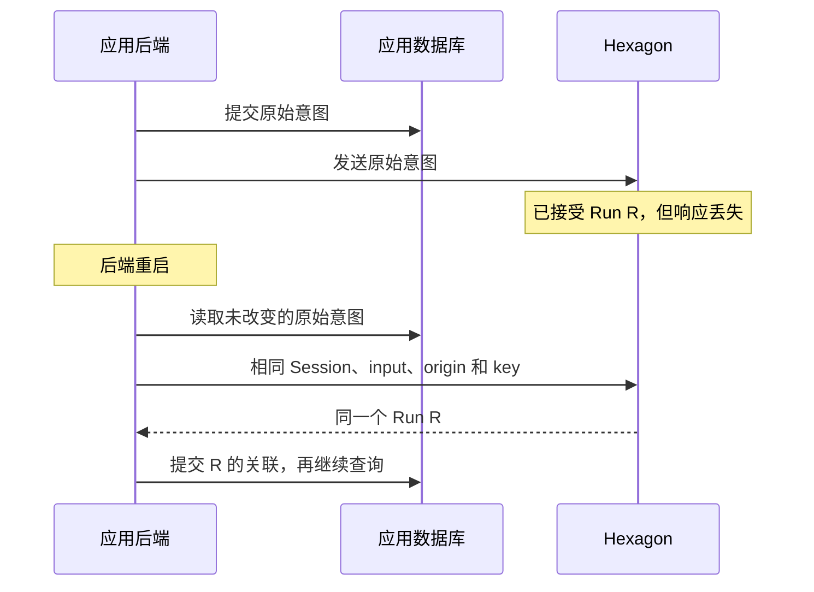

将 Hexagon 客户端放在应用后端，由后端验证业务用户、保存 Session / Run 标识并向前端提供结果。浏览器通过你的应用访问任务，不持有控制平面的管理凭据。

本指南适用于已完成[首个 Session](/zh-CN/start/first-session)的开发者。需要一个持久数据库，以及已验证和启用的 Sandbox / 模型连接。示例只展示 SDK 调用；应用数据库事务、用户登录和业务权限由你的后端实现。

## 发起请求前分清职责



应用后端决定业务用户是否有权访问任务、Session、Run 或产物；Hexagon 验证自己的租户边界并管理执行。两层检查都需要：Alice 与 Bob 共用一个应用 Token 时，Hexagon 无法据此判断你的接口应向谁展示哪些业务记录。读取和修改前都要检查业务归属，包括订阅事件和代理下载。Hexagon Token 留在服务端，浏览器取得应用后端授权后的响应。

## 保存业务关系

至少保存以下记录；字段名是应用设计建议，不是 Hexagon 数据库 schema：

| 应用记录 | 保存内容 | 用途 |
| --- | --- | --- |
| 工作上下文 | 业务用户 / 工作区 ID、业务任务 ID、Hexagon Session ID | 每次读取和操作先检查业务归属 |
| 提交意图 | 业务请求 ID、Session ID、完整 input、origin、幂等键 | 响应丢失后重试同一次提交 |
| 执行结果 | Run ID、最后观察到的状态、结果引用 | 后端重启后继续查询 |
| 观察进度 | Run ID、最后持久化的事件游标 | 恢复流并去重 |
| 资源回收 | Session ID、关闭意图、最后确认状态 | 追踪未完成的清理 |

不能仅检查“用户提交了一个合法格式的 Session ID”。先在应用数据库中确认它属于当前业务用户，再调用 Hexagon。即使多个用户共用同一个控制平面租户，也需要这层检查。

## 初始化客户端

本机开发可以使用 `Hexagon.local()`。后端连接远程控制平面时，使用服务器端配置的 URL 和应用 Token。

Python：

```python
import os
from hexagon import Hexagon
client = Hexagon(os.environ['HEXAGON_API_URL'], os.environ['HEXAGON_API_TOKEN'])
```

TypeScript（独立应用中安装本地构建的 SDK 包）：

```typescript
import { Hexagon } from '@hexagon/agent-sdk';
const apiUrl = process.env.HEXAGON_API_URL;
const apiToken = process.env.HEXAGON_API_TOKEN;
if (!apiUrl || !apiToken) throw new Error('Missing server-side Hexagon configuration');
const client = new Hexagon(apiUrl, apiToken);
```

应用 Token 用于其被允许的操作。连接管理、注册和审批等操作需要核对各自权限，不能假设执行 Token 具有全部管理能力。不要将 Token、Authorization header 或原始 Provider 凭据写入请求日志。

## 创建上下文并提交

首次业务任务使用直接 Session 创建：

```python
session = client.create_session(
    harness={'id': 'pi', 'version': '1.5.2'},
    sandbox_connection_id=sandbox_connection_id,
    model_connection_id=model_connection_id,
)
# 将 session['id'] 保存到已经验证归属的业务记录，然后再提交任务。
run = client.submit(session['id'], saved_input, saved_idempotency_key,
                    origin={'request_id': saved_business_request_id})
# 将 run['id'] 保存到同一业务请求记录。
```

```typescript
const session = await client.createSession({
  harness: { id: 'pi', version: '1.5.2' },
  sandbox_connection_id: sandboxConnectionId,
  model_connection_id: modelConnectionId,
});
// Persist session.id against the authorized business record before submission.
const run = await client.submit(session.id, savedInput, savedIdempotencyKey,
  { request_id: savedBusinessRequestId });
// Persist run.id against the same business request.
```

上述 `saved*` 值应来自你已持久化的提交意图，不是在每次 HTTP 重试时重新生成。`origin` 有助于关联来源，但不能代替鉴权或幂等键。当前请求哈希包含 input 和非空 origin；同一个 key 使用不同 input 或 origin 会得到 `idempotency_conflict`。

业务数据库与 Hexagon 不共享事务。要显式处理“远端接受了请求，但本地尚未保存响应”的间隙：保存提交意图 → 发起请求 → 保存响应。Run 提交响应丢失时，使用相同 Session、input、origin 和 key 再次调用；不能换 key 来绕过错误。

Session 创建没有相同的 Run 幂等键契约。创建结果未知时进入调查状态，先通过 Console / Session 查询查明归属和资源，避免直接循环创建。生产应用应将这类待调查记录放进可观察的恢复队列。

## 正常提交与响应丢失后的恢复

以下时序从应用已经保存归属明确的 Session 关系开始。`request-001` 代表一次业务意图；用户以新任务继续工作时，建立新的意图与 key。





超时不能证明 Run 被拒绝。有 Run ID 时查询该 Run；没有 Run ID 时，按上述路径恢复已经提交到数据库的 Run 意图。旧 key 配合新输入产生的是意图冲突，不能为了绕过冲突就生成新 key。新 key 表示新工作，原 Run 结束后可能因此创建第二个 Run。这套恢复方式不适用于盲目重复创建 Session、Tool 副作用或结果未知的云资源操作。

## 可运行的持久提交示例

[backend-intents.py](https://github.com/NexusFox88/hexagon-docs/blob/main/resources/examples/documentation/backend-intents.py)使用应用自己的 SQLite 保存上下文归属、业务请求、完整 input / origin、幂等键和 Run ID。它把数据库部分与 Hexagon SDK 调用明确分开，适合观察后端重启和响应丢失之间的边界。需要先安装 Python SDK，并已有一个归属明确、可继续工作的 Session；不要使用已经关闭的首个教程 Session。

下面每条命令都是独立进程。使用私有目录保存数据库和输入文件，将 YOUR_SESSION_ID 换成后端已确认的 Session：

```sh
mkdir -p .local/docs-backend
chmod 700 .local/docs-backend
.local/docs-example-venv/bin/python examples/documentation/backend-intents.py --database .local/docs-backend/intents.sqlite --user alice bind --session YOUR_SESSION_ID
cat > .local/docs-backend/input.txt <<'TASK'
List the files in the workspace without changing them.
TASK
.local/docs-example-venv/bin/python examples/documentation/backend-intents.py --database .local/docs-backend/intents.sqlite --user alice prepare --session YOUR_SESSION_ID --request request-001 --input-file .local/docs-backend/input.txt
.local/docs-example-venv/bin/python examples/documentation/backend-intents.py --database .local/docs-backend/intents.sqlite --user alice submit --request request-001
.local/docs-example-venv/bin/python examples/documentation/backend-intents.py --database .local/docs-backend/intents.sqlite --user alice status --request request-001
```

`prepare` 先提交本地事务，不调用 Hexagon。`submit` 用保存的意图调用 SDK，再保存 Run ID；若响应丢失，再执行同一 submit 命令即可重发相同意图。已保存 Run ID 时，submit 直接查询它。`status` 不发送新任务；没有 Run ID 时返回 `submission_not_confirmed`，不能据此断言远端未接受。

CLI 的 `--user` 是演示参数，**不是身份认证**。真实 HTTP handler 必须从已认证会话取得用户身份；`bind` 只能由可信的 Session 创建响应处理流程调用，不能开放给用户自行认领任意 Session。示例不实现 Session 创建对账、前端事件服务、任务队列或关闭调度；仍按本页对应流程处理。数据库保存原始输入，应按业务敏感数据管理，不上传或打印整库。

[检查记录](https://github.com/NexusFox88/hexagon-docs/blob/main/resources/testing/evidence/2026-11-20-backend-intents-example.json)使用真实 SQLite 和模拟 SDK，验证了响应丢失、重启、精确重发、已知 Run 查询、跨用户拒绝与意图冲突。它没有调用真实控制平面，也没有证明双 SDK 实云旅程；TypeScript 的 SDK 调用对照见上文，其应用数据库事务由集成方实现。

无需安装 SDK 或配置云凭据，即可运行离线持久化检查：

```sh
python3 -B examples/documentation/check-backend-intents.py
```

检查使用临时 SQLite 文件和模拟远端服务，验证本示例的恢复与归属检查，不证明服务端幂等实现或生产并发流量行为。

## 查询与前端交付

后端根据保存的 Run ID 调用 Python `client.run(run_id)` 或 TypeScript `await client.run(runId)`。把 `queued`、执行中、等待授权 / 审批、终态分别呈现，不把所有非完成状态都画成错误。

流式更新由后端订阅并转发。前端连接断开只表示观察中断，不能自动触发取消。终态以持久查询为准；返回产物前再次检查业务权限。预览 URL 是受时限约束的访问凭据，不应进入公共日志。

### 通过已授权的应用接口交付产物

SQLite 示例还提供库方法 `store.deliver_artifact(client, user, request, artifact_id)`。HTTP 处理器从已认证会话中取得 `user`，解析业务请求，再调用此方法后写入下载响应。该方法返回经过校验的字节，CLI 有意不打印文件内容。

该方法在远端调用之前检查业务归属，确认已保存 Run 仍属于已保存 Session，要求 Run 已到终态，从该 Run 的导出列表中查找目标产物，核对产物的 Run / Session 关联，并验证字节数和 SHA-256。它不会把导出名称用作本地路径。失败或取消的 Run 也可能产生有用产物：方法允许交付其经过验证的文件，但 UI 仍须展示真实 Run 结果，并按业务任务的成功标准判断是否完成。

拒绝活动 Run 是此示例的交付策略，底层 API 仍允许在执行期间列出已导出文件。进度事件和已稳定结果的交付应分别处理。未知产物、错误关联或完整性失败不能被转换为一次成功的空文件下载；将这些失败映射到应用自己的响应契约，并保留私有诊断上下文。

使用应用选定的安全文件名和 `application/octet-stream` 将内容作为附件返回，不要在应用自身 origin 下直接渲染生成的 HTML。每次下载和事件订阅都重新核对已认证用户。如果产品支持分享或归属转移，应明确实现相应授权策略，不能把持有 Run / 产物 ID 当作权限。

[交付检查记录](https://github.com/NexusFox88/hexagon-docs/blob/main/resources/testing/evidence/2026-11-20-backend-artifact-delivery-review.json)使用真实临时 SQLite 和模拟 SDK，覆盖重启后交付、跨用户与无关产物拒绝、远端关联错误、活动 Run 拒绝、字节损坏，以及原有提交恢复流程。它没有实现登录、生产 HTTP 下载接口、大响应流式交付或对应的 TypeScript 数据库集成。

## 并发与清理

一个 Session 只允许一个活动 Run。遇到 `session_busy`，可以在应用层保存待发送消息，在前一 Run 结束后再提交；这是你的应用队列，不是平台自动排队。独立任务可使用独立 Session，前提是账户配额允许。

为每个 Session 定义明确的关闭责任，例如用户结束工作或业务任务达到保留期限。先处理活动任务，再显式 close，并记录确认结果。进程退出钩子不能作为唯一清理机制；服务异常退出时仍需从数据库恢复未完成关闭。

### 持久化并恢复关闭意图

可运行示例将清理与提交分别存储。决定关闭某个工作上下文后，使用其已有、已确认业务归属的 Session ID：

```sh
.local/docs-example-venv/bin/python examples/documentation/backend-intents.py --database .local/docs-backend/intents.sqlite --user alice request-cleanup --session YOUR_SESSION_ID
.local/docs-example-venv/bin/python examples/documentation/backend-intents.py --database .local/docs-backend/intents.sqlite --user alice cleanup-status --session YOUR_SESSION_ID
.local/docs-example-venv/bin/python examples/documentation/backend-intents.py --database .local/docs-backend/intents.sqlite --user alice cleanup-step --session YOUR_SESSION_ID
```

`request-cleanup` 提交一条 `requested` 记录，不联系 Hexagon。此后通过该存储执行的 prepare / 新提交会被拒绝；已保存 Run 的查询和经过验证的产物交付仍可使用。重复执行不会覆盖已有记录，包括已经确认的状态。

`cleanup-step` 先查询同一个 Session。若已关闭，直接记录 `confirmed`，不再发送关闭请求；否则发送一次 close，再次查询，只有读取到 `closed` 才确认。发生错误时保留持久化意图，只记录异常类名，不保存可能含敏感信息的异常文本。调查错误后可以针对同一 Session 再执行该命令。命令没有自动重试循环，也不直接调用 Provider 删除资源。

| 结果 | 恢复方式 |
| --- | --- |
| 关闭响应丢失，但查询显示 Session 已关闭 | 确认已保存意图，不创建另一个工作上下文 |
| `session_busy` | 等待活动任务结束；或按用户意图显式请求取消，观察终态后再尝试关闭 |
| 创建 / 检查点 / 删除结果未知 | 检查已有资源操作并遵循[对账流程](/zh-CN/operate/reconciliation)，保留全部原始 ID |
| 查询失败或找不到 Session | 保留未解决意图；检查地址、租户和已保存关联，不能把缺少响应解释为清理成功 |

该命令提供可观察的单次清理操作，不是后台调度器。生产 worker 需要有界退避、监控和待处理记录的执行归属；多个 worker 之间还需协调提交准入与关闭意图。示例的本地检查不是分布式锁，不能消除已经发出的提交请求产生的竞态，Hexagon 的活动 Run 检查仍然必要。

[清理示例检查](https://github.com/NexusFox88/hexagon-docs/blob/main/resources/testing/evidence/2026-11-20-backend-cleanup-review.json)使用真实 SQLite 和模拟 SDK，验证重启持久化、阻止后续新任务、关闭响应丢失恢复、失败保留以及跨用户拒绝。它不证明真实云删除或生产并发调度器已经完成；应用清理记录应与控制平面的资源操作证据共同保留。

## 验收你的集成

- 用两个业务用户验证不能互读或操作对方任务。
- 在提交响应丢失后重发同一意图，确认返回同一个 Run。
- 重启应用后按已存 Run ID 查询，而不是创建新任务。
- 断开前端并重新连接，确认原 Run 继续且事件不重复显示。
- 关闭 Session 后确认资源状态，并仍可读取已导出产物。

这些是集成验收要求，不是本文示例已完成的实云测试声明。实现依据：[Run 提交](https://github.com/NexusFox88/hexagon-docs/blob/main/resources/modules/execution/runs.ts)、[Token 认证](https://github.com/NexusFox88/hexagon-docs/blob/main/resources/modules/credentials/api-auth.ts)、[SDK](https://github.com/NexusFox88/hexagon-docs/blob/main/resources/sdk/README.md)、[HTTP 契约](/zh-CN/reference/http)。下一步：[连续多轮工作](/zh-CN/build/multi-turn)、[流式事件](/zh-CN/build/stream-events)、[请求恢复](/zh-CN/build/recovery)。
