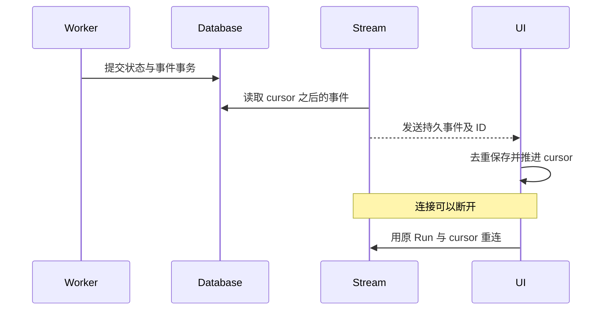
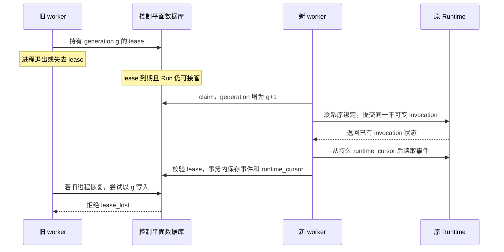
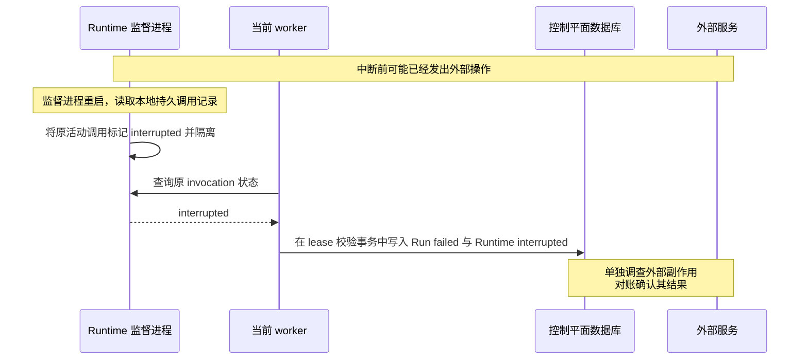

Hexagon 的运行状态和事件保存在控制平面数据库中。客户端读取的是持久执行记录，而不是依赖一条永远在线的连接来维持任务。

## 写入顺序为什么重要

状态变更与相关事件在事务中保存，然后供流式或分页接口读取。这样客户端断线不会让已经提交的状态变化消失。服务端在观察到终态后再次补读事件，避免最后一个事件在空页与终态查询之间被遗漏。

应用保存事件和消费位置时同样需要协调。仅在内存中保存游标，重启后可能重放；先保存游标再丢失事件会漏掉界面记录。按 Run/event ID 去重通常比追求网络上绝不重复发送更可靠。

## 三类恢复不能混为一谈

| 故障 | 可以确定什么 | 恢复方式 |
| --- | --- | --- |
| 客户端断线 | 只知道观察中断 | 重连原 Run，补读事件，查询终态 |
| worker 重启 | 控制平面进程丢失，但数据库仍有执行记录 | 新 worker 根据 lease 和持久 invocation 协调恢复 |
| Runtime 中断 | Sandbox 侧执行监督进程丢失，先前活动 invocation 不能视为安全重放 | 隔离旧调用，记录失败 / interrupted，调查外部副作用 |

worker 使用 lease 和 generation fencing，过期 worker 不能任意覆盖新持有者的状态。这个机制约束控制平面写入，不意味着外部服务也参与同一数据库事务。

## unreachable 与 interrupted

Runtime unreachable 表示暂时无法确认远端状态。进程可能仍运行，因此不能重新安装 Harness 或再发送一份有副作用的任务来“修复”。恢复流程优先联系原绑定和不可变 invocation。

Runtime interrupted 表示观察到了监督进程中断相关状态。它与单纯网络不通不同，旧活动调用被隔离；已发出的工具操作仍可能需要对账。已知中断工作区不被当作普通空闲唤醒直接重用。

## worker 重启：接管观察与协调，不重新创建任务

下面描述已经初始化 Runtime、且 invocation 意图已经持久化的恢复路径。首次准备目录、启动监督进程的恢复边界另见[初始化](/zh-CN/concepts/initialization)。

接管需要数据库可用、符合接管条件的 Run 和可工作的 worker；它不是对恢复时长的保证。Runtime 不可达时，控制平面保留执行记录，记录恢复需求，不能据此宣布任务已停止。重新发送相同的不可变 invocation 是恢复协议中的幂等定位动作；不应由业务应用重新提交一份新 Run 来替代它。

这里存在两个不同的消费位置：

| 游标 | 消费者 | 表达什么 |
| --- | --- | --- |
| 内部 `runtime_cursor` | 控制平面 worker | 哪些 Runtime 事件已导入控制平面 |
| 公共事件 `id` / `after` | 应用客户端 | 哪些控制平面持久事件已被应用处理 |

两者不共享编号空间，也不能互相代用。Runtime 事件导入按来源游标去重，并与内部消费位置一起提交；公共流还包含控制平面自身产生的事件。应用保存公共 ID 为十进制字符串，不将其转换为 JavaScript `Number`，也不要求相邻 ID 连续。

## Runtime 中断：已观察到中断，不能恢复为一次全新执行

这个失败结论描述执行监督中断，不证明模型或 Tool 的所有副作用都未发生。即使 Run 原来处于 `cancelling`，观察到 Runtime interruption 也先记录 `runtime_interrupted` 失败，而不是声称取消已确认。旧调用不能作为新任务安全重放；新任务的设计应先核对已有工作区、产物和外部结果。

## 恢复启动不等于重放任务

决定哪些动作可以重复之前，worker 会读取持久化 Runtime binding，并检查这个 Run 是否已有 invocation 记录。

| 已观察到的边界 | 控制平面的恢复行为 | 不因此获得的权限 |
| --- | --- | --- |
| `reserved`／`preparing`，或恢复准备阶段 | 重做目录／文件准备，再保存启动意图 | 重复已派发的外部 Tool 写入 |
| 启动结果不确定，当前 Run 没有持久 invocation | 先检查 Runtime 健康；不可达时检查 supervisor 锁。只有明确空闲才允许再次通过锁保护启动 | 因超时或锁探测返回异常就再次启动 |
| 启动结果不确定，但 invocation 已保存 | 检查原 Runtime，不走无 invocation 的重启路径 | 将原任务作为新 Run 启动 |
| 既有 binding 为 `ready`／`unreachable` | 恢复原不可变 invocation 与其事件位置 | 重新安装输入，或假定进程状态丢失 |
| 已观察到 invocation／工作区 `interrupted` | 隔离并报告失败，保留记录供调查 | 自动把工作区当作健康状态，或重新派发待处理 mailbox 写入 |

进程锁防止通过此 launcher 启动两个 supervisor 监听器。它不证明模型调用 exactly-once，不保留任意进程内存，也不结算远程写入。即使允许启动 supervisor，重启后的 supervisor 仍可能发现旧活动 invocation 记录并将它们隔离。

本地自动化检查使用 fake connector 或临时本地记录，覆盖空闲／占用／异常锁结果、原服务已健康、launcher 互斥和中断隔离。它们支持这些具体机制，不代表每个云 Provider 都能承受所有故障。实现：[worker 启动分支](https://github.com/NexusFox88/hexagon-docs/blob/main/resources/modules/execution/worker.ts)、[Runtime client 对账](https://github.com/NexusFox88/hexagon-docs/blob/main/resources/modules/sandboxes/runtime-client.ts)、[Runtime 隔离](https://github.com/NexusFox88/hexagon-docs/blob/main/resources/runtime/server.py)。

## 客户端应从哪里继续

应用重连时使用原 Run ID 和最后一个**已持久处理**的公共事件 ID。分页返回空列表只说明那次读取没有新事件；它不是 Run 终态。SSE 的 `stream.end` 是无持久 ID 的传输结束通知，不应推进消费游标。断流、心跳或没有新输出都不能单独证明完成。

一个具体例子：应用已收到事件 `104`，但数据库事务尚未提交就崩溃。恢复后仍从已提交的 `103` 读取，让 `104` 再次到达并按 Run/event ID 去重。如果先把游标写成 `104` 再保存内容，崩溃可能让内容永远被跳过。若处理事件还会发送邮件等外部操作，本地事件去重也不能保证该外部操作 exactly-once；需要该操作自己的幂等或对账机制。

能区分“继续观察原 Run”“接管原 invocation”“核对已发生的副作用”，就具备了选择恢复路径所需的概念基础。实际操作见[恢复指南](/zh-CN/build/recovery)、[远程结果对账](/zh-CN/operate/reconciliation)和[事件与状态参考](/zh-CN/reference/events-and-states)。以上时序来自实现审阅，不代表本轮进行了真实故障注入。补充依据：[worker 恢复](https://github.com/NexusFox88/hexagon-docs/blob/main/resources/modules/execution/worker.ts)、[Runtime 监督进程](https://github.com/NexusFox88/hexagon-docs/blob/main/resources/runtime/server.py)。

## unknown 不是失败证明

云创建、删除或 Tool 写入可能生效后丢失响应。此时持久操作日志保留意图和标识，供后续核对。网络层错误不能证明“没有创建资源”或“没有写入”。

Run 提交的幂等键只针对该请求边界，不能推出所有第三方写入具有全局 exactly-once 语义。审批记录也不是外部系统事务。必须检查实际调用策略与远端结果。

理解上述边界后，应用可以在中断时显示“正在恢复观察”“执行状态待确认”或“需要对账”，而不是一律显示“失败，请重试”。具体动作见[恢复指南](/zh-CN/build/recovery)，流消费见[事件指南](/zh-CN/build/stream-events)。实现依据：[架构](https://github.com/NexusFox88/hexagon-docs/blob/main/resources/docs/architecture.md)、[执行状态事务](https://github.com/NexusFox88/hexagon-docs/blob/main/resources/modules/execution/runs.ts)、[流路由](https://github.com/NexusFox88/hexagon-docs/blob/main/resources/apps/control-plane/server.ts)。
