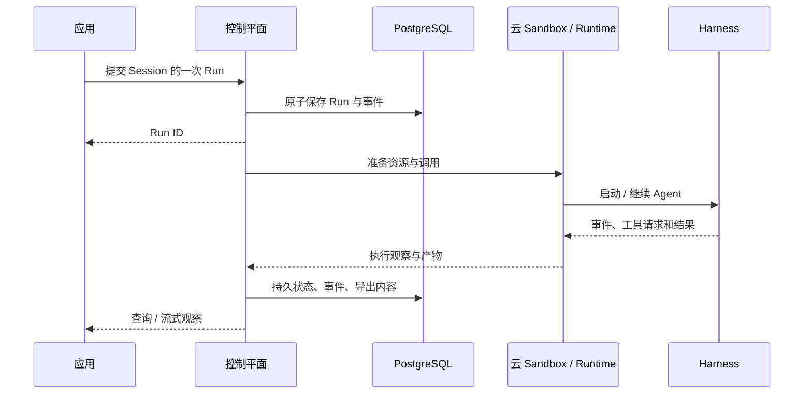
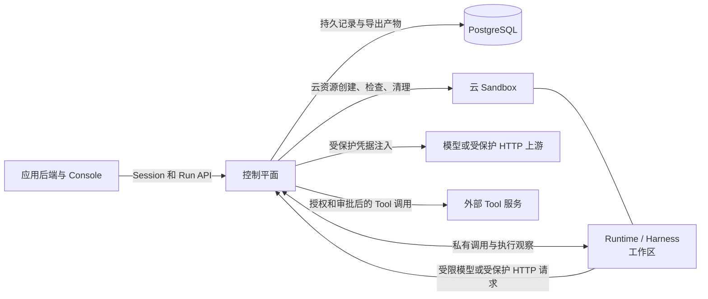
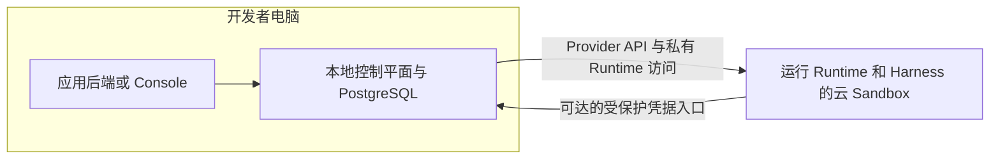
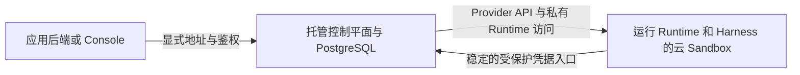

Hexagon 把持久任务管理和云端进程执行分开。理解这个边界，可以判断故障应该在哪一层调查，也能避免扩展时让不同 Provider 的逻辑侵入应用接口。

## 责任分工

| 层 | 拥有的责任 | 不由它决定的事 |
| --- | --- | --- |
| 应用 / SDK | 业务权限、提交意图、结果展示 | 云进程是否已经终止 |
| 控制平面 | Session / Run、调度、云资源操作、凭据、事件、产物 | Agent 的具体推理步骤 |
| Sandbox connector | 云创建、查询、文件、执行、私有访问、清理适配 | 业务 Session / Run 语义 |
| Runtime | Sandbox 内进程监督、Harness 调用与工具桥接 | Provider 账户管理 |
| Harness | Agent 逻辑、模型调用、工具选择、对话格式 | 控制平面的租户和审批规则 |

Console 消费同一控制平面 API。它配置、观察和管理工作，不是另一套独立执行后端。关闭 Console 不会关闭后台任务。

## 一次任务的顺序

工具可能进入授权或审批等待，云操作可能进入未知状态，因此实际流程包含暂停观察和对账分支。图示不是“每个远程请求一定收到响应”的承诺。

## 沿同一个项目任务理解边界

假设你的后端要求 Agent 为上传的项目添加筛选功能、运行测试并导出修改后的文件。业务请求及其与用户的关联由应用后端负责；Session 和 Run 记录由控制平面负责；工作文件与进程位于云 Sandbox；Runtime 监督 Harness，Harness 决定如何执行任务。

箭头表达职责和数据流，不代表只有一个监听端口或一条网络连接。控制平面的管理 API、受保护凭据入口、私有 Runtime 访问分别有自己的鉴权和可达性要求。Provider connector 运行在控制平面侧，不是 guest 中的 Agent 进程。

对这个任务而言，模型响应成功只是一项观察结果。Harness 仍需完成执行，worker 还要解释输出、捕获导出产物，之后才能完成 Run。当前产物实现将元数据和字节保存到 PostgreSQL。未导出的工作区文件受所选 Sandbox 的持久化行为约束。关闭 Session 会清理云资源，保留的 Run 记录和已导出产物仍可查询。

## 两种部署位置，相同的执行边界

### 本地控制平面

SDK 支持的本地发现机制用于找到本地工作区端点和客户端凭据，guest 仍在云中运行。电脑上的 loopback 管理地址不是云端可达的凭据入口：需要为选定执行路径配置独立的开发入口。停止本地控制平面会停止它的 worker 和对账流程，但不能据此证明远程进程或资源都已停止。

### 托管控制平面

hosted 改变控制平面和持久服务的运行位置，不会把 Harness 执行移到 API 服务器。应用后端仍需校验业务用户权限并保护控制平面 Token。两种部署都需要受支持的 Sandbox／Harness／模型组合；图示不代表目录中的每一项都通过了同样的真实云旅程。

## 资源与凭据分别归谁管理

| 资源或权限 | 归属 / 位置 | 对这个任务的影响 |
| --- | --- | --- |
| 业务用户与请求映射 | 应用后端 | 检查哪个用户可读取或继续此 Session；租户校验不等于业务用户权限 |
| Session、Run、lease、事件游标、资源操作账本 | 控制平面与 PostgreSQL | 使用原 ID 恢复观察；API 响应丢失不能证明云资源不存在 |
| Provider 账户凭据与云资源 ID | 控制平面凭据存储及 connector／操作记录 | guest 不接收账户凭据；清理使用原资源身份 |
| Runtime 进程与 Harness 调用 | Sandbox 内 Runtime，配合控制平面持久化的调用记录 | Runtime 监督进程，不管理 Provider 账户 |
| 工作区与原生对话状态 | Sandbox／Harness，依具体适配器而定 | 连续性取决于具体暂停／恢复契约，不普遍保证内存保留 |
| 导出产物字节与元数据 | 当前实现中的控制平面 PostgreSQL | 完成导出后可独立于 Sandbox 保留；不是全部工作区文件的快照 |
| 原始模型与受保护 HTTP 凭据 | 加密的控制平面 Secret 与访问后端 | 代理执行固定上游策略并注入鉴权；guest 可能持有受限委托权限 |
| Tool OAuth 或 API 凭据 | 控制平面连接与 Tool broker | 派发前检查账户授权、操作策略及必要审批 |
| Runtime／Tool bridge 与委托访问 Token | 受限执行通道 | 即使不是原始 Provider／账户凭据，也属于敏感访问能力 |
| 用户普通变量 | 静态加密保存，执行时进入 Harness 环境 | Agent 代码和子进程可读；托管凭据访问应使用受保护连接 |
| 预览票据与 OCI registry 凭据 | 独立的预览和镜像准备路径 | 预览票据授予访问权；registry 鉴权可能交给获准的 Provider builder，不属于普通 Harness 环境 |

模型流量经过受保护凭据通道，Harness 仍需选择兼容的模型协议。访问后端不转换协议，也不判断任务是否成功。broker 管理的 Tools 走另一条路径：Harness 经 Runtime bridge 提交请求，worker 请求控制平面 broker 完成授权／审批／派发，再经 bridge 返回结果。即使 Agent 看不到原始凭据，获准的外部写入仍可能发生。

这里描述的是 Hexagon 管理的连接和 broker 管理的 Tools。任务代码执行的原生 shell 命令和网络请求还受 Sandbox／网络配置边界约束，不能假设任意命令都会被拦截并要求人工审批。委托权限、registry 鉴权与普通变量的区别见[凭据与信任边界](/zh-CN/concepts/security-boundaries)。

## 用边界定位故障

应用断流：先恢复原 Run 的观察。worker 重启：观察持久 lease 和执行恢复。Runtime 不可达：不能推断进程停止。Provider 删除响应丢失：查原操作和资源 ID。模型协议失败：查 Harness 与端点兼容性，而不是更换业务 Session ID 掩盖问题。

读完后，你应能从业务请求追踪到云端执行，指出每类凭据由谁持有，并解释为什么客户端断开不等于取消。下一步：[持久事件与恢复](/zh-CN/concepts/events-and-recovery)、[信任边界](/zh-CN/concepts/security-boundaries)或[贡献者代码地图](/zh-CN/contribute/codebase)。

依据：[实现架构](https://github.com/NexusFox88/hexagon-docs/blob/main/resources/docs/architecture.md)、[执行 worker](https://github.com/NexusFox88/hexagon-docs/blob/main/resources/modules/execution/worker.ts)、[Runtime supervisor](https://github.com/NexusFox88/hexagon-docs/blob/main/resources/runtime/server.py)、[访问授权](https://github.com/NexusFox88/hexagon-docs/blob/main/resources/modules/access/access.ts)、[Tool broker](https://github.com/NexusFox88/hexagon-docs/blob/main/resources/modules/tools/broker.ts)、[产物存储](https://github.com/NexusFox88/hexagon-docs/blob/main/resources/modules/artifacts/artifacts.ts)。
