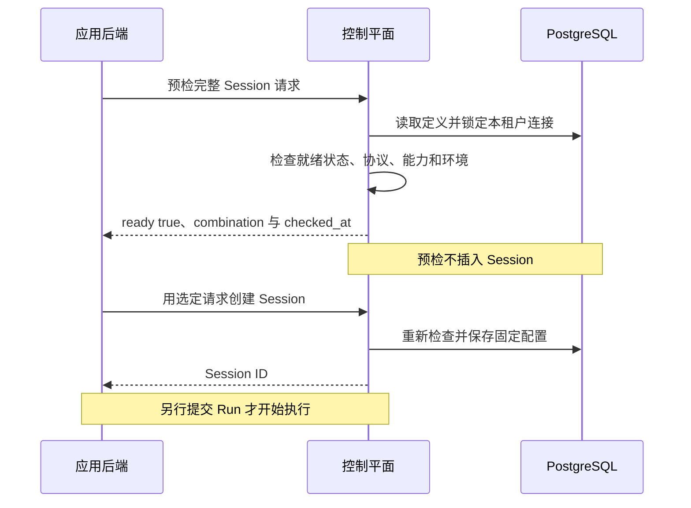
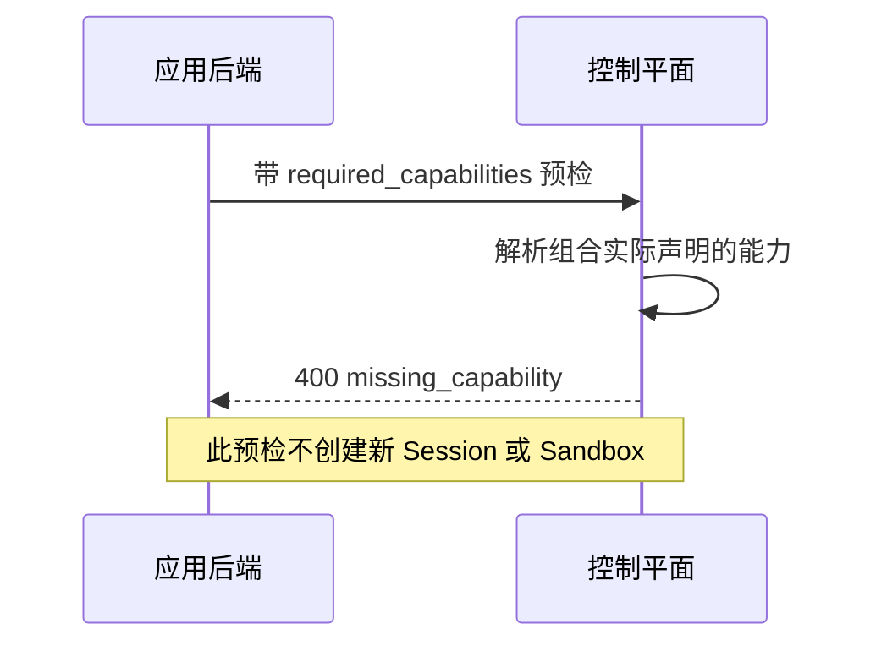
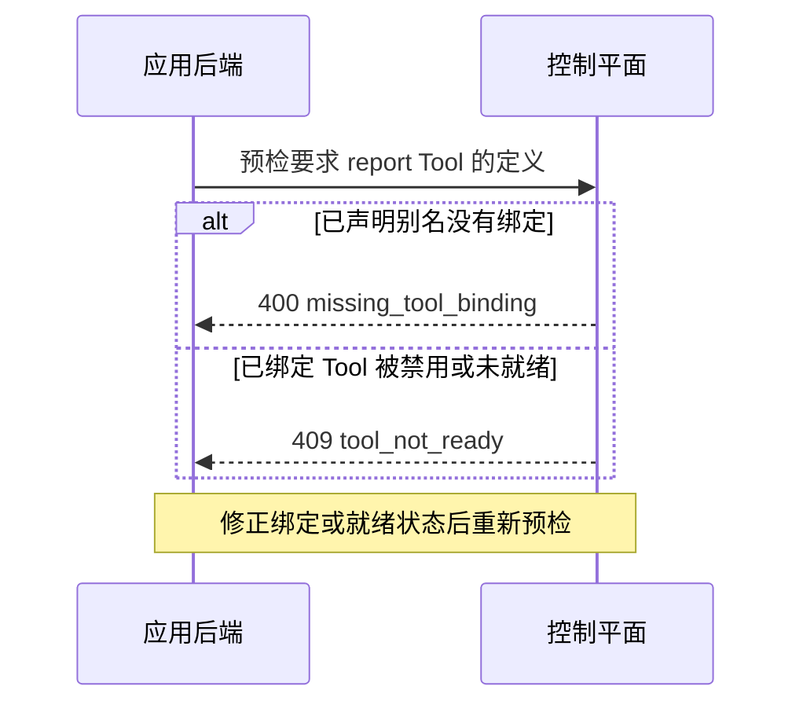

预检回答“当前请求在已知配置和能力上能否开始”；创建 Session 把选定配置固定下来；真正执行时仍需要云账户配额、网络、模型和 Runtime 可用。这三个阶段不能互相代替。

## 创建之前检查什么

控制平面检查连接的租户归属与类型、Sandbox / 模型是否验证并启用、必需工具是否就绪、Harness 版本与协议、初始化支持、OCI 与私有镜像能力，以及网络和 required capabilities。

三种典型结果：

| 请求 | 结果含义 |
| --- | --- |
| 已就绪连接与兼容 Harness | 返回 ready 和组合信息；仍未证明未来云创建成功 |
| OCI Harness 配到不支持 OCI 的 Provider | 执行前拒绝，不静默换成内置 Harness |
| 必需 Tool 未授权 / 未启用 | 初始化不能通过；按需要授权或明确改为可选工具 |

可选 Tool 仍需有效的连接绑定、正确类型和租户归属；它只是允许该工具尚未 ready，不是允许任意缺失连接。

预检不保存新的 Session，也不分配该 Session 的云 Sandbox。它可能检查或恢复凭据入口，因此“没有创建 Sandbox”不代表绝无任何网络准备动作。

## 三条预检路径

以下时序依据实现整理，是示意说明，不是真实 Provider 测试记录。只有前面的检查通过，才可能观察到后面的具体错误；响应报告首个适用失败，不会一次列出所有潜在问题。

### 配置兼容的请求

预检不是资源预留，也不是可复用的授权票据。创建时会按当时的状态重新校验。例如，预检之后连接被禁用，即使请求体不变，创建仍可能失败。云资源分配由执行／生命周期路径启动，不会仅因预检返回 `ready: true` 就发生。

### 缺少必需能力

例如，组合不包含 `snapshot` 却要求此能力时会失败。应选择满足要求的组合；只有产品任务确实不需要该能力时，才移除要求。不能为了让预检通过而删掉真实需求。部分失败有更具体的错误码，如 `sandbox_oci_image_unsupported`；模型协议不兼容和网络策略不支持也分别检查。

### 必需 Tool 不可用

已保存的 Agent 可以先声明 `report`，具体 Session 再绑定连接。缺少绑定与绑定了真实但未完成授权的连接不同。直接 Session 根据传入的绑定生成 Tool 名称声明，因此在那里省略一个 Tool 不会产生隐藏的必需工具。已声明的可选 Tool 也需要有效绑定。可选只推迟就绪要求，不跳过归属、类型检查和派发时授权。操作审批发生在后续具体调用上，预检不会预先批准未来操作。

## 每个阶段究竟证明什么

| 阶段 | 已确定的事实 | 尚未证明 |
| --- | --- | --- |
| 定义／schema 校验 | 字段和行为符合受支持形状，所选 Harness 定义已知 | 连接就绪和未来执行成功 |
| 连接与组合预检 | 当前归属、类型、启用／就绪状态，以及声明的能力／协议策略兼容 | 未来配额、上游可用性、操作审批、完整真实云旅程 |
| 创建 Session | 持久 Session 固定了解析后的配置和版本引用 | Sandbox 分配、进程启动、模型任务成功 |
| 首个 Run 提交 | 通过当前提交检查后接受 Run，包括引用输入文件检查 | worker 准备和 Harness 成功执行 |
| worker 调用与 Tool 派发 | 当前执行和授权检查允许此次动作 | 后续外部响应、副作用结算、产物导出 |

组合的 compatibility 与 verification 字段回答不同问题：支持的组合仍可以处于未验证状态。预检时间戳记录检查时间，不是 Provider 容量租约。

## Agent revision 与连接 version 是两回事

假设 Session A 创建自 Agent revision 2 和 Sandbox 连接 version 5。编辑 Agent 后产生 revision 3，A 仍保留 revision 2。新建 Session 未指定历史 revision 时，解析当前 Agent 定义；显式指定 revision 2 则选择那份已保存定义，但创建时连接 ID 仍解析到当前连接，不会恢复连接 version 5 或旧凭据。

连接禁用后，新的工作受当前就绪检查阻止。配置或凭据变化需要自己的验证和启用流程；重新启用不会改写 A 的初始化快照，也不能保证旧绑定仍可使用。应按实际错误和[连接生命周期规则](/zh-CN/build/connection-lifecycle)处理，不把 revision 当作绕过检查的方式。调整既有任务的行为需要新 Session 或相应的新 Agent revision，不能修改历史快照。

## 创建时固定什么

Session 保存 Harness id/version、可选镜像信息、行为定义、工具和受保护 API 别名、资源与网络策略、连接版本及其配置，以及可选 Agent revision。普通 env 的有效合并值独立加密保存，查询只显示变量名。

`identity` 是行为描述，不是账户身份或权限授权。instructions 和 context 指导 Harness 行为，不能覆盖平台权限。上下文引用的文件还会在 Run 提交时检查存在性、SHA-256 和编码。

## 查询历史快照

Python `client.session_initialization(session_id)` 与 TypeScript `await client.sessionInitialization(sessionId)` 返回版本化快照。Console 的 Initialization 展示同一份有效配置。它在关闭后仍可读取，不能用 Agent 当前定义代替。

快照省略凭据和环境值，所以不是完整可重放备份。用它生成新 Session 时，连接 ID 会解析到当前连接配置和权限。重复相同 ID 不保证重现历史云条件；需要明确重新预检。

## 固定配置不等于冻结所有外部状态

更新模板不会改写现有 Session。禁用 Sandbox 或模型连接仍会阻止新的 Run；配置固定不能绕过当前可用性检查。供应商删除资源、配额耗尽或 Token 失效也不能被快照阻止。

依据：[Session 创建](https://github.com/NexusFox88/hexagon-docs/blob/main/resources/modules/execution/sessions.ts)、[初始化契约](https://github.com/NexusFox88/hexagon-docs/blob/main/resources/docs/session-initialization.md)。下一步：[模板](/zh-CN/build/agent-templates)、[连接生命周期](/zh-CN/build/connection-lifecycle)、[文件上下文](/zh-CN/build/project-context)。

实现细节：[组合解析器](https://github.com/NexusFox88/hexagon-docs/blob/main/resources/modules/execution/compatibility.ts)、[提交检查](https://github.com/NexusFox88/hexagon-docs/blob/main/resources/modules/execution/runs.ts)。继续配置 [Sandbox 资源与网络策略](/zh-CN/build/sandbox-policy)，或查阅 [Session API 契约](/zh-CN/reference/sessions)。
