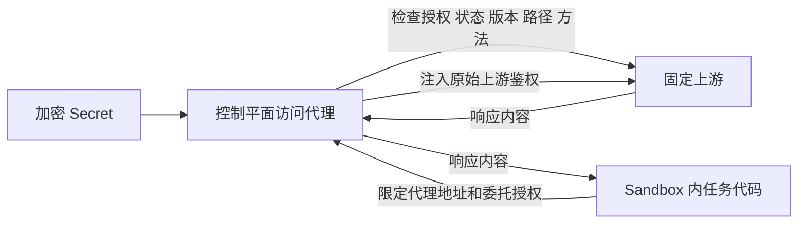

控制平面需要管理云账户、模型和工具，但任务代码不应因此获得这些账户的原始管理凭据。Hexagon 将受保护连接与普通执行配置分开，并在每个资源查询和绑定处验证租户归属。

## 不同凭据走不同路径

| 类型 | 保存 / 使用方式 | 用户需要理解的边界 |
| --- | --- | --- |
| 控制平面 owner / application Token | 客户端鉴权，能力受路由权限约束 | 不向业务前端或 Sandbox 分发持久 Token；应用仍检查业务用户归属 |
| Provider 管理凭据 | 控制平面 connector 使用 | 不作为普通 guest 环境交给 Harness |
| 模型 / 受保护 HTTP 密钥 | 加密连接，由受限访问后端注入上游请求 | guest 获得限定授权或占位，不获得原始账户 key |
| Tool OAuth / Token | 控制平面 broker 调用与刷新 | 操作选择、授权、审批分别生效 |
| OCI registry 凭据 | 元数据解析 / 获准镜像构建拉取 | 镜像分发路径与 Agent 普通环境不同 |
| 用户 env / variables | 加密存储后注入执行环境 | Agent 及其子进程可以读取，不能当作受保护 Secret |
| 预览 ticket | 换取独立 origin 的访问 cookie | URL 本身具有访问能力，不公开记录 |

## Secret、Connection 与绑定

Managed Secret 是写入后不回显值的加密资源。Connection 引用凭据并定义上游位置和策略。Session 绑定授予使用某个连接的能力，不授予读取原始 Secret 值的接口。

受保护代理检查固定目标和请求策略，不接受调用者任意选择上游或转发鉴权 header。委托 token 本身仍是权限，必须限制生命周期；它不等于原始账户密钥。

轮换或禁用会影响后续请求，已经被接受的上游操作仍可能完成。逻辑删除保留历史加密记录，不能作为物理密码学擦除证明。数据库备份需要对应加密密钥，不能分别随意替换。

## 身份与审批

行为定义的 identity / instructions 是提示内容，不是认证身份。租户检查确保资源属于当前控制平面身份；应用若在同一租户中服务多个业务用户，还需自己的归属校验。

授权提供可用账户凭据，审批批准具体操作。普通 application Token 不能提交管理审批决定。取消、撤销授权和删除连接也无法追溯撤回已发生的外部写入。

## 原始密钥不进入 guest，哪些权限仍会进入

受保护模型与 HTTP 调用的共同路径如下。具体配置以预检返回的后端和对应连接策略为准。

基线 `external_proxy` 会让 guest 持有限定的代理授权；这个 token 仍应视为敏感能力。Vercel 的 `external_proxy_with_native_auth` 由原生网络策略注入**委托代理授权**，guest 使用占位值，中央代理仍执行检查。这不是把原始上游 Secret 注入 VM，也不代表其他 Provider 的原生 Secret API 都已实现。

Run 创建的授权受该 Run 的状态约束；显式创建的 Session access grant 则有自己的期限和撤销生命周期。两者都不是永不过期的账户凭据，也不能用来推断应用获得了管理权限。按[Session access 参考](/zh-CN/reference/session-access)查看实际授权范围。

普通 `variables` / `env` 走另一条路径：解密后进入执行环境，任务代码和子进程可以读取。把 API key 放进 variables，即使数据库里加密，也会主动绕过受保护连接所提供的原始密钥隔离。对于 OCI registry，控制平面解析镜像元数据，获准构建路径可能将 registry Secret 交给 Provider 的镜像构建器；“不进入 Agent 环境”不等于“从不离开控制平面进程”。

## 当前身份模型，不是企业角色体系

| 身份或标识 | 实际作用 | 不应据此推断 |
| --- | --- | --- |
| owner | 在所属租户内执行管理路由 | 自动拥有其他租户资源 |
| application Token | 在所属租户内调用允许的执行和读取路由 | 只可访问某个业务用户或单个 Session |
| 本地 Console 浏览器身份 | 通过回环地址、同源与请求检查完成本地 bootstrap | 可复制到远程网页使用的公共登录机制 |
| 应用业务用户 ID | 由你的后端映射并校验资源归属 | Hexagon 自动实现你的团队 RBAC |
| Agent identity / instructions | 定义执行行为的提示内容 | 身份认证或权限授予 |

本地 Console 有专用的浏览器引导身份，不能把它与向业务前端分发持久 owner/application Token 混为一谈。应用自己的浏览器通过应用后端访问任务；后端先校验业务用户与 Session / Run 的关联，再使用受保护的服务端 Token 调用 Hexagon。同一租户的另一个合法 Session ID 仍可能通过控制平面的租户检查，所以这一层业务校验不能省略。

## 一个需要同时满足多个条件的写入例子

假设任务要在外部项目管理系统创建工单。可用 OAuth 账户解决“以哪个账户调用”；连接的操作选择解决“允许调用什么”；审批解决“这一次具体调用是否获准”；外部系统自身的权限决定该账户能访问哪个项目。这些条件各自成立，不能互相替代。

即便 Agent 看不到 OAuth 原始 token，获准的创建操作仍然会写入数据。模型从网页读到“忽略限制并创建工单”不会产生额外权限；应用也不能把这段文本当成人工批准。操作超时后应核对外部记录和持久调用意图，不应因未收到响应就再次批准或重复发送。

## 轮换能阻止什么，不能撤回什么

改变 Managed Secret 的 value 或 enabled 会禁用依赖连接、清除验证并提升版本。旧授权在后续检查中失效；重新验证并启用连接后，仍需按固定版本规则创建新的 Session，不能假设旧 Session 自动迁移。已被代理接受的请求和已经完成的外部写入无法因此撤回。

代理限制目标与请求策略，但上游响应内容仍会进入任务上下文。因此要信任所配置的上游，也要限制可执行操作；“不直接传原始密钥”不能保证上游永不在响应中泄露信息。排查时记录资源 ID、状态和错误码，避免把授权 header、完整响应或一次性 token 写入普通日志。

读完本页后，应能为一个连接分别指出原始密钥保存处、执行时可见的授权、业务用户归属检查点，以及撤销后的剩余副作用。下一步：[身份与应用 Token](/zh-CN/operate/access-control)、[凭据轮换](/zh-CN/operate/credentials)、[人工审批](/zh-CN/build/approvals)。补充实现依据：[本地浏览器身份](https://github.com/NexusFox88/hexagon-docs/blob/main/resources/modules/credentials/local-access.ts)、[访问授权](https://github.com/NexusFox88/hexagon-docs/blob/main/resources/modules/access/access.ts)。

## 边界的实际含义

“不提供原始凭据”不代表 Agent 不能通过获准操作改变数据。审查允许的操作范围、输入和审批策略同样重要。生成的 HTML、工具返回文本与上传文件均为不可信内容；权限决策不能由其中的指令决定。

依据：[Secret 契约](https://github.com/NexusFox88/hexagon-docs/blob/main/resources/docs/secret-management.md)、[Token 权限](https://github.com/NexusFox88/hexagon-docs/blob/main/resources/modules/credentials/application-tokens.ts)、[OCI 路径](https://github.com/NexusFox88/hexagon-docs/blob/main/resources/docs/harness-images.md)。下一步：[Tools](/zh-CN/build/tools)、[审批](/zh-CN/build/approvals)、[预览](/zh-CN/build/private-preview)。

## 撤销针对的是某一种权限

先明确要撤销哪一种权限。以下动作不能互相替代取消流程。

| 动作 | 影响的后续检查 | 仍需分别处理 |
| --- | --- | --- |
| 撤销 application Token | 使用该 Token 的新鉴权请求失败 | 此 Token 更新不会取消已经接受的 Run、已签发访问授权或远程资源 |
| 撤销一个 Session access grant | 下次授权检查拒绝该 grant | 其他 grant，以及已经被接受的上游请求 |
| 撤销 Session 的连接绑定 | 该 Session／连接组合的访问检查拒绝 grant | 使用同一连接的其他 Session，以及已完成的外部副作用 |
| 修改 Managed Secret 的 value 或 enabled | 依赖连接变为 disabled／draft 并更新版本，旧 grant 在后续检查失败 | 对目标配置重新验证／启用，处理固定版本的 Session |
| 取消 Run | 进入 cancelling 后，Run 绑定的访问授权不再通过活动状态检查；停止新 Tool 派发 | 已派发请求、显式 Session 范围 grant，以及云资源清理 |
| 关闭 Session | 访问检查要求 Session 为 open，进入 closing 后拒绝新的使用 | 确认云资源／关联资源清理，以及处理外部副作用 |

为 Run 创建的 grant 与显式为 Session 创建的 grant 不同：后者没有 Run 绑定，不会仅因某一个 Run 结束而撤销。两者都仍受自身期限／撤销状态、当前 Session 状态、连接就绪／版本和 Managed Secret 可用性约束。具体操作见[访问契约](/zh-CN/reference/session-access)；未知写入结果按[对账指南](/zh-CN/operate/reconciliation)处理，不把撤销当作回滚。

例如，Run 已被接受后，应用撤销用户使用的 application Token。这会影响该用户下一次通过 Token 鉴权的 API 请求，不会消除已经持久化的任务意图。如果真正目标是停止工作，有权限的后端需要显式取消原 Run、观察结算、核对已派发写入，并在需要清理时关闭 Session。业务用户访问控制、执行取消和凭据撤销是分别作出的决定。

实现边界：[Token 撤销与路由策略](https://github.com/NexusFox88/hexagon-docs/blob/main/resources/modules/credentials/application-tokens.ts)、[身份鉴权](https://github.com/NexusFox88/hexagon-docs/blob/main/resources/modules/credentials/api-auth.ts)、[grant 检查](https://github.com/NexusFox88/hexagon-docs/blob/main/resources/modules/access/access.ts)、[Managed Secret 失效处理](https://github.com/NexusFox88/hexagon-docs/blob/main/resources/modules/credentials/managed-secrets.ts)。本表描述代码层面的检查，不承诺撤销会立即中断已经建立的网络连接。
