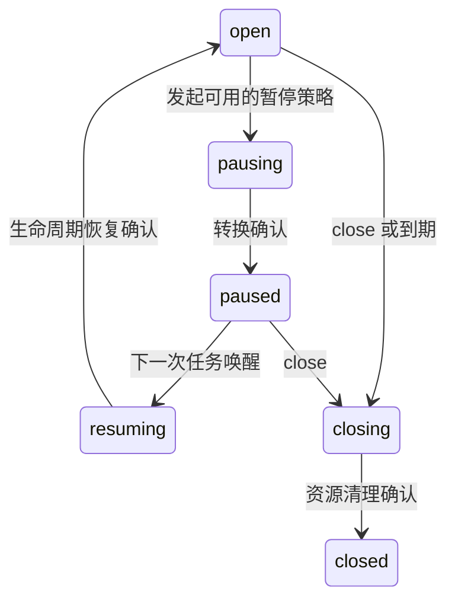

Serverless 在这里描述空闲时如何管理计算资源，以及下一次提交如何恢复工作上下文。Session 的持久身份与某个 Provider 当前的计算状态是两件事。

## Session 与资源状态分开看

Session 有 open、pausing、paused、resuming、closing、closed 等状态。Sandbox 的运行 / 暂停状态和 Runtime 可达性另行记录。Provider managed standby 未必能从 API 精确观测，所以 open Session 不证明计算一直活跃，paused 也需要结合暂停 scope 和 Provider 返回判断。

图示为主要受管理路径；Provider 自动 standby 不必经过平台的每个显式暂停状态。过渡结果不明时状态可能保留待调查，不能为了图表完整而强行推到目标态。

## 四种保留机制

内存暂停保留虚拟机或进程状态；磁盘恢复保留文件并重启 Runtime；快照重建保持 Session 身份但更换云资源；Provider managed standby 由供应商调度，平台在下一次任务时恢复可用执行。

应用应依赖受管理工作区和已验证的 Harness 对话恢复，避免依赖任意进程、socket 和临时目录。Fly Machines 有冷启动回退；Modal 可以更换资源 ID；Blaxel 的实际 standby 不可由其 API 明确确认。具体策略见[当前 Provider 表](https://github.com/NexusFox88/hexagon-docs/blob/main/resources/docs/serverless-sessions.md)。

## 谁能进入空闲

只在 Runs 之间暂停。等待授权或审批仍是活动 Run，不能当作空闲回收。下一次 submit 由 worker 协调唤醒、Runtime 恢复与新 invocation，不要求应用先手工 resume。

正常唤醒不重放不确定的活动 invocation。快照、创建或恢复操作结果未知时仍需要对账；“自动恢复”不能掩盖重复外部写入风险。

## 暂停 scope 决定你能推断什么

| 情况 | 平台记录意味着什么 | 不能据此推断 |
| --- | --- | --- |
| `scope: session` | 逻辑 Session 暂停，默认手工暂停 scope | 云计算已暂停、费用停止或资源期限冻结 |
| `scope: sandbox`，原生暂停 / 快照 | 平台执行对应 Provider 生命周期策略 | 所有 Provider 都保留内存与后台服务 |
| `scope: sandbox`，自动 standby | Provider 管理实际调度；记录 `provider_managed_standby` | 平台已经观测到计算处于暂停状态 |
| `pausing` / `resuming` | 生命周期转换尚未确认完成 | 可以忽略原操作并再次创建资源 |

自动空闲检查选择 `sandbox` scope。它要求 Session 为 open、已有 Sandbox、具有暂停或自动 standby 能力，而且不存在非终态 Run。因而，刚创建但尚未分配资源的 Session 与等待审批的 Session 都不是“到计时器就暂停”的对象。并发提交和生命周期操作还需要协调；计时器到点不是完成承诺。

## 用四种策略理解下一轮

| 策略 | 下一轮准备什么 | 稳定身份与保留边界 |
| --- | --- | --- |
| 内存暂停 | 恢复暂停的计算实例 | Session 身份保持；具体内存行为仍依组合验证 |
| 磁盘恢复 | 从保留文件恢复 Runtime 与 Harness 上下文 | 文件是基础，不能依赖旧 socket 或后台 PID |
| 快照重建 | 从已确认的快照准备新的资源绑定 | Session ID 保持；云资源 ID 可以改变 |
| Provider managed standby | 联系既有资源并恢复可用执行环境 | 实际 standby 时序与可观测性由 Provider 决定 |

例如，第一轮保存项目文件并结束，空闲后第二轮仍向原 Session 提交。若使用快照重建，应用从 Session 获取当前资源绑定，不继续操作缓存的旧云资源 ID；若磁盘恢复导致预览进程消失，则文件保留不等于原预览仍能访问。需要的服务必须通过适用的恢复流程重新就绪。

## 三种时间不能合并

`idle_timeout_seconds` 决定空闲检查资格；实际采用值最多为资源 `timeout_seconds` 减十秒。资源运行期限负责限制活动资源寿命；Provider 的账户保留和计费规则是第三层。它们不是同一个倒计时。

当前控制平面的到期扫描排除 `state: paused` 且 `pause_scope: sandbox` 的 Session，唤醒时为对应控制平面管理资源记录新的运行期限。逻辑 Session 暂停不获得这个豁免。这个实现规则不覆盖 Provider 自身的保留限制，也不代表暂停资源永不收费或永久可恢复。

显式 close 与期限触发的关闭也不同：显式 close 遇到活动 Run 返回 `session_busy`；控制平面到期处理会撤销旧 worker lease，使活动 Run 进入取消流程，并在资源删除确认后完成终态。关闭正在等待授权的任务时，不能将一次被拒绝的 close 当作资源已清理。操作与错误见[Session 参考](/zh-CN/reference/sessions)。

能分别回答“Session 是否接受后续工作”“计算是否真的暂停”“Runtime 是否可达”“资源是否已确认删除”，才足以选择下一步动作。状态域的组合比一个统一的“在线 / 离线”标记更准确。

## 从持久活动记录理解空闲计时

空闲查询使用 Session 的 `updated_at` 与最近 Run 的 `updated_at` 中较晚的时间，并同时要求没有非终态 Run、已有计算资源、具备支持的生命周期能力。关闭浏览器或暂时没有模型 token，都不能单独满足这些条件。

以 `idle_timeout_seconds: 60`、`timeout_seconds: 600` 的 Session 为例：Run 在 12:00:00 完成后，假设没有其他更新，相关持久活动时间超过 60 秒才具备暂停资格。worker 的五秒扫描间隔不是保证 12:01:00 暂停完成的承诺。它先处理到期再处理空闲，避免清理扫描重叠，还可能遇到未完成转换或 Provider 延迟。

如果 Run 到 12:01:00 仍为 `waiting_authorization`，它依然活动，不满足空闲暂停条件；等待期间资源期限仍可能到期。逻辑 `scope: session` 暂停也不会停止控制平面资源期限。界面应分别展示授权等待、空闲资格和到期，不将“浏览器不活跃”的计时器当作计算资源生命周期依据。

## 沿快照唤醒追踪资源身份

下表使用示意名称，不是可提交的 API 值或真实回执。

| 步骤 | 持久身份 / 记录 | 需要确认什么 |
| --- | --- | --- |
| 首个 Run 结束 | Session S、原云资源 R1 | 暂停前没有活动 Run |
| 请求快照 | checkpoint 操作保存意图及快照句柄 C1 | 保留快照回执；快照结果未知时仍需调查 |
| 删除原计算资源 | checkpoint 记录仍关联 R1 | 暂停路径完成前，检查确认源资源已不存在 |
| 接受下一次 Run | 原 Session S、新 Run | 使用 C1 恢复，不把后续任务当作新 Session |
| 发起恢复 | 独立 restore 操作保存 operation ID | 响应丢失时按该操作对账；发现恰好一个匹配资源才可绑定 |
| 准备 Runtime | Session S 现在关联 R2 | 准备恢复后的 Runtime，不用初始输入覆盖保留工作区 |

R2 已创建后，恢复响应仍可能丢失。查询为空或有歧义不能作为再次发起恢复的理由：操作保持未确认。保留 Session／operation 记录并调查，不更换身份重试。源资源与 checkpoint 也属于不同资源；关闭 Session 除了当前计算资源，还要处理保留的 checkpoint／镜像资源。

原生文件系统恢复可能保留资源身份、重建 Runtime 进程；内存暂停的实际保留取决于 Provider／Harness 契约；自动待机则可能在 Session 仍 open 时改变资源调度。这些路径都不能让结果未知的活动 Tool 副作用变得可以安全重复。

示例依据：[空闲资格与生命周期清理](https://github.com/NexusFox88/hexagon-docs/blob/main/resources/modules/sandboxes/lifecycle.ts)、[worker 扫描与恢复](https://github.com/NexusFox88/hexagon-docs/blob/main/resources/modules/execution/worker.ts)、[checkpoint／restore 账本](https://github.com/NexusFox88/hexagon-docs/blob/main/resources/modules/sandboxes/checkpoints.ts)。选型与操作继续阅读 [Sandbox 能力](/zh-CN/integrations/sandboxes)和[容量、配额与成本](/zh-CN/operate/capacity-and-cost)。

## 关闭、到期与费用

close 是终态清理，不是可逆暂停。控制平面确认资源清理后才记录 closed；不确定删除保留 closing 和操作记录。供应商睡眠不是资源不存在，也不一定停止所有费用。

由控制平面执行的期限需要服务在线。控制平面停机不能保证按时完成云删除。存储费、账户保留期限和各 Provider 限制独立存在，不能根据 idle_timeout 直接推导账单。

下一步：[配置并验证自动唤醒](/zh-CN/build/idle-and-wake)、[持久化边界](/zh-CN/concepts/persistence)、[未知结果恢复](/zh-CN/build/recovery)。实现依据：[生命周期管理](https://github.com/NexusFox88/hexagon-docs/blob/main/resources/modules/sandboxes/lifecycle.ts)。
