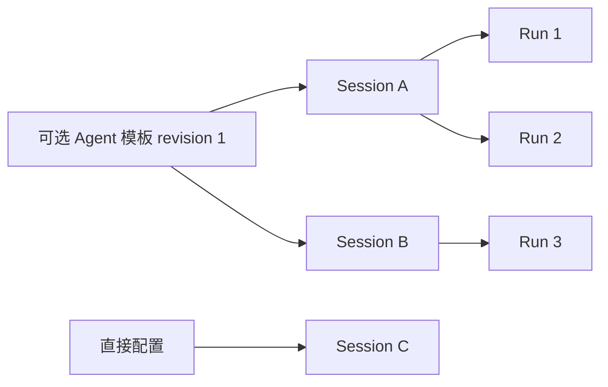

这三个对象回答不同的问题：Session 表示在哪个持续工作上下文中执行，Run 表示哪一次提交，Agent 模板表示复用哪份执行配置。

## 对象关系

Session A 与 B 可以使用同一模板，却具有不同工作区和运行历史。Session C 完全不需要模板。Run 1 和 Run 2 在 A 中先后执行，不能同时成为活动 Run。

## Session 是持久身份

Session 固定 Harness、连接配置和可选模板 revision，关联工作区、对话状态和云资源。SDK 客户端重建不会改变其身份；只要权限允许，另一语言的 SDK 也能通过相同 ID 继续操作。

Session 不等同云机器。Modal 等策略可以重建底层资源并保留 Session ID。反过来，Session 记录仍存在也不能证明原进程或内存仍在。

关闭是终态操作，回收云资源；暂停和 Provider standby 是可继续的生命周期策略。历史 Run 与导出 Artifact 可以在关闭后保留，而原工作区不能据此视为永久可访问。

## Run 是一次可追踪提交

每个 Run 有输入、幂等请求身份、执行状态、持久事件和最终结果。正常第二轮使用新 key 创建新 Run；同一请求响应丢失则复用原 key 找回原 Run。

等待授权或审批仍属于活动执行。断开事件流不释放活动 Run 限制，也不取消任务。如果界面显示“连接中断”，应用应恢复观察原 Run，而不是自动提交第二份任务。

## 模板是可选复用

Agent 模板用不可变修订记录配置演进。修改模板不会覆盖既有 Session，归档模板也不会关闭其创建的云资源。需要更换已固定的执行定义时，创建新 Session 并明确迁移需要的输入。

## 三个判断例子

| 需求 | 对象选择 |
| --- | --- |
| 在同一项目继续改代码 | 原 Session，新 Run |
| 用相同配置处理另一个项目 | 相同模板 revision，新 Session |
| 提交响应丢失 | 原 Session、原输入、origin 与 key，恢复原 Run |

## 两个项目与三次 Run

图中的名称是说明用标签，不是可直接填入 API 的资源 ID。假设有一份 revision 1 的“项目编辑器”模板：Session A 处理库存项目，Session B 处理文档项目。Run 1 在 A 中添加库存筛选；它进入终态后，Run 2 在同一个 Session 中调整筛选标签；Run 3 在 B 中修改文档。共用模板不会让 A、B 共享项目文件、原生对话历史或 Run 列表。

独立的直接配置分支说明，不先保存模板也能使用同一执行模型。创建 Session 时选择直接 Harness 定义或 `agent_id` 其中一种。模板用于复用配置，不是持续运行的 Agent 进程、独立云账户，也不是首次任务的必备前置条件。

| 标识 | 应用用它做什么 | 不能替代什么 |
| --- | --- | --- |
| `session_id` | 继续同一工作上下文、列出其中的 Run | 业务用户授权或 Provider 资源 ID |
| Run 的 `id` | 查询一次已接受的提交、观察事件、取得产物 | 后续轮次所用的 Session ID |
| `agent_id` 与 `agent_revision` | 标识创建时采用的可复用定义 | 能随时更新既有 Session 的可变指针 |
| 幂等 key | 在租户和 Session 范围内恢复同一次提交 | 事件游标或跨 Session 的通用去重键 |
| 事件 `id` | 从已持久化的游标之后恢复观察 | 新的执行请求 |
| Provider 资源 ID | 检查或对账真实云资源 | Session 的持久身份 |

业务请求映射保存在你的后端。有效的 Hexagon 对象 ID 用来定位记录，不能证明当前业务用户有权访问它。

## 两种会产生不同工作的误用

**“事件流断了，所以再建一个 Run。”** 假设 Run 1 仍在执行，浏览器连接中断。新 key 表示新的工作请求；原 Run 仍活动时，同一 Session 返回 `409 session_busy`。如果重试到达时原 Run 已完成，新 key 反而可能创建第二次任务。应找回原 Run ID，从已持久化事件游标恢复观察。如果丢失的是提交响应，重试原 Session、原输入、**原 origin 和原 key**。复用 key 却改变输入或 origin 会返回 `409 idempotency_conflict`；仅设置 `origin.message_id` 是关联元数据，不会自动去重。

**“修改模板就会更新当前项目。”** 假设 A、B 创建后，编辑器模板更新到 revision 2。它们的历史定义仍是 revision 1。新 Session 可以选择新 revision，但不会自动继承 A 的工作区或对话。需要明确选择要迁移的文件／上下文，再创建新的工作上下文。归档模板会阻止从该归档 Agent 创建新 Session，不是取消 Run 或关闭既有 Session 的命令。

## 应用需要做的生命周期判断

| 观察 | 含义 | 下一步判断 |
| --- | --- | --- |
| Session 已存在，尚未提交 Run | 已有持久配置，不要求计算资源已经存在 | 上传必需输入并提交首个任务 |
| Run 等待授权或审批 | 仍是活动 Run | 解决具体等待，不提交并发后续轮次 |
| Run 为 cancelling | 进程／副作用尚未完成结算 | 观察原 Run，并调查已派发的副作用 |
| Run 为 completed、failed 或 cancelled | 活动 Run 槽位已释放 | 检查 Session／Runtime 可用性后决定是否继续 |
| Session 为 paused | 按暂停 scope 和 Provider 契约继续 | 新接受的 Run 可触发唤醒；不要假定进程内存保留 |
| Session 为 closing | 清理尚未确认 | 跟进资源操作对账，不创建替代资源掩盖不确定结果 |
| Session 为 closed | 不能在该 Session 开始新工作 | 读取保留的结果／产物，需要时创建新上下文 |

活动 Run 槽位空闲不保证健康：Runtime 已中断或连接变化仍可能阻止后续轮次。取消本身不会关闭 Session，也不会撤销外部写入。即使 Session 已关闭，使用原匹配 key 重试已接受的提交仍可能返回历史 Run；这是取得已接受工作，不是重新打开 Session。

依据：[Session 实现](https://github.com/NexusFox88/hexagon-docs/blob/main/resources/modules/execution/sessions.ts)、[Run 提交](https://github.com/NexusFox88/hexagon-docs/blob/main/resources/modules/execution/runs.ts)。下一步：[多轮工作](/zh-CN/build/multi-turn)、[模板操作](/zh-CN/build/agent-templates)、[恢复](/zh-CN/build/recovery)。

精确字段和错误：[Sessions API](/zh-CN/reference/sessions)、[Runs API](/zh-CN/reference/runs)。历史配置：[初始化契约](https://github.com/NexusFox88/hexagon-docs/blob/main/resources/docs/session-initialization.md)。
