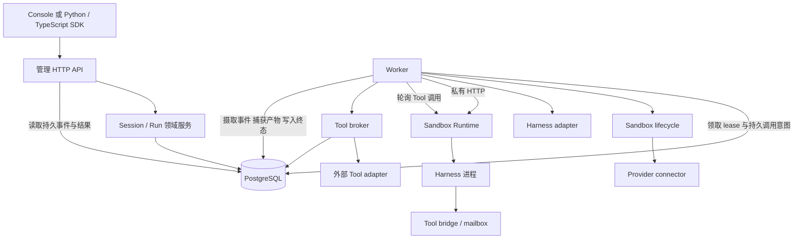

阅读本页可以沿一次 Run 找到对应实现。改变行为前先阅读[工程架构](https://github.com/NexusFox88/hexagon-docs/blob/main/resources/docs/architecture.md)和[验收旅程](https://github.com/NexusFox88/hexagon-docs/blob/main/resources/testing/acceptance.md)。用户旅程是接受标准，不能因当前代码缺少某步就删掉该要求。

## 目录职责

| 位置 | 责任 |
| --- | --- |
| `apps/control-plane` | HTTP 装配、管理 API、凭据入口与预览入口 |
| `apps/console` | 消费同一 API 的管理界面；双语言 catalog 与应用自有交互组件 |
| `modules/execution` | Session/Run、输入、初始化、调度、结果解释 |
| `modules/sandboxes` | 资源生命周期、操作记录、快照、暂停与清理 |
| `modules/harnesses` | Harness 注册、协议、镜像与执行适配 |
| `modules/connections / credentials / access` | 账户配置、密钥及受保护访问策略 |
| `modules/tools / apps` | ToolBroker、调用对账、应用与 OAuth 管理 |
| `modules/artifacts / storage` | 产物与 PostgreSQL 事务、迁移 |
| `integrations` | 云 Provider、模型、应用、HTTP Tool 与 MCP 的外部协议适配 |
| `runtime` | Sandbox 内 Python 监督服务与 Tool bridge |
| `sdk` | Python 与 TypeScript 的公共客户端 |
| `tooling / testing` | 管理、验证脚本与旅程/证据，不是业务实现替代 |

## 沿一次提交读代码

1. **客户端入口**：[TypeScript SDK](https://github.com/NexusFox88/hexagon-docs/blob/main/resources/sdk/typescript/index.ts)和[Python SDK](https://github.com/NexusFox88/hexagon-docs/blob/main/resources/sdk/python/hexagon/__init__.py)发起相同 HTTP 操作。Console 也调用这些公共接口，不拥有另一套执行状态。
2. **身份与路由**：[server.ts](https://github.com/NexusFox88/hexagon-docs/blob/main/resources/apps/control-plane/server.ts)校验请求身份和调用范围，解析 Session ID、输入与幂等键，交给领域服务。每次资源查找和跨资源绑定都要验证租户归属。
3. **持久提交**：[runs.ts](https://github.com/NexusFox88/hexagon-docs/blob/main/resources/modules/execution/runs.ts)管理幂等、活动 Run 约束、状态推进与事件；[sessions.ts](https://github.com/NexusFox88/hexagon-docs/blob/main/resources/modules/execution/sessions.ts)固定配置与资源关联。状态和事件必须先落库再向客户端发送。
4. **调度执行**：[worker.ts](https://github.com/NexusFox88/hexagon-docs/blob/main/resources/modules/execution/worker.ts)持租约执行准备、原调用恢复、事件摄取和结果完成。旧 worker 不能在租约失效后更新新状态；客户端断开不取消任务。
5. **云资源**：[connector 契约](https://github.com/NexusFox88/hexagon-docs/blob/main/resources/modules/sandboxes/connector.ts)与[注册表](https://github.com/NexusFox88/hexagon-docs/blob/main/resources/integrations/sandboxes/registry.ts)提供创建、检查、文件、命令和私有访问。具体 Provider 差异留在 adapter，不把供应商分支散落到通用 Run 编排。
6. **Sandbox 进程**：[Runtime](https://github.com/NexusFox88/hexagon-docs/blob/main/resources/runtime/server.py)监督 Harness 进程；[Harness 契约](https://github.com/NexusFox88/hexagon-docs/blob/main/resources/modules/execution/harness.ts)定义安装、调用与结果。控制平面不执行上传的用户源码，Runtime 不持有云资源管理职责。
7. **外部 Tool**：[tool_bridge.py](https://github.com/NexusFox88/hexagon-docs/blob/main/resources/runtime/tool_bridge.py)衔接调用，[broker.ts](https://github.com/NexusFox88/hexagon-docs/blob/main/resources/modules/tools/broker.ts)处理授权、审批、派发与持久结果。原始账户凭据留在控制平面；不确定副作用进入[reconciliation.ts](https://github.com/NexusFox88/hexagon-docs/blob/main/resources/modules/tools/reconciliation.ts)。
8. **完成与交付**：[Artifacts](https://github.com/NexusFox88/hexagon-docs/blob/main/resources/modules/artifacts/artifacts.ts)保存交付文件；worker 检查实际结果和产物后推进终态。自然语言“已完成”不是执行成功证据。客户端查询持久结果，并单独关闭 Session 清理资源。

## 运行时调用关系

图表示运行时职责，不是所有模块的静态 import 图。 图中使用较短名称以避免类名单词被拆开：Worker 对应 `ExecutionWorker`，Sandbox lifecycle 对应 `SandboxLifecycle`，Provider connector 对应 `SandboxConnector` 及适配器，Tool broker 对应 `ToolBroker`。Provider adapter 操作云资源；Harness adapter 定义执行程序的安装与调用；Runtime 监督 Sandbox 内进程。Tool bridge 把调用交给 mailbox，再由控制平面 broker 处理授权、审批和外部派发，不是让 Harness 持有账户管理权限直接调用任意服务。

Console 的[api helper](https://github.com/NexusFox88/hexagon-docs/blob/main/resources/apps/console/app.js)向 `/v1` 发起请求。它的本地身份引导属于客户端认证，不构成第二套 Run 状态存储；改变 Console 展示不能替代领域层状态变更。

## 从一个症状定位函数和测试

| 要理解的行为 | 阅读入口 | 对应测试入口 |
| --- | --- | --- |
| 重复提交为什么返回原 Run | `Runs.submit` 中幂等查询、Session 锁和活动 Run 检查 | [runs.test.ts](https://github.com/NexusFox88/hexagon-docs/blob/main/resources/modules/execution/runs.test.ts) |
| 准备阶段中断后哪些步骤可重做 | `ExecutionWorker.execute` 与 Runtime binding 的准备 / 启动分支 | [worker-prepare.test.ts](https://github.com/NexusFox88/hexagon-docs/blob/main/resources/modules/execution/worker-prepare.test.ts) |
| 原调用如何固定而不重新生成 | `ExecutionWorker.invocation` 的持久 invocation 读取与写入 | [worker.test.ts](https://github.com/NexusFox88/hexagon-docs/blob/main/resources/modules/execution/worker.test.ts) |
| 模型文本、退出状态与产物如何形成结果 | worker 的 `drain` / `finish` 以及 `Artifacts.capture` | [worker-results.test.ts](https://github.com/NexusFox88/hexagon-docs/blob/main/resources/modules/execution/worker-results.test.ts) |
| 授权等待与审批怎样影响外部派发 | `ToolBroker.process` 和持久 Tool call 状态 | [broker.test.ts](https://github.com/NexusFox88/hexagon-docs/blob/main/resources/modules/tools/broker.test.ts)、[cancellation.test.ts](https://github.com/NexusFox88/hexagon-docs/blob/main/resources/modules/tools/cancellation.test.ts) |
| 删除响应不明为何不能直接 closed | `SandboxLifecycle` 的原操作与资源确认路径 | [lifecycle.test.ts](https://github.com/NexusFox88/hexagon-docs/blob/main/resources/modules/sandboxes/lifecycle.test.ts) |
| Runtime 重启如何保护活动调用 | `runtime/server.py` 启动时的隔离与 invocation 身份检查 | [监督锁测试](https://github.com/NexusFox88/hexagon-docs/blob/main/resources/testing/runtime-supervisor-lock.test.ts)、[工作区测试](https://github.com/NexusFox88/hexagon-docs/blob/main/resources/testing/runtime-workspace-persistence.test.ts) |

这些文件是阅读与验证入口，不表示仅运行它们即可覆盖所有变更。测试涉及数据库或进程时，按[测试指南](/zh-CN/contribute/testing)准备前提并记录实际结果；真实 Provider / 模型旅程另行执行，不能由模拟测试推断通过。

一个修改边界的反例：某个 Provider 需要特殊私有 HTTP 隧道，不应在 worker 中加入 `provider === ...` 的网络实现。先查看 connector 的私有访问契约、目标释放责任与对应 adapter，在这一边界表达差异，再检查 Runtime 和预览调用者是否正确释放资源。这样同一修复才能同时作用于执行与预览，而不形成两份供应商逻辑。

## 状态恢复从哪里看

- Run 和调用恢复：execution/worker 与 runs；不要重放已开始但结果未知的操作。
- 暂停、快照和资源删除：[lifecycle.ts](https://github.com/NexusFox88/hexagon-docs/blob/main/resources/modules/sandboxes/lifecycle.ts)与[checkpoints.ts](https://github.com/NexusFox88/hexagon-docs/blob/main/resources/modules/sandboxes/checkpoints.ts)。空闲、paused、closed 与云资源删除不是同一状态。
- 凭据访问：[access-server.ts](https://github.com/NexusFox88/hexagon-docs/blob/main/resources/apps/control-plane/access-server.ts)和 modules/access；不能把原始 key 注入 env 作为兼容性回退。
- 存储升级：[migrate.ts](https://github.com/NexusFox88/hexagon-docs/blob/main/resources/modules/storage/migrate.ts)与编号 SQL；不要修改已应用迁移去伪装新 schema。

## 如何选修改位置

| 改动 | 首先查看 | 同步检查 |
| --- | --- | --- |
| 新增 Sandbox | connector + integrations/sandboxes | 能力声明、未知创建、清理、双 SDK 旅程 |
| 新增 Harness | harness 契约 + modules/harnesses | 协议、Tools、native history、结果和取消 |
| 新增应用操作 | integrations/apps + ToolBroker | schema、权限、写审批、未知副作用 |
| 调整控制台交互 | apps/console | en/zh-CN、键盘、焦点、应用自有组件 |
| 调整公共字段 | server + 领域契约 + 两套 SDK | 类型、权限、示例与现有版本兼容 |
| 修改状态推进 | runs / worker / lifecycle | 事务、事件先持久化、租约 fence、恢复 |

阅读源码时完成一项不创建云资源的走查：找到 submit 路由、幂等键检查、worker 的调用持久化、Runtime 执行入口、Tool 派发边界和结果落库位置。能够说明各步失败后谁恢复、哪些动作不可盲重试，才算理解执行路径；仅能列目录不够。

本页基于当前文件结构与实现核对，不声称新增测试已通过。确定性验证与真实 Provider/模型验收分别记录，敏感资源标识留在本地私有证据。

下一步：[Sandbox 连接器](/zh-CN/contribute/sandbox-connectors)、[Harness 适配器](/zh-CN/contribute/harness-adapters)、[Tool 与应用连接器](/zh-CN/contribute/tool-connectors)。
