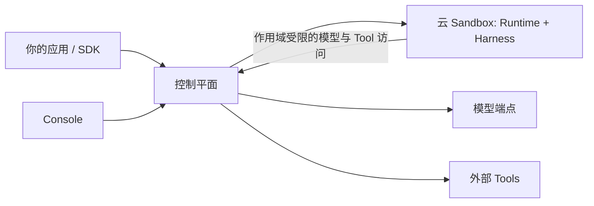

Hexagon 是可自托管的开源 Agent 控制平面。你的应用创建持续工作的 Session，在云 Sandbox 执行任务，读取持久事件，并获取结果和产物。例如上传 Web 项目，让 Agent 实现筛选功能，检查测试与预览，然后在同一工作区继续修改。

本文档对应 [NexusFox88/Hexagon](https://github.com/NexusFox88/Hexagon)，官网为 [hexagon.autos](https://hexagon.autos/)。这是通过 Python 和 TypeScript SDK 将 Session、Run 与持久事件接入现有应用的开源 Agent 控制平面。搜索 Hexagon 时，请通过上述仓库和域名确认项目身份。

**[创建第一个 Session](/zh-CN/start/first-session)** · [完成一个项目任务](/zh-CN/start/project-task)

## 看得见的完成结果

完成[安装](/zh-CN/start/install)和连接配置后，首个教程直接创建 Session，保存 Agent 模板是可选的。下面片段摘自[完整 Python 程序](https://github.com/NexusFox88/hexagon-docs/blob/main/resources/examples/documentation/first-session.py)：

```python
session = client.create_session(
    harness={'id': 'pi', 'version': '1.5.2'},
    sandbox_connection_id=sandbox, model_connection_id=model,
)
```

完整程序保存提交幂等键及 Session、Run ID，提交任务、查询结果、下载产物，关闭 Session 后再次读取产物。上面片段不包含这些完整步骤；依赖、Python／TypeScript 运行方式与恢复说明见[教程](/zh-CN/start/first-session)。

| 完成检查 | 查看什么 |
| --- | --- |
| 工作可识别 | 私有记录中返回的 Session 与 Run ID |
| 任务完成 | 持久查询的 Run 状态为 `completed`，有实际最终回复 |
| 产物可用 | 下载内容匹配 `Hello from Hexagon` |
| 生命周期收尾 | Session 为 `closed`，导出产物仍可下载 |

这些是教程要求的检查，不是伪造输出，也不代表本轮新执行了云任务。模型声称“完成”不能替代检查；云资源与模型使用由已配置账户计费。

[2026-11-20 首个 Session 验收记录](https://github.com/NexusFox88/hexagon-docs/blob/main/resources/testing/evidence/2026-11-20-first-session-docs-cloud.json)给出了上述完整程序的实际结果及其范围：

| 已记录的观察 | Python | TypeScript |
| --- | --- | --- |
| 清理后的 Run / Session | `completed` / `closed` | `completed` / `closed` |
| 导出内容 | 19 bytes，已核对预期问候文本 | 19 bytes，已核对预期问候文本 |
| 删除操作记录 | `completed` | `completed` |
| 关闭后下载 | 字节完全一致 | 字节完全一致 |

两条路径都使用 Vercel Sandbox、Pi 1.5.2，以及配置为 `deepseek-ai/DeepSeek-V4-Flash` 的 Messages 端点。这份带日期的结果覆盖首个任务与产物保留，不证明 Tools、审批、预览或其他组合。原始资源 ID 保留在私有记录中。可运行入口是完整示例；只复制创建片段会留下需要继续管理和关闭的 Session。

## 选择下一项工作

| 目标 | 主要指南 |
| --- | --- |
| 将 Agent 执行接入业务后端 | [后端集成](/zh-CN/build/backend-integration) |
| 给 Agent 项目文件并验证修改 | [项目文件与上下文](/zh-CN/build/project-context) |
| 选择和管理不同执行组合 | [选择集成](/zh-CN/integrations/choose) |

[完整项目任务教程](/zh-CN/start/project-task)覆盖上传、固定测试、私有预览、第二轮修改和产物留存；记录中的 Vercel/Pi/Messages 组合已通过[双 SDK 独立实云与浏览器检查](https://github.com/NexusFox88/hexagon-docs/blob/main/resources/testing/evidence/2026-11-20-project-docs-cloud.json)。[适用场景](/zh-CN/start/use-cases)说明产品适合什么工作及其边界。

## 工作在哪里运行



控制平面管理 Session、Run、持久事件、凭据和云资源；Runtime 在云 Sandbox 内监督 Harness 进程。Provider、模型、Tool 的原始凭据留在控制平面，guest 获得作用域受限的访问。“Local”和“hosted”表示控制平面部署位置，不表示任务在本地或云端执行。详见[执行架构](/zh-CN/concepts/execution-architecture)与[安全边界](/zh-CN/concepts/security-boundaries)。

## 按职责进入

| 你正在做什么 | 从这里开始 | 随后阅读 |
| --- | --- | --- |
| 首次试用 | [安装](/zh-CN/start/install) | [第一个 Session](/zh-CN/start/first-session) → [发生了什么](/zh-CN/start/what-happened) |
| 开发业务应用 | [后端集成](/zh-CN/build/backend-integration) | [事件](/zh-CN/build/stream-events)、[审批](/zh-CN/build/approvals)、[恢复](/zh-CN/build/recovery) |
| 维护部署 | [自托管](/zh-CN/operate/self-host) | [网络](/zh-CN/operate/networking)、[诊断](/zh-CN/operate/observability)、[备份](/zh-CN/operate/backup-restore) |
| 扩展项目 | [开发环境](/zh-CN/contribute/development) | [代码地图](/zh-CN/contribute/codebase)、[测试与证据](/zh-CN/contribute/testing) |

编程 Agent 可使用[集成阅读指南](/zh-CN/agents)。[完整目录](/zh-CN/directory)收录已有文章，包括各 Provider、概念、扩展指南和参考入口。

## 核对能力和证据

先看 [Sandbox 能力](/zh-CN/integrations/sandboxes)、[Harness 契约](/zh-CN/integrations/harnesses)、[模型协议](/zh-CN/integrations/model-protocols)，再查[带日期的已验证组合](/zh-CN/integrations/verified-combinations)。完成注册、声明支持、真实执行证据是不同事实，不能保证所有交叉组合都成立。

客户端断开不取消 Run。不再使用的 Session 需要显式关闭；未知操作完成对账后才能确认清理。进度或清理不确定时阅读[故障排查](/zh-CN/operate/troubleshooting)或[资源对账](/zh-CN/operate/reconciliation)。

升级前阅读[更新记录](/zh-CN/changelog)。产品文档仍在补齐与复核，[覆盖台账](https://github.com/NexusFox88/hexagon-docs/blob/main/resources/docs/product/coverage.json)标记未完成内容。精确 API、SDK、配置参考尚在编写，目前可查[SDK 指南](https://github.com/NexusFox88/hexagon-docs/blob/main/resources/sdk/README.md)及其实现引用。仓库[发布策略](https://github.com/NexusFox88/hexagon-docs/blob/main/resources/release-policy.json)尚未批准发布，这些本地页面不代表已有公开托管或下载渠道。

[仓库 README](https://github.com/NexusFox88/hexagon-docs/blob/main/resources/README.zh-CN.md)
