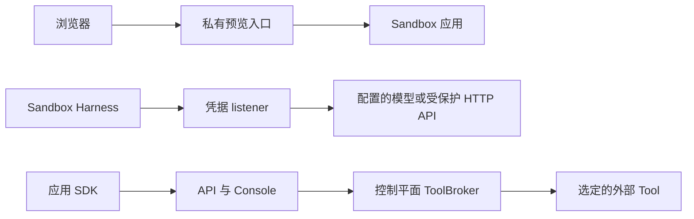

Hexagon 有三种不同的入站流量。它们服务不同调用方，必须按责任配置，不能把一个开发 tunnel 指向所有服务。

| 入口 | 默认本地监听 | 调用方与用途 |
| --- | --- | --- |
| 管理 API / Console | 127.0.0.1:8787 | SDK 与 Console，提交任务和管理配置 |
| 私有预览 | 127.0.0.1:8788 | 浏览器，访问授权的 Sandbox HTTP 服务 |
| 受保护凭据 listener | 127.0.0.1:8789 | Sandbox，使用限定范围的模型 / HTTP 访问 |

默认值不是公网暴露建议。部署时可通过对应 HOST / PORT 配置改变监听地址，反向代理只路由指定用途。

## 本地开发入口

受管理启动器默认配置 Cloudflare 开发通道，要求 cloudflared 可用。它只转发凭据 listener，不转发管理 API。Console 的 Network & ingress 展示通道状态，管理界面可在通道失败时独立工作。

临时通道传输委托 token 和请求 / 响应内容，数据路径包含 tunnel 服务。生产或固定网络环境应使用自行配置的稳定 HTTPS origin。外部模式配置示例：

```json
{"no_proxy":[],"ingress":{"mode":"external","url":"https://credentials.example.com"}}
```

把配置保存到私有部署文件，再使用 local configure 并在无活动任务时重启。上述 example 域名是占位，必须替换为真实可达且路由到凭据 listener 的 origin。

停止临时入口是运行时动作；下次执行可能按保存模式自动恢复。要持续禁止入口，保存 disabled 模式。活动 invocation 使用中的 origin 不应被换成另一个通道。

## hosted 与预览

hosted 使用稳定 HTTPS 凭据 origin，并拒绝临时 tunnel。云 Sandbox 必须可以访问它；从控制平面 curl 自己成功不能证明云网络可达。

管理 API 保留鉴权。预览使用独立域名与通配 TLS / 路由，每个 grant 有独立子域，不能让生成应用与 Console 共用 origin。预览协议限制见[预览指南](/zh-CN/build/private-preview)。OAuth callback 是另一类管理回调路径，不能把凭据通道当作 OAuth 管理 tunnel。

## 出站代理和网络策略

保存的 outbound_proxy 与进程环境控制相应出站路径，显式环境优先，no_proxy 合并并保留 loopback。受保护上游有额外目标限制：直连检查公共 DNS 地址并拒绝重定向；显式可信 egress proxy 必须配合准确主机列表，不能用任意代理绕过目的地址检查。

`HEXAGON_ACCESS_EGRESS_PROXY_URL` 与 `HEXAGON_ACCESS_EGRESS_HOSTS` 是受保护上游代理设置。列表使用精确 hostname，不是 wildcard。不要因为普通 npm 请求能联网就认为模型 / Tool 路径已经配置成功。

Sandbox allowlist 必须包含凭据 origin 的 hostname，否则预检会拒绝。Provider 的网络策略与控制平面的 Tool 出站策略不同，见[网络策略](/zh-CN/build/sandbox-policy)。

## 沿请求路径定位，而不只看端口



| 症状 | 优先检查的边界 | 完成信号 |
| --- | --- | --- |
| Console 可打开，但 SDK 鉴权失败 | API 地址、工作区身份与 Token | 鉴权请求到达目标部署 |
| 模型验证成功，但 Run 无法连接 | Sandbox 出站与凭据域名路由 | 真实 Sandbox 使用委托 grant 到达受保护入口 |
| 凭据域名返回管理页面 HTML | 反向代理目标与端口 | 只路由到凭据 listener，管理入口保持独立 |
| 模型可用，但预览失败 | 预览 grant/域名、Sandbox 进程与端口 | 授权浏览器可见目标应用，未授权访问被拒绝 |
| 依赖下载正常，但 Tool 调用失败 | 控制平面 Tool 出站与精确 host 策略 | 目标操作通过配置适配器成功执行 |
| 重启后连通性改变 | 保存配置、显式环境与入口域名 | 重新核查两段网络，不轮换活动调用的入口 |

图中表示流量职责，不代表每条箭头共用一套授权。ToolBroker 调用发生在控制平面，Sandbox 域名 allowlist 不管理这段出站。[local 模式云任务与恢复记录](https://github.com/NexusFox88/hexagon-docs/blob/main/resources/testing/evidence/2026-11-18-local-beta-delivery.md)仅证明其中实际使用的临时入口拓扑，不证明任意 hosted 稳定域名。应在自己的拓扑重做云端可达与预览隔离检查。

## 诊断顺序

1. status / Console：控制平面是否运行、是否连对工作区。
2. 凭据入口状态：origin 是否属于当前实例，TLS / 路由是否正确。
3. 真实云任务：Sandbox 是否到得了入口，是否被网络 allowlist 阻止。
4. 受保护上游：模型协议、固定目标、凭据和出站代理是否匹配。
5. 预览：应用进程、端口、grant、独立 origin、过期状态。

记录阶段、受控错误码和必要 ID，避免记录完整 header、token、上游响应体。不要通过公开管理 API 或将原始模型 key 塞入 Sandbox 来规避入口故障。

完成条件是实际云任务调用成功、预览授权隔离正确、未授权访问被拒绝，以及重启后入口仍可用。实现依据：[入口](https://github.com/NexusFox88/hexagon-docs/blob/main/resources/apps/control-plane/main.ts)、[配置](https://github.com/NexusFox88/hexagon-docs/blob/main/resources/modules/deployment/settings.ts)、[Secret 边界](https://github.com/NexusFox88/hexagon-docs/blob/main/resources/docs/secret-management.md)。下一步：[故障排查](/zh-CN/operate/troubleshooting)、[安全边界](/zh-CN/concepts/security-boundaries)、[私有预览](/zh-CN/build/private-preview)。
