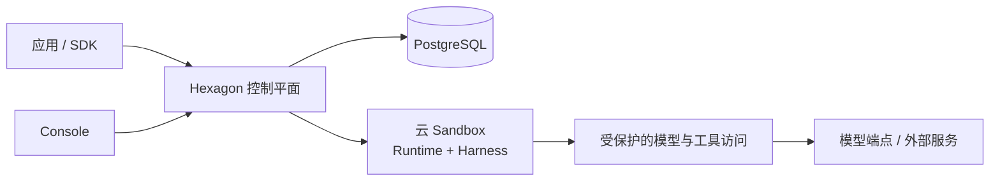

Hexagon 为应用提供一个开源、可自托管的 Agent 控制平面。应用提交任务，Hexagon 管理云执行资源、运行状态、工具调用、事件与产物，让应用能够围绕长期存在的工作上下文构建自己的产品体验。

当你需要判断 Hexagon 在系统中的位置，或第一次看到 Session、Run、Harness 等术语时，阅读本页。

## 应用能得到的四个结果

| 结果 | 用户或应用能观察到什么 | 需要保留的边界 |
| --- | --- | --- |
| 将请求变为持久工作 | 提交任务后取得 Run ID，之后仍可查询状态、事件和导出文件 | 后端仍负责业务授权及请求与 Run 的映射 |
| 选择执行组合 | 通过共同应用 API 选择 Sandbox、Harness、模型与 Tools，并查看预检和有范围的验证 | 统一接口不代表所有组合等价或全部支持 |
| 管理跨连接的任务生命周期 | 在同一 Session 继续工作，处理授权／审批、重连、取消并确认清理 | 断线不等于取消；未知外部结果需要对账 |
| 在明确的信任边界内运行 | 自己运行控制平面、配置账户，了解原始凭据与委托权限的使用位置 | 自托管控制平面不会把云端任务执行移到你的电脑 |

**Harness** 是运行 Agent 循环的引擎：理解任务、与模型交互并选择执行步骤。Hexagon 提供围绕它的任务与资源生命周期。Console 用于配置和调查这些过程；应用通常通过 Python SDK、TypeScript SDK 或 HTTP API 接入。

## 从一个项目任务理解它

假设你的应用允许用户上传一个 Web 项目，并要求 Agent 增加筛选功能：

1. 你配置一个云 Sandbox 连接和一个模型连接，验证并启用它们。
2. 应用选择兼容的 Harness，创建 Session 并上传项目文件。
3. 应用提交修改要求，得到 Run 标识。
4. Hexagon 在云 Sandbox 内运行 Agent。应用订阅持久事件，在自己的界面呈现进度。
5. Agent 修改文件、运行测试，并将交付文件写入该 Run 的产物目录。
6. 应用读取最终结果、下载产物，必要时提供有访问控制的 Web 预览。
7. 用户继续提出修改要求时，应用在同一个 Session 中创建新的 Run。
8. 工作完成后关闭 Session，确认云资源清理；已导出的产物和完成记录仍可查询。

是否能够执行每一步，取决于所选组合的实际能力和验证范围。测试是否通过，应读取真实测试结果；不能仅凭 Agent 的自然语言回答判定。

## 系统中的角色

| 组件 | 责任 |
| --- | --- |
| 你的应用 | 用户体验、业务身份和权限、任务标识保存、结果交付 |
| Console | 配置连接，观察 Session、Run 和资源，处理授权与管理操作 |
| 控制平面 | 持久化 Session / Run / 事件，管理云资源、凭据和执行调度 |
| Sandbox | 实际执行任务的云环境，承载工作区和进程 |
| Runtime | 在 Sandbox 内监督 Harness 进程并衔接执行协议 |
| Harness | 运行 Agent 逻辑，使用模型和获准工具完成任务 |
| 模型与 Tools | 提供推理和外部操作能力，受各自连接与权限约束 |

图中展示责任关系，具体调用通道由连接类型决定。Provider 管理凭据保留在控制平面；受保护模型和工具凭据通过限定范围的访问机制使用。你主动放入 Session `env` 或 `variables` 的值可被 Sandbox 内代码读取。

## 三个核心对象

**Session** 是可持续使用的工作上下文，关联对话、工作区和固定的执行配置。它的身份不等同某一台云机器；某些恢复策略会更换底层资源。

**Run** 是一次提交的执行记录。一个 Session 当前只允许一个活动 Run；客户端断线不会使 Run 自动取消。

**Agent 模板** 是可选的可复用配置。你可以直接创建 Session；只有需要重复使用和版本化配置时才需要模板。模板更新不会改写既有 Session 固定的配置。

## 部署位置与执行位置

local 和 hosted 描述控制平面的位置。本地控制平面使用本地数据库和私有配置，但真实 Agent 任务仍在云 Sandbox 中执行。Hexagon 不要求你通过本机 Docker 来替代真实云执行。

控制平面保留运行记录和导出产物。Sandbox 工作区、进程与内存的保留能力因 Provider 和生命周期动作而异，不能从“Session 持久存在”推导出“进程永不丢失”。

下一步：[判断适用场景](/zh-CN/start/use-cases)或[启动本地控制平面](/zh-CN/start/install)。机制依据见[工程架构](https://github.com/NexusFox88/hexagon-docs/blob/main/resources/docs/architecture.md)与[验收旅程](https://github.com/NexusFox88/hexagon-docs/blob/main/resources/testing/acceptance.md)。
