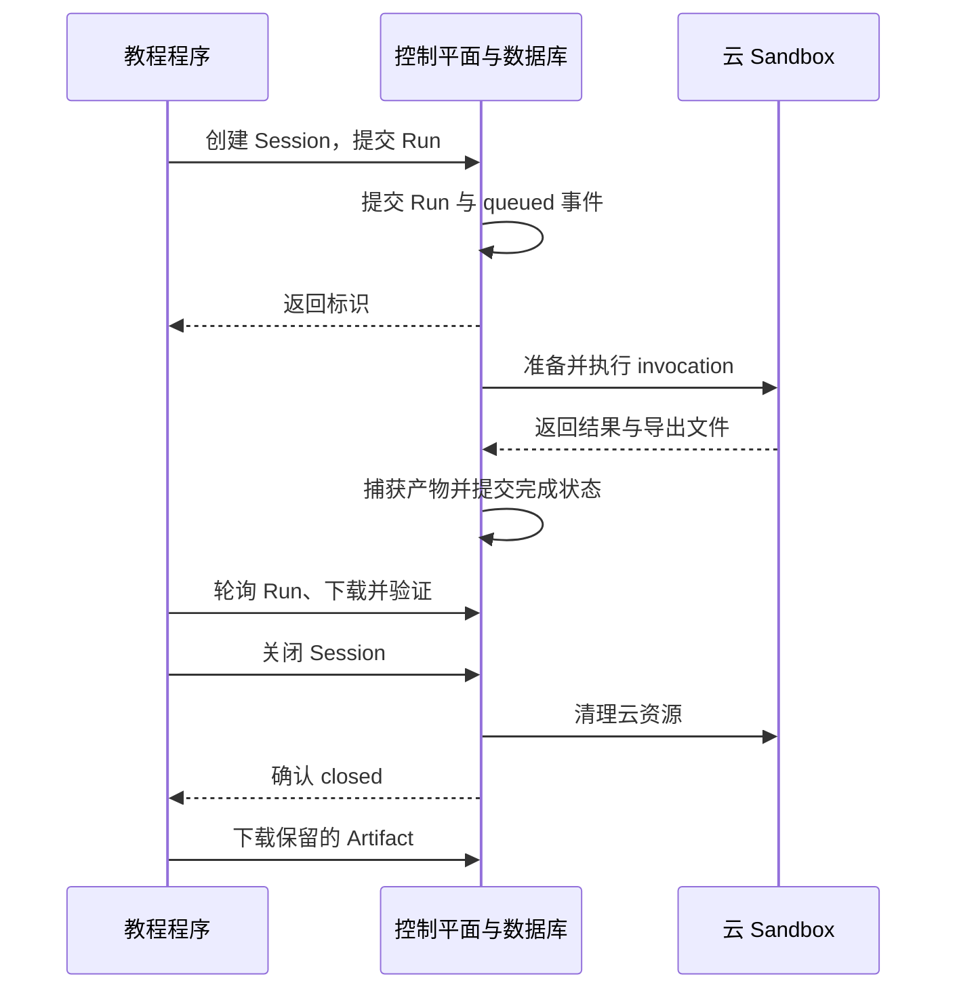

完成[首个 Session](/zh-CN/start/first-session)后，你拥有三个不同层次的结果：持久的 Session 身份、一次 Run 执行记录，以及从云工作区导出的文件。

## 从调用到产物

1. **连接已经准备好。** Sandbox 连接描述云资源的访问方式；模型连接描述端点、模型和协议。验证通过与启用是开始工作之前的前提。
2. **Session 固定配置。** 创建时选择的 Harness 与连接配置形成执行上下文。直接创建无需隐式生成 Agent 模板。
3. **Run 表示这一次请求。** 示例在提交前保存 input 和幂等键。响应丢失时，可用相同请求找回原 Run，而不是产生第二个任务。
4. **控制平面安排执行。** 它管理云资源和运行状态；Sandbox 内 Runtime 监督 Harness 进程，Harness 调用模型并完成任务。
5. **执行状态持久保存。** 控制平面先持久化状态和事件，再提供给观察者。示例使用轮询；使用事件流的客户端断线后也可以重新观察原 Run。
6. **产物导出后完成。** Harness 使用提供的产物目录。worker 导出文件后，Run 才进入对应的完成状态；仅创建普通工作区文件不保证它成为 Artifact。
7. **关闭回收云资源。** Session 关闭与 Run 完成是不同动作。关闭后，已导出文件仍在控制平面存储中，可以再次下载。

## 把教程输出对应到实际工作

| 程序显示或保存的内容 | 标识什么 | 单凭它不能证明什么 |
| --- | --- | --- |
| `Session: … Run: …` | 持续上下文与这一次已接受提交 | 执行成功或清理完成 |
| 打印的 `output` | Run 查询返回的最终助手结果 | 所有承诺文件都已正确导出 |
| `artifact-0.bin` 等本地文件 | 下载的字节；本地文件名有意不直接采用远程路径 | 新的活动工作区或可部署 Web 服务 |
| journal 中的 `artifacts` | 远程 Artifact ID、名称、大小和哈希 | 全部 Sandbox 文件的完整备份 |
| `closed_and_retention_checked` | 程序观察到 closed，并确认重新下载的首个产物字节不变 | 每个可能产物、其他 Provider 或所有恢复分支均已验证 |

两套程序在关闭前验证每份已列出下载的大小和哈希，并要求至少一份文件包含 `Hello from Hexagon`，允许首尾空白。关闭后重新下载的是**列表中的首个 Artifact**，再比较字节。[已记录的云运行](https://github.com/NexusFox88/hexagon-docs/blob/main/resources/testing/evidence/2026-11-20-first-session-docs-cloud.json)中，每套 SDK 都只生成一份 19 字节产物，因此对那些运行而言，单文件保留检查覆盖了全部导出集合。不能把程序的首文件复查外推为其他任务的全文件保留验证。

## 用简短时序回看同一次教程

图示概括成功路径；等待、未知远程结果和重试应按教程中的失败出口处理。Runtime 是 Sandbox 内的监督进程，Harness 是它运行的 Agent 引擎；Python 或 TypeScript 程序是控制平面的客户端。为保持时序简短，图中合并控制平面和数据库参与者；事件仍先提交再供观察，导出字节独立于云资源保存。

教程采用轮询而非 SSE 订阅，但轮询不影响持久事件记录：Console 和事件 API 后续仍可查看同一 Run。Console 的 Initialization 展示固定配置；Run 输入／输出与事件展示执行；Fleet／资源操作记录展示分配和清理。不要把这些独立记录当作同一个成功标志。

## 在 Console 对照查看

按示例打印的 ID 查找 Session 和 Run，核对固定配置、输入、最终结果和资源操作。Sandbox 状态、Runtime 可达性和 Run 状态分别描述不同对象：Run 完成并不等于 Sandbox 已删除，Runtime 不可达也不等于进程已经终止。

如果继续任务，应在尚未关闭的同一 Session 中提交新 Run。首个示例已经主动关闭 Session，因此新实验需要创建新的 Session。不要尝试把关闭当作可逆的暂停。

## 哪些东西会保留

| 对象 | 这次教程中的行为 |
| --- | --- |
| Session / Run 记录 | 可继续查询已完成记录 |
| 导出 Artifact | 关闭后仍可下载 |
| 原始云工作区 | 关闭会删除云资源，不能假设仍可访问 |
| Harness 进程 / 预览服务 | 不随已完成记录永久保留 |
| 私有本地 journal | 由你保管，用于恢复和调查 |

空闲暂停的保留规则与关闭不同。不同 Provider 对内存、文件和进程的保留能力也不同，见 [Serverless Session](https://github.com/NexusFox88/hexagon-docs/blob/main/resources/docs/serverless-sessions.md)。

## 选择下一步实验

| 接下来想做什么 | 阅读入口 | 注意事项 |
| --- | --- | --- |
| 看到有价值的项目改动 | [完整项目任务](/zh-CN/start/project-task) | 创建新资源，包含两轮、测试、预览与清理 |
| 接入自己的产品 | [后端接入](/zh-CN/build/backend-integration) | 网络调用前保存业务归属和提交意图 |
| 在界面展示进度 | [事件投递](/zh-CN/build/stream-events) | 后端消费与浏览器显示分别维护进度 |
| 理解保留范围 | [持久化边界](/zh-CN/concepts/persistence) | 历史记录、工作区文件和进程内存不同 |

已完成的教程是一次固定实验，不是后台等待新工作的 Agent。保留其 journal 作为证据，为下一次实验创建新 Session。[Session、Run 与 Agent](/zh-CN/concepts/sessions-runs-agents)解释公共对象模型，底层实现归属见[架构](https://github.com/NexusFox88/hexagon-docs/blob/main/resources/docs/architecture.md)。

更换执行环境前阅读[选择组合](/zh-CN/integrations/choose)；事件持久化和重放机制见[事件与恢复](/zh-CN/concepts/events-and-recovery)。
